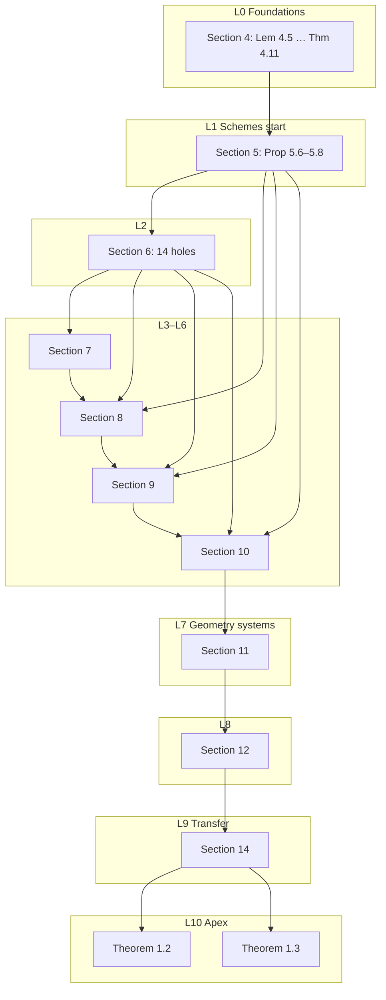

# Proof holes (BFS dependency order)

Inventory of Lean `sorry` holes in this repository, ordered **prove-first**: Layer 0
are holes with no remaining unfinished prerequisites; later layers wait on earlier
ones. Apex theorems 1.2 and 1.3 are **last**.

**Count:** 69 `sorry`, 0 `admit`. All live in `AEC/Section*/Results.lean`.
Sections **2**, **3**, and **13** have no holes.

**Dependency basis:** paper/logical order from `dependencies.mermaid`
(`A --> B` means B waits on A), reconciled with the current hole set, plus
within-section paper numbering and Lean `Results`→`Results` imports
(S7–S11 on S5/S6).

**Note on Lean-import BFS:** A module-only BFS among hole-bearing `Results.lean`
files would place S1, S12, and S14 in Layer 0 because those stubs do not import
later Results. That ranking is wrong for prove-first work; this file uses the
logical order instead.

**Reconciliation with `dependencies.mermaid`:** The mermaid “Presentations”
subgraph (Lemmas 2.1–2.5, Theorem 2.6, Proposition 2.3 converse) is **filled**
(Section 2 has no `sorry`). Those nodes are omitted from the cluster DAG below.
Section 13 is complete and was never on that chain.

---

## Counts by section

| Section | Holes | File |
|--------:|------:|------|
| 1 | 2 | `AEC/Section1/Results.lean` |
| 2 | 0 | — |
| 3 | 0 | — |
| 4 | 4 | `AEC/Section4/Results.lean` |
| 5 | 3 | `AEC/Section5/Results.lean` |
| 6 | 14 | `AEC/Section6/Results.lean` |
| 7 | 9 | `AEC/Section7/Results.lean` |
| 8 | 5 | `AEC/Section8/Results.lean` |
| 9 | 7 | `AEC/Section9/Results.lean` |
| 10 | 9 | `AEC/Section10/Results.lean` |
| 11 | 8 | `AEC/Section11/Results.lean` |
| 12 | 4 | `AEC/Section12/Results.lean` |
| 13 | 0 | — |
| 14 | 4 | `AEC/Section14/Results.lean` |
| **Total** | **69** | |

---

## Remaining hole clusters (prove-first DAG)

Within a layer, siblings are listed in paper number order.

---

## BFS layers (individual holes)

### L0 — Independent foundations (4 open)

No unfinished Results prerequisites. Section 3 is complete (Theorem 3.11 closed by the
`θ⁺ · a^θ` renaming kill); Section 4 starts the diagrams/orbits stack.

**Live board:** [`holes.html`](holes.html) + [`holes-graph.json`](holes-graph.json).
Edge **B→A** means the English proof of A requires B (no soft/narrative-only edges).
Blue = done; green = open; grey = blocked. No separate failed status unless a
counterexample refutes the program.

**Dependency rule:** edge B→A only if the English proof of A requires B, or A
needs an explicit Lean infra subgoal B (not a paper-number chain).

**Open:** `proposition_5_7` (existence of named realizations on a
tail; packer + package transfer done), `objectOfEmptyChain`.
**Note:** `theorem_3_11`, `lemma_4_6`, `lemma_6_14`, `proposition_4_3`, `lemma_4_5`, `lemma_4_7`, `proposition_5_8`, `proposition_5_9`,
`infra_pair_coloring_glue`, `infra_rank_slice`, `infra_type_u_witness_set`, `infra_countable_back_and_forth`, `infra_stable_diagram_realize`, `infra_zeta_model_existence`, `infra_eligible_reclass`, `infra_template_fixed_support`, `infra_named_working_scheme`, `infra_named_working_package` are done.
Lean 5.8 is the residual `diagram_iso`+`structural_iso` form.
False `6.13→6.14` / `5.8→5.9` edges removed. Later adjacent-number edges still suspect.

**Wired (intended use, reach apex):** `5.6 → 9.3, 10.2`; `5.7 → 9.3, 10.6, 10.8`;
`2.3 → 1.2`; `3.11 → 4.2, 5.8`; `4.6 → 4.9`; `6.14 → 12.6`; `13.5 → 10.9, 14.2`.
Full hard-edge list: [`holes-edges.txt`](holes-edges.txt). Target: every Results/paper
node reaches Thm 1.2 or 1.3; completed work should admit dead-code analysis of each edge.

| Decl | Title | Location |
|------|-------|----------|
| `theorem_3_11` | Theorem 3.11 | `AEC/Section3/Results.lean` (**done**: no `sorryAx`; recurring-profile pigeonhole `exists_asymmetric_common_setup` in `ReversalKill.lean`, Prop 3.9 alignment, `θ⁺ · a^θ` kill `exists_killed_copy` in `RenamingKill.lean` via chains of strong self-maps `selfChainRec`) |
| `proposition_4_3` | Proposition 4.3 | `AEC/Section4/Results.lean` (**done**: `prop43_hull_back_and_forth` in `Prop43BAF.lean`; hull back-and-forth on `HullMatch` stages, uses the new `StableDiagram.trans` field) |
| `lemma_4_5` | Lemma 4.5 | `AEC/Section4/Results.lean` (**done**: no `sorryAx`; mixed S⊕new occupancy closed in `fingerprint_same_order_and_occupancy`) |
| `lemma_4_6` | Lemma 4.6 | `AEC/Section4/BlockInterchange.lean` (**done**: English tree/repeat/orbit via `BlockRegions` + `lemma_4_5_with_E`; `DisjointBlockSwap` packaging is degenerate) |
| `lemma_4_7` | Lemma 4.7 | `AEC/Section4/Results.lean` (**done**: `type_u_witness_set_param`) |
| `proposition_4_8` | Proposition 4.8 | `AEC/Section4/Results.lean:1274` |
| `proposition_4_9` | Proposition 4.9 | `AEC/Section4/Results.lean:1294` |
| `lemma_4_10` | Lemma 4.10 | `AEC/Section4/Results.lean:1331` |
| `theorem_4_11` | Theorem 4.11 | `AEC/Section4/Results.lean:1376` |

Within Section 4, `lemma_4_6` is done; Prop 4.9 remains blocked on remaining gaps.

### L1 — Section 5 after diagrams (3)

Waits on Section 4 diagrams / amalgamation story.

| Decl | Title | Location |
|------|-------|----------|
| `proposition_5_6` | Proposition 5.6 | `AEC/Section5/Results.lean:184` (feeds Thm 9.3, Prop 10.2) |
| `proposition_5_7` | Proposition 5.7 | `AEC/Section5/Results.lean` (**open**: existence on a naming tail; feeds Thm 9.3, Prop 10.6, Lem 10.8) |
| `infra_template_fixed_support` | Template F(J+H) | `AEC/Section5/TermTemplate.lean` (**done**: `withFixedSupport`, `sumLexEmbedRight` / `sumLexEmbedLeftIncl`, `fixedSupportArrow`) |
| `infra_eligible_reclass` | Convention 5.3 tails / Lim | `AEC/Section5/EligibleSubclass.lean` (**done**: `eligibleTail`, `EligibleSubclass.tail` / `lim` / `aboveNamingThreshold`) |
| `infra_named_working_scheme` | Named WorkingScheme ctor | `AEC/Section5/NamedWorkingScheme.lean` (**done**: `WorkingScheme.IsStructIso` + `namedWorkingScheme` packer; no `sorry`) |
| `infra_named_working_package` | Named package transfer | `AEC/Section5/NamedPackageTransfer.lean` (**done**: `isWorkingPackage_namedWorkingScheme`; no `sorry`) |
| `objectOfEmptyChain` | Seed object at eligible level | `AEC/Section5/Results.lean` (**open**: nonempty chain unions no longer supply empty-index objects) |
| `proposition_5_8` | Proposition 5.8 | `AEC/Section5/Results.lean:224` (**done**: Lean residual via `diagram_iso` + `structural_iso`) |

### L2 — Section 6 unlock (14)

Waits on Section 5 working package. Lean: later Results import this module.

| Decl | Title | Location |
|------|-------|----------|
| `lemma_6_1` | Lemma 6.1 | `AEC/Section6/Results.lean:47` |
| `proposition_6_3` | Proposition 6.3 | `AEC/Section6/Results.lean:65` |
| `lemma_6_4` | Lemma 6.4 | `AEC/Section6/Results.lean:89` |
| `lemma_6_5` | Lemma 6.5 | `AEC/Section6/Results.lean:106` |
| `theorem_6_6` | Theorem 6.6 | `AEC/Section6/Results.lean:141` |
| `corollary_6_7` | Corollary 6.7 | `AEC/Section6/Results.lean:156` |
| `lemma_6_9` | Lemma 6.9 | `AEC/Section6/Results.lean:167` |
| `theorem_6_10` | Theorem 6.10 | `AEC/Section6/Results.lean:182` |
| `lemma_6_11` | Lemma 6.11 | `AEC/Section6/Results.lean:200` |
| `proposition_6_12` | Proposition 6.12 | `AEC/Section6/Results.lean:212` |
| `proposition_6_13` | Proposition 6.13 | `AEC/Section6/Results.lean:226` |
| `proposition_6_15` | Proposition 6.15 | `AEC/Section6/Results.lean:257` |
| `corollary_6_16` | Corollary 6.16 | `AEC/Section6/Results.lean:269` |
| `lemma_6_17` | Lemma 6.17 | `AEC/Section6/Results.lean:301` |

(`lemma_6_14` is already proved.)

### L3 — Section 7 (9)

Lean: imports `AEC.Section6.Results`.

| Decl | Title | Location |
|------|-------|----------|
| `lemma_7_2` | Lemma 7.2 | `AEC/Section7/Results.lean:39` |
| `proposition_7_3` | Proposition 7.3 | `AEC/Section7/Results.lean:59` |
| `proposition_7_5` | Proposition 7.5 | `AEC/Section7/Results.lean:82` |
| `lemma_7_6` | Lemma 7.6 | `AEC/Section7/Results.lean:100` |
| `proposition_7_8` | Proposition 7.8 | `AEC/Section7/Results.lean:118` |
| `theorem_7_9` | Theorem 7.9 | `AEC/Section7/Results.lean:134` |
| `lemma_7_11` | Lemma 7.11 | `AEC/Section7/Results.lean:151` |
| `lemma_7_12` | Lemma 7.12 | `AEC/Section7/Results.lean:163` |
| `theorem_7_13` | Theorem 7.13 | `AEC/Section7/Results.lean:176` |

### L4 — Section 8 (5)

Lean: imports `Section5.Results` and `Section6.Results`. Soft paper chain after S7.

| Decl | Title | Location |
|------|-------|----------|
| `lemma_8_2` | Lemma 8.2 | `AEC/Section8/Results.lean:35` |
| `lemma_8_3` | Lemma 8.3 | `AEC/Section8/Results.lean:48` |
| `lemma_8_4` | Lemma 8.4 | `AEC/Section8/Results.lean:65` |
| `lemma_8_5` | Lemma 8.5 | `AEC/Section8/Results.lean:76` |
| `theorem_8_6` | Theorem 8.6 | `AEC/Section8/Results.lean:86` |

### L5 — Section 9 (7)

Lean: imports S5/S6 Results. Unlocks boundary story for later geometry.

| Decl | Title | Location |
|------|-------|----------|
| `proposition_9_1` | Proposition 9.1 | `AEC/Section9/Results.lean:35` |
| `corollary_9_2` | Corollary 9.2 | `AEC/Section9/Results.lean:50` |
| `theorem_9_3` | Theorem 9.3 | `AEC/Section9/Results.lean:57` |
| `lemma_9_5` | Lemma 9.5 | `AEC/Section9/Results.lean:87` |
| `theorem_9_6` | Theorem 9.6 | `AEC/Section9/Results.lean:96` |
| `lemma_9_7` | Lemma 9.7 | `AEC/Section9/Results.lean:119` |
| `theorem_9_8` | Theorem 9.8 | `AEC/Section9/Results.lean:129` |

### L6 — Section 10 (9)

Lean: imports S5/S6 Results. Soft chain after S9; feeds Corollary 10.10 into S11.

| Decl | Title | Location |
|------|-------|----------|
| `lemma_10_1` | Lemma 10.1 | `AEC/Section10/Results.lean:31` |
| `proposition_10_2` | Proposition 10.2 | `AEC/Section10/Results.lean:38` |
| `lemma_10_4` | Lemma 10.4 | `AEC/Section10/Results.lean:48` |
| `theorem_10_5` | Theorem 10.5 | `AEC/Section10/Results.lean:63` |
| `proposition_10_6` | Proposition 10.6 | `AEC/Section10/Results.lean:72` |
| `proposition_10_7` | Proposition 10.7 | `AEC/Section10/Results.lean:80` |
| `lemma_10_8` | Lemma 10.8 | `AEC/Section10/Results.lean:92` |
| `theorem_10_9` | Theorem 10.9 | `AEC/Section10/Results.lean:104` |
| `corollary_10_10` | Corollary 10.10 | `AEC/Section10/Results.lean:117` |

### L7 — Section 11 (8)

Lean: imports S5/S6 Results. Soft internal chain:
`claim_11_10 → claim_11_11 → claim_11_12 → claim_11_13 → theorem_11_9`
(plus `lemma_11_2` last clause after Corollary 10.10).

| Decl | Title | Location |
|------|-------|----------|
| `lemma_11_2` | Lemma 11.2 | `AEC/Section11/Results.lean:33` |
| `proposition_11_6` | Proposition 11.6 | `AEC/Section11/Results.lean:135` |
| `proposition_11_7` | Proposition 11.7 | `AEC/Section11/Results.lean:145` |
| `claim_11_10` | Claim 11.10 | `AEC/Section11/Results.lean:200` |
| `claim_11_11` | Claim 11.11 | `AEC/Section11/Results.lean:306` |
| `claim_11_12` | Claim 11.12 | `AEC/Section11/Results.lean:340` |
| `claim_11_13` | Claim 11.13 | `AEC/Section11/Results.lean:369` |
| `theorem_11_9` | Theorem 11.9 | `AEC/Section11/Results.lean:156` |

### L8 — Section 12 (4)

Waits on geometric systems / exact boundary story (soft: fewer-axis lifting).

| Decl | Title | Location |
|------|-------|----------|
| `theorem_12_2` | Theorem 12.2 | `AEC/Section12/Results.lean:29` |
| `lemma_12_3` | Lemma 12.3 | `AEC/Section12/Results.lean:65` |
| `lemma_12_5` | Lemma 12.5 | `AEC/Section12/Results.lean:84` |
| `lemma_12_6` | Lemma 12.6 | `AEC/Section12/Results.lean:99` |

### L9 — Section 14 transfer (4)

Chain: `lemma_14_2 → theorem_14_3 → corollary_14_4 → theorem_14_5`.

| Decl | Title | Location |
|------|-------|----------|
| `lemma_14_2` | Lemma 14.2 | `AEC/Section14/Results.lean:85` |
| `theorem_14_3` | Theorem 14.3 | `AEC/Section14/Results.lean:96` |
| `corollary_14_4` | Corollary 14.4 | `AEC/Section14/Results.lean:105` |
| `theorem_14_5` | Theorem 14.5 | `AEC/Section14/Results.lean:112` |

### L10 — Apex (2)

Uniform eventual categoricity and the qualitative form. Depend on the transfer
layer (and thus the whole stack).

| Decl | Title | Location |
|------|-------|----------|
| `theorem_1_2` | Theorem 1.2 | `AEC/Section1/Results.lean:22` |
| `theorem_1_3` | Theorem 1.3 | `AEC/Section1/Results.lean:28` |

---

## Layer size check

| Layer | Count |
|------:|------:|
| L0 | 4 |
| L1 | 3 |
| L2 | 14 |
| L3 | 9 |
| L4 | 5 |
| L5 | 7 |
| L6 | 9 |
| L7 | 8 |
| L8 | 4 |
| L9 | 4 |
| L10 | 2 |
| **Total** | **69** |
