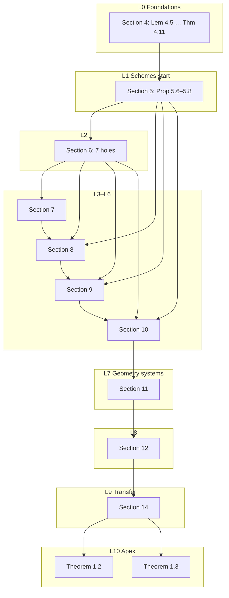

# Proof holes (BFS dependency order)

Inventory of Lean `sorry` holes in this repository, ordered **prove-first**: Layer 0
are holes with no remaining unfinished prerequisites; later layers wait on earlier
ones. Apex theorems 1.2 and 1.3 are **last**.

**Count:** 44 `sorry`, 0 `admit`.
Sections **2**, **3**, **4**, and **13** have no holes.

**Dependency basis:** paper/logical order from `dependencies.mermaid`
(`A --> B` means B waits on A), reconciled with the current hole set, plus
within-section paper numbering and Lean `Results`→`Results` imports
(S7–S11 on S5/S6).

**Note on Lean-import BFS:** A module-only BFS among hole-bearing `Results.lean`
files would place S1, S12, and S14 in Layer 0 because those stubs do not import
later Results. That ranking is wrong for prove-first work; this file uses the
logical order instead.

**Reconciliation with `dependencies.mermaid`:** The mermaid “Presentations”
subgraph (Lemmas 2.1–2.5, Theorem 2.6, Proposition 2.3 converse) is **filled**
(Section 2 has no `sorry`). Those nodes are omitted from the cluster DAG below.
Section 13 is complete and was never on that chain.

---

## Counts by section

| Section | Holes | File |
|--------:|------:|------|
| 1 | 2 | `AEC/Section1/Results.lean` |
| 2 | 0 | — |
| 3 | 0 | — |
| 4 | 0 | — |
| 5 | 1 | `AEC/Section5/Results.lean` |
| 6 | 7 | `AEC/Section6/Results.lean` |
| 7 | 5 | `AEC/Section7/Results.lean` |
| 8 | 5 | `AEC/Section8/Results.lean` |
| 9 | 7 | `AEC/Section9/Results.lean` |
| 10 | 9 | `AEC/Section10/Results.lean` |
| 11 | 8 | `AEC/Section11/Results.lean` |
| 12 | 4 | `AEC/Section12/Results.lean` |
| 13 | 0 | — |
| 14 | 4 | `AEC/Section14/Results.lean` |
| **Total** | **56** | |

The table is the previous `Results.lean` rollup. The live count of declarations using
`sorry` is **32** (48 at the start of the overnight run). `WorkingScheme.exists_approximationSequence`
was retired (unused; Lemma 6.9 is `SingleModelData.exists_approximationSequence`).
Statement audit: `AEC/Audit/TinyAEC.lean` builds `tinyAEC` (empty language, at most one
element per model); `AEC/Audit/Counterexamples.lean` refutes unconditional Prop 10.2, the old
4th clause of Lemma 11.2, the old Lemma 10.8 statement (when a new realization exists),
unconditional Thm 9.3 (`emptyAEC`), and Thms 9.8, 11.9, 12.2, 14.3 for arbitrary face families /
geometric systems. `AEC/Section5/EmptiedScheme.lean` shows `IsWorkingPackage` is vacuous for
object-free schemes; Thm 8.6, Thm 9.3, Prop 10.6, Prop 11.7 have sorry-free degenerate proofs that way (counted as NOT done; board flag `degenerate`); Prop 11.6 is proved degenerately on a constant
geometric system (now with `[CategoricalUnbounded K]`).
`AEC/Audit/AllSets.lean` builds the AEC of all sets (chain unions are direct limits) and
`AllSetsMinimal.lean` a `MinimalData` on it; they refute Prop 10.7 as stated and the original
point-set hypotheses of Thm 10.9 / Cor 10.10 (restated to `P(B) = f[P(A)]`).
Overnight additions: `AEC/Audit/EqPattern.lean` (an `OrderPresentation` and a `StableDiagram` on the
AEC of all sets) refutes Lemma 12.6 as formalized and the original form of Lemma 12.5 (restated:
query type `ι` inside the hypothesis); `AEC/Audit/BoundaryGlue.lean` refutes Lemma 12.3 and
`AEC/Audit/FaceGlue.lean` refutes Lemma 9.7 (tops may glue faces along a non-face overlap);
`AEC/Audit/Counterexamples.lean` also refutes Claims 11.10 and 11.13 as formalized;
`AEC/Audit/PredSets.lean` (sets with a unary predicate + `MinimalData`) refutes the
unconditional Corollary 14.4 (restated with `[CategoricalUnbounded K]`).
**Degenerate closures are NOT counted as done** (board flag `degenerate`, status blocked):
Thm 8.6, Prop 9.1, Cor 9.2, Thm 9.3, Thm 9.6, Lem 10.1, Prop 10.6, Prop 11.6, Prop 11.7,
Claim 11.12 (the last via `AEC/Section11/Repiece.lean`). Each carries a proposed honest
restatement in `holes-graph.json`, as does every refuted-as-formalized node.
`AEC/Audit/NoPairs.lean` (a `MinimalData` with no independent pairs) refutes Lemma 10.4 and
Theorem 10.5 as stated: the abstract `productCopies` needs more axioms.

---

## Remaining hole clusters (prove-first DAG)

Within a layer, siblings are listed in paper number order.

---

## BFS layers (individual holes)

### L0 — Independent foundations (0 open)

No unfinished Results prerequisites. Section 3 is complete (Theorem 3.11 closed by the
`θ⁺ · a^θ` renaming kill); Section 4 (the diagrams/orbits stack) is complete (Theorem 4.11 closed
by the countable tower of Lemma 4.10 lifts into one categorical `E(J)`).

**Live board:** [`holes.html`](holes.html) + [`holes-graph.json`](holes-graph.json).
Edge **B→A** means the English proof of A requires B (no soft/narrative-only edges).
Blue = done; green = open; grey = blocked. No separate failed status unless a
counterexample refutes the program.

**Dependency rule:** edge B→A only if the English proof of A requires B, or A
needs an explicit Lean infra subgoal B (not a paper-number chain).

**Blocked (split):** `infra_78_mixed_level_isolation` — **grokbot cycle 31:** split into tracked sub-tips (`infra_78_fixed_list_eventually_free` **done**; `infra_78_same_level_type_amalgam` **done** (cycle 32), `infra_78_nonfree_extension_tied` **done** (cycle 33); `infra_78_bookkeeping_closure` split (cycle 34: `infra_78_mixed_ls_pair` **done**; `infra_78_code_copies_bounded` **done** (cycle 35); `infra_78_copies_persist_at_limits` **done** (cycle 36); `infra_78_bookkeeping_assembly` split (cycle 37: `infra_78_cardinal_closure` **done**; `infra_78_bookkeeping_sets_construction` split (cycle 38: `infra_78_bookkeeping_sets_abstract` **done**; cycle 39: `infra_78_bookkeeping_sets_instantiate` **done** ([`Bookkeeping.lean`](AEC/Section7/Bookkeeping.lean)), closing `infra_78_bookkeeping_sets_construction`; `infra_78_bookkeeping_req1_high_cof` / `req2_high_cof` now **open**; the matrix composition law and continuity at limits are tracked outputs of `infra_78_matrix_construction`; open: `infra_78_bookkeeping_sets_instantiate`); blocked: `infra_78_bookkeeping_req1_high_cof`, `infra_78_bookkeeping_req2_high_cof`)); blocked: `infra_78_matrix_construction`, `infra_78_isolated_stage`, `infra_78_theta_shrink`, `infra_78_isolation_transfer`); the full claim stays tracked. **grokbot_02:** mixed-level tied freeness and Lemma 7.6 for `ν ≤ μ` are now proved (`infra_78_tied_free_lift_mixed` in `MixedTiedLift.lean`, `infra_78_lemma_7_6_mixed` in `MixedDescent.lean`); what remains is the `ρ⁺` matrix argument itself; its stationary combinatorics are done (`infra_78_stationary_combinatorics`: `infra_78_stationary_high_cof`, `infra_78_bounded_in_earlier_stage`, `infra_78_stationary_fixed_list`). **Audit (grokbot_02):** the untied `IsFreeFrom` is vacuous (`AEC/Audit/FreeFromVacuous.lean`: it holds whenever the restriction has an approximation sequence), so `lemma_6_11` and `proposition_6_13` were demoted to degenerate/NOT done (`proposition_6_13` is now restated with `IsTiedFree` and **done** in `AEC/Section6/LocalCharacterTied.lean`), and the fixed-list local-character contradiction is split off as open tip `infra_78_tied_local_character` (tied local character + base monotonicity), now **done** (`infra_78_tied_local`, with the testing reduction `infra_78_tiedFree_of_upTo`), so `infra_78_mixed_level_isolation` is open again. Follow-up audit: `proposition_6_12`, `lemma_6_17` and `infra_78_finite_continuity` also rest on the untied notion and were demoted to degenerate/NOT done (tied restatements proposed in `holes-graph.json`; `infra_78_finite_continuity` is now restated with `IsTiedFree` and **done**). Hard-edge counts in `holes-edges.txt` and `holes-graph.json` reconciled (4 file-only edges added to the JSON). Earlier notes: Proposition 7.8 shrinks a level-`κ` matrix `X_i ≤ Y_i` (`ρ⁺` stages, Fodor) to level-`λ` pairs `A ≤ U` and applies Lemma 7.6 with `A` at level `λ < κ`; the Lean tied-freeness / move / descent infrastructure is same-level only (`infra_73_move_iso` is a structural iso). Needed: mixed-level tied freeness and Lemma 7.6 for `ν < μ`. `proposition_7_8` is **blocked** on it (and its Lean statement, over an arbitrary `WorkingScheme`, should first be restated for `SingleModelData`). **Done this round:** `infra_76_arbitrary_fragment` / `lemma_7_6_tied` ([`TiedDescent.lean`](AEC/Section7/TiedDescent.lean): English Lemma 7.6 for an arbitrary isolating fragment along a tied-free lift; symmetry of the tied answer `infra_76_tied_majority`, fragment = an approximation list of `tp(W/A)`). `infra_73_block_restriction` ([`BlockRestriction.lean`](AEC/Section7/BlockRestriction.lean): block presentation `A ≅ E(σ⁺ ×ₗ μ)`, `J₀` = sequence supports ∪ a `χ₀⁺` reservoir per block, placements of `q` and `q'` (Prop 4.9 with `χ^σ = χ`), a block `b` met by neither placement, `A* = E(J₀ ∪ b)` with `g : A ≅ A*` fixing the sequence, differing tests moved inside `b` into the reservoir); hence `infra_73_alt2_tied_marginal` and the unconditional English uniform shrink `proposition_7_3_uniform`. **Done this run:** `infra_610_tied_free_lift` ([`TiedFreeLift.lean`](AEC/Section7/TiedFreeLift.lean)), `infra_73_tied_of_isolated` (restated: `hMargFree : IsFreeLift` → `hMargTied : IsTiedFree` on the `u`-marginal; the old form was false), `infra_72_over_B_isolation`, `lemma_7_2` (English form `lemma_7_2_tied`), `objectOfEmptyChain` sorry removed (`lemma_5_4` gains `hObj`). Retired and removed: `infra_69_transfer_sequence`, `infra_610_same_head_transfers_joint`. `lemma_7_6` done (English form `lemma_7_6_tied`). `proposition_7_5` stays done. `infra_78_finite_continuity` done (Def 7.7 for finite marks via the tied Prop 6.13).

**Definition 5.2 repairs (made for Proposition 5.6).** The planned statement of Proposition 5.6 (a working package with an object at every eligible level) was refutable from the definitions; each obstruction was checked in Lean before the repair.
1. `WorkingScheme.diagram_iso` is now for lists with `#α < μ`, and `WorkingScheme.diagram_preserved` for lists with `#α < μ` and `#α < ν` (`AEC/Section5/WorkingScheme.lean`). Unbounded, the two fields applied to the list of all occurrences of an object made every permitted arrow between objects at one level vertexwise bijective; the stable diagram `D` only controls bounded lists. `diagram_refl`, `diagram_symm`, `diagram_trans`, `diagram_reindex`, `diagram_restrict`, `diagram_empty` are unchanged.
2. `IsSaturated.saturated` now assumes `∀ i, ext (Sum.inl i) = base i` (`AEC/Section5/PackageClauses.lean`): the witness extends the list whose diagram is that of the actual list. Before, `ext` was unrelated to `base` and `xs`, and the clause failed for a constant `ext` over an injective `xs`.
3. `HasChainUnions.union` now assumes the cocone condition `∀ i j, SystemArrow.comp (le i j) (toZ j) = toZ i` in its universal property (`AEC/Section5/PackageClauses.lean`). This repair was not planned: after 1 and 2 the statement was still refutable, since for a two-element constant family the clause identified any two permitted arrows `X → Z`, which with mixed downward closure refutes every package that has an object.

Callers: `namedWorkingScheme` now takes `hι : #ι < μ0`, `hTail : ∀ μ ∈ T, μ0 ≤ μ`, `hinf : ∀ μ ∈ T, ℵ₀ ≤ μ` (a bounded list together with the names is bounded); `named_index_lt_of_tail` and `sum_mk_lt_of_lt` moved to `NamedWorkingScheme.lean`. Props 5.7, 5.8, 5.9 remain proved without `sorry`.

**Known residual in `HasChainUnions`.** The clause quantifies over arrows `le i j` for *every* ordered pair `(i, j)`, composing strictly, so its families consist of mutually inverse isomorphisms; with the cocone condition the clause holds in every scheme (take `U := obj i₀`). A faithful clause would index `le` over `i ≤ j` in a directed order. It was left unchanged (minimal repairs); the real content for single models is `SingleModelData.exists_directed_union`. Re-index the clause when Sections 6–11 first need a chain union.

**Lemma 6.1 is done, with a repaired statement** (`AEC/Section6/ParameterOrbits.lean`). The bare-scheme statement was refutable (`DiagramEq` may be equality of lists). Assuming a working package with presentations is not enough: `IsWorkingPackage` and `HasPresentations` do not make the automorphisms of the vertex models, which Lemma 4.5 produces, structural isomorphisms of the scheme (counterexample pattern, not formalized: isomorphisms that preserve a colouring by more than `χ` colours). The statement now has:
1. `hiso : AssemblesStructIso W b` (new definition): at every object there is a set `B` of at most `b` occurrences such that strong vertex automorphisms fixing `B` and commuting with the specified maps are the vertex maps of a structural isomorphism. The English bound `b` and `hb : b + σ < χ` are kept.
2. `hχ : ls K + 2^(2^σ) ≤ χ`, the bound of Lemma 4.5, `hcat : ∀ μ ∈ W.eligible, Categorical K μ`, and `[CategoricalUnbounded K]`.
3. `hedge : ∀ i j, ¬ S.specified i j`: the shape has no specified map. Lemma 4.5 gives vertex automorphisms one vertex at a time, and they need not commute with the maps of a system. Any finite number of vertices is covered. A one-vertex hypothesis was not used: it is not needed, and it does not suffice for this proof (one vertex with a specified map to itself).

`IsWorkingPackage` and `HasPresentations` are not hypotheses; the proof does not use them. `hiso` holds for the Prop 5.6 scheme with `b = 0` (`SingleModelData.assemblesStructIso`, from `assemblesStructIso_bijective`) and for the Prop 5.7 named scheme with `b + #names` (`WorkingScheme.assemblesStructIso_named`). `SingleModelData.exists_parameter_orbit_reps` is the lemma for the Prop 5.6 scheme with no scheme hypothesis left. `proposition_5_6` does not export `hedge`, `hcat` or `hiso` for its existential scheme: callers of Lemma 6.1 use `SingleModelData.scheme` directly, or the statement of Prop 5.6 has to be extended. Shapes with specified maps remain open for Lemma 6.1 (they need orbits of system automorphisms, not of vertex automorphisms). Hard edge `4.5 → 6.1` added; Prop 6.3 is done (PlacedTester packaging); Lemma 6.4 is done; Lemma 6.5 is done (next paragraph).

**Lemma 6.5 is done, with a repaired statement** (`AEC/Section6/PlacedComparisons.lean`). The old Lean form had `SameGaloisType` (scheme amalgamation) on the left of the iff; that is Theorem 6.6, and English Lemma 6.5 says its argument "does not require an amalgamation relation on types". Its `g` was only monotone (the iff fails for small `g`), and a bare `WorkingScheme` has no presentation in which to place a tuple. The statement is now at the level of a presentation, like Prop 6.3 and Lemma 6.4: `hL : ClosedLevel K E D g μ`, `I` a well-order of size `μ`, `A = E(I)`, and tuples `d₀`, `d₁` of length at most `σ < μ` in strong `μ`-extensions `B₀`, `B₁` of `A`. It has three clauses:
1. existence: some placement over `I` lifts the bounded diagrams of `d₀` (`Placement.LiftsBounded`), from `exists_boundedDiagramLift` (Lemma 4.10);
2. uniqueness: two such placements agree over all of `A` (`Placement.AgreeOn … Set.univ`), from `Placement.LiftsBounded.agreeOn_univ`. This clause is not in the planned statement; it is the English sentence "unique as a diagram over all of `A`";
3. testing: for lifts `P₀` of `d₀` and `P₁` of `d₁`, `P₀.AgreeOn E D P₁ Set.univ` iff the diagrams of `d₀` and `d₁` agree at the bounded levels `ρ < μ` over all `p : β → A` with `#β ≤ g σ + ls K` (the right side of Theorem 4.11 (2)). `←` is `agreeOn_univ_of_tests` (the placed tester). `→` is new, `Placement.LiftsBounded.same_of_agreeOn`: equal comparisons make `P₀` lift `d₁` as well (`Placement.LiftsBounded.of_agreeOn`), so both tuples have the diagram of its placed tuple; it holds for every bounded query, without the bound on `#β`.

`σ` is any infinite bound on the length, in place of `|v| + ℵ₀`. The separate hypothesis `hg : PlacedTester K E D g` of the planned statement is omitted, since it is the field `hL.tester`. `hs₁ : K.Strong incl₁` is kept but not used by the proof (a comparison of `d₁` is a hypothesis of clause 3). The last sentence of the English statement (other natural parameter layouts) is not formalized: `NaturalParameterLayout` has no placement data. Hard edges `4.10 → 6.5`, `4.8 → 6.5` and `6.3 → 6.5` added (the English proof says Proposition 6.3 identifies the full placed comparisons; in Lean its `PlacedTester` is the tester of `ClosedLevel`); `6.4 → 6.5` stays hard (the English proof applies Lemma 6.4, and the Lean proof reaches the same `compact_placement` through Lemma 4.10). Theorem 6.6 is done (next paragraph). By hard edges alone `lemma_5_4`, `lemma_5_5`, `proposition_5_8`, `proposition_5_9` and `lemma_6_1` do not reach the apex (`lemma_6_1` has only the soft edge to `proposition_6_3`); the header of `holes-edges.txt` now says so.

**Theorem 6.6 is done, with a repaired statement.** The old Lean form quantified over a bare `WorkingScheme` with unconstrained `g` and ad-hoc vertex matching (`SameGaloisType` / scheme amalgamation), which is refutable. It is now the presentation-level packaging of `ClosedLevel.amalgamation` and `ClosedLevel.tuple_amalgamation_iff` under `hL : ClosedLevel K E D g μ`: strong `μ`-extensions of a `μ`-model amalgamate, and an amalgam identifying two bounded tuples exists iff their diagrams agree on parameter queries of size at most `g(σ) + ℓ` at levels `ρ < μ`. The English ω-tower / Lem 6.4–6.5 argument is already the engine of Theorem 4.11 (2); Section 6 numbering packages that. Hard edge `4.11 → 6.6`; `6.5 → 6.6` softened (English narrative). Corollary 6.7 is done (next paragraph).

**Corollary 6.7 is done, with a repaired statement** (`AEC/Section6/LargerLevelRealization.lean`). The old Lean form quantified over a bare `WorkingScheme` (`Tail` / `SystemArrow` / `permitted`) with no closed levels, strongness, sizes or testing bound for the Theorem 4.11 engine to use, and it had neither the prescribed tuple nor the type clause of the English statement. It is now at the level of a presentation, like Theorem 6.6, under two closed levels `hν : ClosedLevel K E D g ν`, `hμ : ClosedLevel K E D g μ`, `ν < μ`, for a strong `f : A → B` of `ν`-models and a strong `i : A → N` into a `μ`-model. It has three clauses:
1. realization: a strong `F : B → N` with `F ∘ f = i` (`exists_strong_embedding_into_larger_base`, the empty tuple in clause 2);
2. prescribed tuple: for `d : α → B`, `z : α → N` with `#α < ν`, if the diagrams of `(d, f p)` and `(z, i p)` agree at the bounded levels `ρ < ν` over all `p : β → A` with `#β ≤ g(#α ⊔ ℵ₀) + ls K`, there is such an `F` with `F ∘ d = z` (`exists_strong_embedding_into_larger`);
3. actual `ν`-types: a tuple `x : α → N` with `#α < ν` lies in a strong `ν`-submodel `B'` of `N` containing `A`, and the diagrams of `(x, i p)` in `N` and of its copy in `B'` agree at every bounded level `ρ < ν` (`exists_actual_nu_type`: exact-size strong hull, coherence, `D.of_strong`).

Proof of clause 2. Identify `N` with its chart `E(Below μ)` (categoricity at `μ`). The images of `A` and `z` are at most `ν` terms, so they lie in `N₀ = E(S)` for a suborder `S ⊆ Below μ` of size `ν` (`exists_suborder_cover`), and `A → N₀` is strong by coherence. `B` and `N₀` are `ν`-sized strong extensions of `A` whose tuples pass the tests, so Theorem 4.11 (2) at `ν` (`ClosedLevel.exists_tuple_amalgam`) gives a `ν`-sized amalgam `P` over `A` identifying `d` with `z`. Now `N₀ → N` is an order map of the presentation and `μ ≥ t(ν)` is a categoricity cardinal, so the countable tower of Theorem 4.11 at the source level `ν` (`exists_strong_embedding_over`, with target chart `J = Below μ`) embeds `P` into `N` over `N₀`; the target is not enlarged. The English proof runs the exhaustion of Theorem 6.6 directly into `N`: it places each new tuple in a chart of `N` and uses saturation at `μ` to realize the joint diagram of the placed tuple, `A` and the previously assigned list back in `N`. That saturation step is not formalized. A direct Lean version by lift extensions was tried and not closed: a lift found over the chart of `A` lives in a presentation `E(J₁)`, and `D.exists_transport` into `N` matches the previously assigned list but not the image of `A`; fixing all of `A` would take a comparison of length `ν` between its images in `N` and in `E(J₁)`, and `D.of_strong` from the `ν`-model `A` does not give one (`t(ν) > ν`). Passing through `N₀ = E(S)` makes the inclusion into `N` an order map, where the level-`ν` comparisons of Theorem 4.11 apply. Hard edge `4.11 → 6.7`; `6.6 → 6.7` softened (the English proof reuses the exhaustion of Theorem 6.6; the Lean proof calls `ClosedLevel.exists_tuple_amalgam` and `exists_strong_embedding_over`, not `theorem_6_6`). Soft edge `corollary_6_7 → lemma_6_9` (English 6.9 does not use Cor 6.7). Theorem 6.10 is unblocked (hard `lemma_6_9 → theorem_6_10`).

**Lemma 6.9 is done for `SingleModelData`.** The chain is `infra_69_recursion_tail`, then `infra_69_assemble` at a same-level tuple `p.ν = μ`. Theorem 6.10 is restated the same way. `stationary_free_extension_exists` packages `IsFreeLift` by amalgamating `p`'s host with `B` and pushing majority values along the `B` leg. A single head in `B` for every parameter list is retired (`qPres_empty_joint_on_I`, `preserves_atomic`). Per-query realization is `qPres_empty_free`. Demoted: `same_head`. Soft-pad placeRoot / global `placement_to_B` stay retired. Majority uniqueness is proved. No constant-family alternate.

**Lemma 6.11 has a sorry-free same-level `SingleModelData` proof (demoted grokbot_02: degenerate, untied `IsFreeFrom` conclusion is vacuous).** `infra_611_fresh_code` builds a Lemma 6.9 code for `p = q.restrict`. The given sequence and that code meet in `infra_611_bridge` (`infra_610_majority_eq_type`, `infra_610_majority_unique`). `infra_611_code_majority` transports the majority onto `q ↾ Z`. Parameter queries are moved by `infra_610_move_query` (`infra_611_image_agree`); `infra_610_same_galois` is the testing criterion. `IsFreeFrom` is that `IsFreeLift`. Mixed `ν < μ` is deferred. Proposition 6.12 is done for same-level existence and anchored independence. Proposition 6.13 (**demoted grokbot_02: degenerate, its untied `IsFreeFrom` conclusion is vacuous**) has sorry-free same-level local character and continuity (`SameLevelChain`, stage-trapped Lemma 6.9 code, `infra_611_isFreeFrom`, `infra_613_freeFrom_trans`). Hard board edges into §7: `proposition_7_8`, `lemma_7_11`, `theorem_7_13` (Def 7.7 / local character). Soft only to `proposition_6_15`. Mixed levels stay deferred. Proposition 6.15 is done for the two-sided strip (`G = P.E`); `infra_615_terminal` is the one-sided specialization. Corollary 6.16 is done for `SingleModelData` (μ blocks on `lvlOrder μ ×ₗ (ℕ ×ₗ lvlOrder μ)`, middle-strip exhaustion postcomposed back onto `A`). Lemma 6.17 has a sorry-free mixed `ν ≤ μ` proof (`DescentRetraction.lean`) but is demoted (grokbot_02: untied `IsFreeLift` conclusion, degenerate). `infra_610_tied_free_lift` done. Open tip: `infra_78_mixed_level_isolation` (blocks `proposition_7_8`). Lemma 7.2 English-complete (`lemma_7_2_tied`); Prop 7.3 English uniform green (`proposition_7_3_uniform`); Lemma 7.6 English green (`lemma_7_6_tied`); Path A Lean Results stay green.

**Wired (intended use, reach apex):** `5.6 → 9.3, 10.2`; `5.7 → 9.3, 10.6, 10.8`;
`2.3 → 1.2`; `3.11 → 4.2, 5.8`; `4.2 → 4.9, 4.10, 4.11`; `4.3 → 4.10, 4.11`; `4.5 → 6.1`; `4.6 → 4.9`; `4.7 → 4.8, 12.5`; `4.8 → 4.10, 4.11, 6.3, 6.5`; `4.10 → 4.11, 6.5`; `6.3 → 6.5`; `6.4 → 6.5`; `4.11 → 5.6, 6.6, 6.7`; `infra_69_place_on_fills → infra_69_assemble → 6.9` (hard; 6.9 done for `SingleModelData`); `infra_610_move_query → infra_610_free_root / infra_610_param_freeing_qPres → infra_610_chart_support → infra_610_moved_majority → infra_610_root_majority + infra_610_root_galois → infra_610_chart_prescriptions → infra_610_place_prescriptions → infra_610_majority_of_placement → infra_610_majority_prescription → infra_610_place_on_B → stationary_free_extension_exists → 6.10` with `infra_610_majority_matches_root → infra_610_majority_prescription` and `infra_610_galois_tests_of_placement → infra_610_majority_prescription` with `infra_610_closed_level → infra_610_same_galois → infra_610_isFreeLift_same_galois` (hard restore tip; majority path soft on same_galois; E5 tipport / moved_majority / root_majority done; E5d′/E5e reflected done; `IsFreeLift` majority-only)
Full hard-edge list: [`holes-edges.txt`](holes-edges.txt). Target: every Results/paper
node reaches Thm 1.2 or 1.3; completed work should admit dead-code analysis of each edge.

| Decl | Title | Location |
|------|-------|----------|
| `theorem_3_11` | Theorem 3.11 | `AEC/Section3/Results.lean` (**done**: no `sorryAx`; recurring-profile pigeonhole `exists_asymmetric_common_setup` in `ReversalKill.lean`, Prop 3.9 alignment, `θ⁺ · a^θ` kill `exists_killed_copy` in `RenamingKill.lean` via chains of strong self-maps `selfChainRec`) |
| `proposition_4_3` | Proposition 4.3 | `AEC/Section4/Results.lean` (**done**: `prop43_hull_back_and_forth` in `Prop43BAF.lean`; hull back-and-forth on `HullMatch` stages, uses the new `StableDiagram.trans` field) |
| `lemma_4_5` | Lemma 4.5 | `AEC/Section4/Results.lean` (**done**: no `sorryAx`; mixed S⊕new occupancy closed in `fingerprint_same_order_and_occupancy`) |
| `lemma_4_6` | Lemma 4.6 | `AEC/Section4/BlockInterchange.lean` (**done**: English tree/repeat/orbit via `BlockRegions` + `lemma_4_5_with_E`; `DisjointBlockSwap` packaging is degenerate) |
| `lemma_4_7` | Lemma 4.7 | `AEC/Section4/Results.lean` (**done**: `type_u_witness_set_param`) |
| `proposition_4_8` | Proposition 4.8 | `AEC/Section4/Results.lean` (**done**: no `sorryAx`; `g σ = max ℵ₀ σ`, test set = joint support `testingSet`; `sameNaturalDiagram_restrict_iff` via the cut-lex amalgam `exists_linearOrder_amalgam` in `UniformTesting.lean`. Statement changes: `DiagramsDifferOnSubset` now compares the restrictions of the given placements, and the hypothesis `ℵ₀ ≤ σ` was added since `StableDiagram.of_strong` is only available for infinite `σ`) |
| `proposition_4_9` | Proposition 4.9 | `AEC/Section4/Results.lean` (**done**: no `sorryAx`; English support-profile obstruction `compact_placement` in `CompactPlacement.lean`: profiles over `S_X` (`SameProfile`, `SupportProfile.ofTerms`, at most `χ` codes `mk_profileCode_le`), no-event continuations `exists_inert_continuation`, no-event comparison by Lemma 4.6 on the slots `sameNaturalDiagram_of_sameProfile_noEvent`, local realizability by Prop 4.2 `exists_local_placement`, `σ⁺` stages with at most `σ` new events. Statement changes: added `[CategoricalUnbounded K]`, `ℵ₀ ≤ σ`, the natural-parameter clause `hnat` and the coherence clause `hcoh`; possibility needs no hypothesis since the prescription for `p` is the diagram of the tuple `q p` of `E(I)`) |
| `lemma_4_10` | Lemma 4.10 | `AEC/Section4/Results.lean` (**done**: no `sorryAx`; `boundedDiagramLift` in `BoundedDiagramLift.lean`: cofinal `χ = 2^(κ ⊔ σ)`, prescription `(φ ∘ d, p)` for a strong `φ : B → E(I)` fixing `p` (`exists_paramFixing`), `compact_placement` at `χ` (`exists_placement_lifting`), agreement of two lifts on `≤ g(σ)` positions (`agreeOn_of_lifts`) and hence everywhere by the placed tester, uniqueness `Placement.LiftsBounded.agreeOn_univ`, restriction `Placement.LiftsBounded.reindex`; the placed tester is the English Prop 4.8 over the base, `exists_placedTester` in `PlacedTesting.lean` (`FrozenData`, `Layout`, Lemma 4.7), exposed as `proposition_4_8_over_base`. Statement changes: the old statement was vacuous (each test clause assumed `D.t μ ≤ Model.card B` with `Model.card B = μ < D.t μ`); the lift clauses are now at bounded levels `ρ < μ`, `J` is produced with `D.t μ ≤ ‖E(J)‖`, uniqueness is the level-`μ` comparison over all of `A`; added `[CategoricalUnbounded K]`, `hcat : Categorical K μ`, `ℵ₀ ≤ σ`, `hg : PlacedTester K E D g`) |
| `theorem_4_11` | Theorem 4.11 | `AEC/Section4/Results.lean` (**done**: no `sorryAx`; `S` = closure points `μ > ℓ` of `{t, g}`, unbounded by `exists_closurePoint_ge` and categorical by Prop 4.3 (`categorical_of_closurePoint`) in `ClosedLevels.lean`. `ClosedLevelAmalgam.lean`: `A ≅ E(I)`, `I` of order type `μ`; `G = E(J)` of a categoricity size `≥ t(μ)`; `LiftsTuple` (a tuple of `E(J)` lifting the bounded diagrams over `A`), one step `exists_lift_extension` (Lemma 4.10 lift, uniqueness at level `μ`, transport into `G` by `StableDiagram.exists_transport`), countable tower of small strong submodels `exists_strong_tower`, each lifted stage strong by `to_strong` (`exists_strong_of_liftsTuple`), union `exists_strong_of_nat_exhaustion`, giving `exists_strong_embedding_over` and the amalgams `exists_amalgam_of_common_lift` / `exists_amalgam_of_agreeOn`; clause 2 from the placed tester `agreeOn_univ_of_tests` and necessity `StableDiagram.same_of_amalgam`. `ClosedLevelTypes.lean`: clauses `ClosedLevel.amalgamation`, `ClosedLevel.tuple_amalgamation_iff`, `ClosedLevel.singleton_types`; singleton codes = label + cuts of the finite support in `I` (`Placement.singletonCode`, `mk_singletonCode_le`, `Placement.AgreeOn.of_sameProfile_univ`). Statement changes: added `[CategoricalUnbounded K]`, `E : OrderPresentation K`, `hg : PlacedTester K E D g` (replacing monotone `g`); clause 2: added `ℵ₀ ≤ σ`, and the old right side, vacuous under `D.t μ ≤ Model.card Bᵢ`, is now the tests at the bounded levels `ρ < μ` over **all** parameter lists `p : β → A` with `#β ≤ g σ + ls K` (`β` is quantified inside the iff: with one fixed `β` the iff fails for small `β`; `+ ls K` because `PlacedTester` bounds positions of `I`, and `≤ g(σ)` positions support `≤ g(σ) + ℓ` elements); clause 3: the old form compared `x, y ∈ A` under `g₀ = g₁` on `A`, which forces `x = y` and is satisfied by any injection `A → μ`; now `code B f x` for elements of all `μ`-extensions `(B, f)` of `A`, with equal codes iff an amalgam over `A` identifies them (the old form is the case `B₀ = B₁ = A`)) |

Section 4 is complete: Theorem 4.11, its last hole, is done (hard deps 4.2, 4.3, 4.8, 4.10 closed).

### L1 — Section 5 after diagrams (0 open)

Proposition 5.6 is done (single-model working package on the closure points of `{t, g}` above `ℓ`). The former seed-object hole `objectOfEmptyChain` is closed: it now takes the hypothesis `hObj : ∀ μ hμ, Nonempty (W.Object μ hμ)` (the existence half of Definition 5.2(2), not recorded by `HasPresentations`), which `lemma_5_4` takes and `proposition_5_6` supplies for single models. Section 5 has no `sorry`.

| Decl | Title | Location |
|------|-------|----------|
| `proposition_5_6` | Proposition 5.6 | `AEC/Section5/Results.lean` (**done**: no `sorryAx`; `SingleModelData.scheme` in `SingleModelScheme.lean` and `SingleModelData.isWorkingPackage` in `SingleModelPackage.lean`. One vertex; objects at `μ` = `K`-structures on the carrier `μ.ord.ToType` in `K` (`SMObject`); arrows = strong maps; eligible = closure points of `{D.t, g}` above `ls K`; `E` from `exists_orderPresentation_of_categoricalUnbounded`, with `CategoricalUnbounded K` from `D`. `DiagramEq` compares two lists by `D.same` inside the presentation `E(ρ)` at every eligible `ρ` above both levels and the length, after canonical charts (`chart`, `push`); for lists bounded at both levels it is `D.same` in the models (`diagramEq_iff_sameD`); `diagram_iso` by Prop 4.3. Saturation `exists_saturation`: a Prop 4.3 automorphism of `E(max μ ν)` moves the base of the witness onto the actual list, then a strong hull of size `μ`. Statement changes: inputs stay `(K) (D) (g)`; the conclusion is now `∃ S W, IsWorkingPackage W ∧ HasPresentations W W.template ∧ (∀ μ hμ, Nonempty (W.Object μ hμ)) ∧ Nonempty S.Vertex ∧ Subsingleton S.Vertex ∧ (∀ κ, ∃ μ, κ ≤ μ ∧ μ ∈ W.eligible) ∧ ∀ μ ∈ W.eligible, IsClosurePoint {D.t, g} μ`, the hypotheses that Proposition 5.7 consumes. Needed the Definition 5.2 repairs above. Feeds Thm 9.3, Prop 10.2) |
| `infra_single_model_scheme` | Single-model WorkingScheme | `AEC/Section5/SingleModelScheme.lean` (**done**: `oneVertexShape`, `SMObject`, `SingleModelData`, `SingleModelData.DiagramEq`, `SingleModelData.scheme`; no `sorry`) |
| `infra_single_model_package` | Single-model package clauses | `AEC/Section5/SingleModelPackage.lean` (**done**: `nonempty_object`, `hasPresentations`, `hasMixedDownward`, `isSaturated`, `satisfiesExhaustion`, `hasChainUnions`, `isWorkingPackage`, `exists_directed_union`; no `sorry`) |
| `proposition_5_7` | Proposition 5.7 | `AEC/Section5/Results.lean` (**done**: no `sorryAx`; `exists_named_realization_of_arrow` via `wellOrder_arrow` + `diagram_preserved` in `NamedRealizationExistence.lean`; packaged with `namedWorkingScheme` / `isWorkingPackage_namedWorkingScheme` on `eligibleTail (μ0 ⊔ ℵ₀)`; the named scheme takes `#ι < μ0` and the tail bounds after the Definition 5.2 repairs) |
| `infra_template_fixed_support` | Template F(J+H) | `AEC/Section5/TermTemplate.lean` (**done**: `withFixedSupport`, `sumLexEmbedRight` / `sumLexEmbedLeftIncl`, `fixedSupportArrow`) |
| `infra_eligible_reclass` | Convention 5.3 tails / Lim | `AEC/Section5/EligibleSubclass.lean` (**done**: `eligibleTail`, `EligibleSubclass.tail` / `lim` / `aboveNamingThreshold`) |
| `infra_named_working_scheme` | Named WorkingScheme ctor | `AEC/Section5/NamedWorkingScheme.lean` (**done**: `WorkingScheme.IsStructIso` + `namedWorkingScheme` packer; no `sorry`) |
| `infra_named_working_package` | Named package transfer | `AEC/Section5/NamedPackageTransfer.lean` (**done**: `isWorkingPackage_namedWorkingScheme`; no `sorry`) |
| `objectOfEmptyChain` | Seed object at eligible level | `AEC/Section5/Results.lean` (**done**: takes `hObj` instead of a `sorry`; `lemma_5_4` gains `hObj`; `infra_69_present_padded`/`infra_69_chart_iso` use `A` itself and no longer call `lemma_5_4`) |
| `proposition_5_8` | Proposition 5.8 | `AEC/Section5/Results.lean` (**done**: Lean residual via `diagram_iso` + `structural_iso`) |

### L2 — Section 6 unlock (Lem 6.9 infra board + package)

Waits on Section 5 working package. Lean: later Results import this module.

| Decl | Title | Location |
|------|-------|----------|
| `lemma_6_1` | Lemma 6.1 | `AEC/Section6/Results.lean` (**done**: no `sorryAx`; `WorkingScheme.exists_parameter_orbit_reps` in `ParameterOrbits.lean`: Lemma 4.5 at each vertex over the parameters and the exceptional occurrences (`exists_vertexwise_orbit_reps`), `AssemblesStructIso`, `W.diagram_iso` for the list of length `≤ χ < μ`; tail = eligible levels above `χ` and the threshold of Lemma 4.5. Statement changes: added `[CategoricalUnbounded K]`, `hedge`, `hcat`, `hχ`, `hiso : AssemblesStructIso W b`; `b` and `b + σ < χ` kept; see the paragraph above) |
| `proposition_6_3` | Proposition 6.3 | `AEC/Section6/Results.lean` (**done**: no `sorryAx`; `exists_layoutTestingFunction` in `LayoutTesting.lean` packages `exists_placedTester` as `TestingFunction layout` with `g.g σ = max σ g0 σ`. Statement repair: dropped `SameGaloisType`/`Tail`/`WorkingScheme` (English placed comparisons; amalgamation is Lem 6.5); inputs `[CategoricalUnbounded K]`, `E`, `D`, `layout`. Softened false `6.1→6.3` and `6.3→6.4`; hard `4.8→6.3`, `4.7→6.3`) |
| `lemma_6_4` | Lemma 6.4 | `AEC/Section6/Results.lean` (**done**: no `sorryAx`; alias of `proposition_4_9` / `compact_placement`. Statement repair: presentation-level with `hnat`/`hcoh`; dropped bare `WorkingScheme` and unused `b`; `hχ = ls K + σ < χ`. Hard `4.9→6.4`) |
| `lemma_6_5` | Lemma 6.5 | `AEC/Section6/Results.lean` (**done**: no `sorryAx`; `placedComparisons` in `PlacedComparisons.lean`: `exists_placedComparison` (`exists_boundedDiagramLift`), `placedComparison_unique` (`Placement.LiftsBounded.agreeOn_univ`), `placedComparison_agree_iff_tests` (← `agreeOn_univ_of_tests`, → `Placement.LiftsBounded.same_of_agreeOn`). Statement repair: dropped `SameGaloisType`/`Tail`/`WorkingScheme` and the monotone-only `g`; presentation-level under `ClosedLevel K E D g μ`, with existence, uniqueness over all of `A`, and the testing iff at bounded levels `ρ < μ` with `#β ≤ g σ + ls K`. Hard `4.10→6.5`, `4.8→6.5`, `6.3→6.5`; `6.4→6.5` kept hard) |
| `theorem_6_6` | Theorem 6.6 | `AEC/Section6/Results.lean` (**done**: no `sorryAx`; packages `ClosedLevel.amalgamation` and `ClosedLevel.tuple_amalgamation_iff`. Statement repair: dropped bare `WorkingScheme`/`SameGaloisType`/unconstrained `g`; presentation-level under `ClosedLevel K E D g μ`. Hard `4.11→6.6`; soft `6.5→6.6`) |
| `corollary_6_7` | Corollary 6.7 | `AEC/Section6/Results.lean` (**done**: no `sorryAx`; `exists_strong_embedding_into_larger`, `exists_strong_embedding_into_larger_base`, `exists_actual_nu_type` in `LargerLevelRealization.lean`: chart `N ≅ E(Below μ)`, suborder `S` of size `ν` covering the images of `A` and the tuple (`exists_suborder_cover`), `ClosedLevel.exists_tuple_amalgam` at `ν`, then `exists_strong_embedding_over` at `ν` into the chart of `N`. Statement repair: dropped bare `WorkingScheme`/`Tail`/`SystemArrow`; presentation-level under `ClosedLevel` at `ν < μ`, with realization, prescribed tuple (tests `#β ≤ g(#α ⊔ ℵ₀) + ls K` at `ρ < ν`) and actual `ν`-types. Hard `4.11→6.7`; soft `6.6→6.7`) |
| `infra_55_one_point_cut` | Infra: one-point cut | `AEC/Section5/OrderPatternRealization.lean` (**open**) |
| `infra_55_enumerate_added` | Infra: enumerate added | `AEC/Section5/OrderPatternRealization.lean` (**open**) |
| `infra_55_pattern_realize` | Infra: pattern realize | `AEC/Section5/OrderPatternRealization.lean` (**open**: was `order_pattern_realized_over_old`) |
| `infra_69_present_padded` | Infra: present padded | `AEC/Section6/UniformApproximations.lean` (**open**) |
| `infra_69_chart_iso` | Infra: chart iso | `AEC/Section6/UniformApproximations.lean` (**open**) |
| `infra_69_place_type` | Infra: place type | `AEC/Section6/UniformApproximations.lean` (**done**: placement ≤τ on the IsPadded well-ordered skeleton; that skeleton does not fill cuts) |
| `infra_69_pad_recursion` | Infra: σ⁺ profile recursion | `AEC/Section6/PaddedPlacement.lean` (**done**: `β₀`, `2^β+σ+b`, suprema at limits) |
| `infra_69_pad_recursion_closed` | Infra: recursion below the level | `AEC/Section6/PaddedPlacement.lean` (**done**: the hypothesis, not a `{D.t,g}`-closure theorem) |
| `infra_69_pad_exists_closed` | Infra: recursion-closed levels | `AEC/Section6/PaddedPlacement.lean` (**done**: cofinality-`ℵ₀` strong limits above one full recursion) |
| `infra_69_pad_downset` | Infra: down-set profile code | `AEC/Section6/PaddedPlacement.lean` (**done**: no `leastElt`; equal codes are `SameProfile`) |
| `infra_69_pad_count` | Infra: down-set profile count | `AEC/Section6/PaddedPlacement.lean` (**done**: at most `2^{\|S\|+σ+b}`) |
| `infra_69_pad_stage_card` | Infra: σ⁺ stage cardinals | `AEC/Section6/PaddedPlacement.lean` (**done**: stages and their union stay under the recursion) |
| `infra_69_pad_obstruction` | Infra: padded profile obstruction | `AEC/Section6/PaddedPlacement.lean` (**done**: `σ⁺` first-time events; reuses inert continuation, no-event comparison, event codes, local placement) |
| `infra_69_place_on_fills` | Infra: place on cut-filling chart | `AEC/Section6/UniformApproximations.lean` (**done**: under `infra_69_pad_recursion_closed`; one `Placement` over the padded chart lifting joints of size at most `max σ τ`) |
| `infra_69_shared_supports` | Infra: shared supports | `AEC/Section6/UniformApproximations.lean` (**open**) |
| `infra_69_cut_clusters` | Infra: cut clusters | `AEC/Section6/UniformApproximations.lean` (**open**) |
| `infra_69_separators` | Infra: separators | `AEC/Section6/UniformApproximations.lean` (**open**) |
| `infra_69_include_shared` | Infra: include shared | `AEC/Section6/UniformApproximations.lean` (**open**) |
| `infra_69_anchor_bound` | Infra: anchor bound | `AEC/Section6/UniformApproximations.lean` (**open**) |
| `infra_69_slot_assignment` | Infra: slot assignment | `AEC/Section6/UniformApproximations.lean` (**open**) |
| `infra_69_disjoint_regions` | Infra: disjoint regions | `AEC/Section6/UniformApproximations.lean` (**open**) |
| `infra_69_copy_cluster` | Infra: copy cluster | `AEC/Section6/UniformApproximations.lean` (**open**) |
| `infra_69_richness_arity` | Infra: richness arity | `AEC/Section6/UniformApproximations.lean` (**open**) |
| `infra_69_interpret_copies` | Infra: interpret copies | `AEC/Section6/UniformApproximations.lean` (**open**) |
| `infra_69_choose_supports` | Infra: choose supports | `AEC/Section6/UniformApproximations.lean` (**open**) |
| `infra_69_whole_block_diff` | Infra: whole-block diff | `AEC/Section6/UniformApproximations.lean` (**open**) |
| `infra_69_no_internal_hits` | Infra: no internal hits | `AEC/Section6/UniformApproximations.lean` (**open**) |
| `infra_69_lem61_off_hits` | Infra: Lem 6.1 off hits | `AEC/Section6/UniformApproximations.lean` (**done**: `SameNaturalDiagram` by `lemma_4_6_blockInterchange` on `ChartOffHit` / `CopyInterchange` in `OffHitBlock.lean`. Statement narrowed: the scheme sentence is `OffHitCopyDiagramEq`) |
| `infra_69_off_hit_diagramEq` | Infra: off-hit DiagramEq | `AEC/Section6/UniformApproximations.lean` (**done**: `OffHitCopyDiagramEq` on `SingleModelData`. `ChartOffHit.readCopy` is the occurrence reading of `movedJoint`; `Placement.Lifts`, `SameNaturalDiagram.same`, and `diagramEq_iff_sameD` give `D(vᵢ, Z) = p↾Z`. Caller supplies `hplaced` and `hread`) |
| `infra_69_hit_bound` | Infra: hit bound | `AEC/Section6/UniformApproximations.lean` (**open**) |
| `infra_69_finitary_exceptions` | Infra: finitary exceptions | `AEC/Section6/UniformApproximations.lean` (**open**) |
| `infra_69_subtuple_uniform` | Infra: subtuple uniform | `AEC/Section6/UniformApproximations.lean` (**open**) |
| `infra_69_uniformity_bounds` | Infra: uniformity bounds | `AEC/Section6/UniformApproximations.lean` (**open**) |
| `infra_69_assemble` | Infra: assemble approx seq | `AEC/Section6/UniformApproximations.lean` (**done** under `infra_69_pad_recursion_closed`: `present_padded`, chart equivalence, `place_on_fills`, `support_copy_sequence`) |
| `infra_69_recursion_tail` | Infra: recursion-closed tail | `AEC/Section6/UniformApproximations.lean` (**done**: eligible levels closed under `{D.t, g}` and under the `σ⁺` profile recursion at every smaller test size) |
| `infra_69_transfer_tuple` | Infra: push occurrences | `AEC/Section6/UniformApproximations.lean` (**done**: occurrence list along a carrier equivalence) |
| `infra_69_diagram_transport` | Infra: diagram transport | `AEC/Section6/UniformApproximations.lean` (**done** inside `P.scheme`: carrier equiv → permitted bijective arrow → `DiagramEq`) |
| `infra_69_transfer_sequence` | Infra: transfer approximation sequence | `AEC/Section6/UniformApproximations.lean` (**retired**, removed from Lean: unused, under-hypothesized, had a `sorry`; not the path to Theorem 6.10) |
| `lemma_6_9` | Lemma 6.9 | `AEC/Section6/Results.lean` (**done** for `SingleModelData` on `infra_69_recursion_tail`, by `infra_69_assemble`) |
| `infra_610_move_query` | Infra: move query B→A | `AEC/Section6/StationaryFreeExtension.lean` (**done**: saturate over concat, `diagram_iso` pullback into `A`) |
| `infra_610_chart_of_B` | Infra: E5a chart of B | `AEC/Section6/StationaryFreeExtension.lean` (**done**) |
| `infra_610_choose_chi` | Infra: E5a′ power-fixed χ | `AEC/Section6/StationaryFreeExtension.lean` (**done**) |
| `infra_610_free_root` | Infra: E5a″ empty-good free-root | `AEC/Section6/StationaryFreeExtension.lean` (**done**) |
| `infra_610_param_freeing_qPres` | Infra: E5b legacy param-freeing q/hnat/hcoh | `AEC/Section6/StationaryFreeExtension.lean` (**done**; retired from support) |
| `infra_610_majority_qPres` | Infra: E5b majority-valued q/hnat/hcoh/hinr | `AEC/Section6/StationaryFreeExtension.lean` (**done**) |
| `infra_610_chart_support` | Infra: E5c support package | `AEC/Section6/StationaryFreeExtension.lean` (**done**: majority `qPres`, `χ = seq.τ`) |
| `infra_610_moved_majority` | Infra: E5d moved majority | `AEC/Section6/StationaryFreeExtension.lean` (**done**) |
| `infra_610_majority_matches_root` | Infra: E5d′ match majority to placed root | `AEC/Section6/StationaryFreeExtension.lean` (**done**: reflected `eB∘qPres`; `diagram_refl`) |
| `infra_610_root_majority` | Infra: E5d″ root majority field | `AEC/Section6/StationaryFreeExtension.lean` (**done**: packaging of `moved_majority`) |
| `infra_610_root_galois` | Infra: E5e placed-root Galois tests | `AEC/Section6/StationaryFreeExtension.lean` (**done**: reflected `eB∘qPres` RHS; majority transport; no Thm 6.6) |
| `infra_610_chart_prescriptions` | Infra: E5 assembler | `AEC/Section6/StationaryFreeExtension.lean` (**done**) |
| `infra_610_place_prescriptions` | Infra: E6 Lem 6.4 place prescriptions | `AEC/Section6/StationaryFreeExtension.lean` (**done**: `proposition_4_9` + chart-root `TupleOver` over `B` with `q.ν = μ`) |
| `infra_610_majority_of_placement` | Infra: majority clause after placement | `AEC/Section6/StationaryFreeExtension.lean` (**done**: packaging of chart-root `hmajority`) |
| `infra_610_galois_tests_of_placement` | Infra: E7 Galois diagram tests | `AEC/Section6/StationaryFreeExtension.lean` (**done**: unfold chart-root packaging of `data.hgalois`) |
| `infra_610_majority_prescription` | Infra: E5–E7 assembler | `AEC/Section6/StationaryFreeExtension.lean` (**done**: amalgam `IsFreeLift`) |
| `infra_610_place_on_B` | Infra: place majority on B | `AEC/Section6/StationaryFreeExtension.lean` (**done**: packaging wrapper of `infra_610_majority_prescription`) |
| `infra_610_closed_level` | Infra: ClosedLevel for `P.g` | `AEC/Section6/StationaryFreeExtension.lean` (**done**: `ClosedLevel.of_closurePoint P.tester`; `SingleModelData` carries `PlacedTester`) |
| `infra_610_same_galois` | Infra: SameGaloisType free lift | `AEC/Section6/StationaryFreeExtension.lean` (**done**) |
| `infra_610_diagramEq_sum_elim_inl` | Infra: Path A DiagramEq head pad | `AEC/Section6/StationaryFreeExtension.lean` (**retired**: no English sentence) |
| `infra_610_place_z_prop49` | Infra: Prop 4.9 z/hPlace package | `AEC/Section6/StationaryFreeExtension.lean` (**done**) |
| `infra_610_hPlace_empty` | Infra: empty hPlace z~qPres0 | `AEC/Section6/StationaryFreeExtension.lean` (**done**) |
| `infra_610_hPlace_full` | Infra: full hPlace joint | `AEC/Section6/StationaryFreeExtension.lean` (**done**) |
| `infra_610_qPres_matches_empty_joint` | Infra: qPres~empty joint on E(I) | `AEC/Section6/StationaryFreeExtension.lean` (**retired**: no §6.2 sentence; soft-pad) |
| `infra_610_qPres_inl_matches_empty` | Infra: qPres head ~ empty via hcoh | `AEC/Section6/StationaryFreeExtension.lean` (**done**) |
| `infra_610_placement_mu_hull` | Infra: μ-hull of chart∪z in E(J) | `AEC/Section6/StationaryFreeExtension.lean` (**done**) |
| `infra_610_placement_to_B` | Infra: global φ : N → B fixing eB | `AEC/Section6/StationaryFreeExtension.lean` (**retired**: impossible; no §6.2 sentence) |
| `infra_610_pull_z_to_B` | Infra: pull zN into B | `AEC/Section6/StationaryFreeExtension.lean` (**done**) |
| `infra_610_transport_joint` | Infra: per-param transport joint into B | `AEC/Section6/StationaryFreeExtension.lean` (**done**) |
| `infra_610_qPres_empty_joint_on_I` | Infra: empty head + params ~ qPres on E(I) | `AEC/Section6/StationaryFreeExtension.lean` (**retired**: soft-pad; `preserves_atomic`) |
| `infra_610_qPres_empty_free` | Infra: type-good push realizes qPres on B | `AEC/Section6/StationaryFreeExtension.lean` (**done**: E4 majority uniqueness) |
| `infra_610_pull_root_agrees_free_ref` | Infra: per-query freeness wrapper | `AEC/Section6/StationaryFreeExtension.lean` (**done**: wrapper of `qPres_empty_free`) |
| `infra_610_same_head_transfers_joint` | Infra: same head transfers joint | `AEC/Section6/StationaryFreeExtension.lean` (**retired**, removed from Lean: unused and false as stated; had a `sorry`) |
| `infra_610_placement_saturate_to_B` | Infra: per-query prescription on B | `AEC/Section6/StationaryFreeExtension.lean` (**done**: type-good push) |
| `infra_610_placement_root_on_B` | Infra: Lem 6.4 placement root on B | `AEC/Section6/StationaryFreeExtension.lean` (**done**: per query) |
| `infra_610_reflect_joint_eB` | Infra: reflect joint E(I)→B | `AEC/Section6/StationaryFreeExtension.lean` (**done**) |
| `infra_610_reflected_matches_chartRoot` | Infra: reflected prescription realized on B | `AEC/Section6/StationaryFreeExtension.lean` (**done**: per-query head) |
| `infra_610_place_z_as_free_lift` | Infra: Galois tests of p vs eB∘qPres | `AEC/Section6/StationaryFreeExtension.lean` (**done**: `hgalois`) |
| `infra_610_isFreeLift_same_galois` | Infra: IsFreeLift via amalgam | `AEC/Section6/StationaryFreeExtension.lean` (**done**: amalgam + majority transport) |
| `stationary_free_extension_exists` | Infra: free-lift existence | `AEC/Section6/StationaryFreeExtension.lean` (**done**: amalgam `IsFreeLift`) |
| `theorem_6_10` | Theorem 6.10 | `AEC/Section6/Results.lean` (**done** for `SingleModelData`) |
| `lemma_6_11` | Lemma 6.11 | `AEC/Section6/AverageDescentTied.lean` (**done**; no `sorry`. Restated to the full English `ν ≤ μ` with tied conclusion `IsTiedFreeMixed`; `ν = μ` by `infra_611_tied`, `ν < μ` by `infra_611_tied_mixed`. Old degenerate wrapper renamed `lemma_6_11_untied`) |
| `infra_611_tied` | Lemma 6.11 same level (tied) | `AEC/Section7/TiedLocalCharacter.lean` (**done**; no `sorry`) |
| `infra_611_tied_mixed` | Lemma 6.11 mixed `ν < μ` (tied) | `AEC/Section6/AverageDescentTied.lean` (**done**; no `sorry`: level-`ν` realization of `q ↾ A`, its mixed tied free lift, Theorem 6.6 at `μ`) |
| `proposition_6_12` | Proposition 6.12 | `AEC/Section6/ProductTied.lean` (**restated to the full English** with tied products `IsProductTied`/`IsFiniteProductTied`: existence, independence, symmetry, associativity, permutation invariance, projections, base change, across levels; (1) existence proved (`infra_612_tied_exists`); (2)–(7) `sorry`, **blocked** on sub-tips. Old degenerate wrapper renamed `proposition_6_12_untied`) |
| `infra_612_tied_exists` | Prop 6.12 (1) existence | `AEC/Section6/ProductTied.lean` (**done**; no `sorry`) |
| `infra_612_tied_independence` | Prop 6.12 (2) independence | `AEC/Section6/ProductTied.lean` (**blocked** on `infra_612_galois_trans_cross_level`; joints at A's level and mu-level copies done) |
| `infra_612_tied_indep_level_joints` | Prop 6.12 (2), joints at A's level, x/y any level | `AEC/Section6/ProductTied.lean` (**done**; no `sorry`) |
| `infra_612_tied_indep_copies` | Prop 6.12 (2), mu-level copies of joints at any level | `AEC/Section6/ProductTied.lean` (**done**; no `sorry`) |
| `infra_612_galois_trans_cross_level` | Galois transitivity via a mu-level middle, ends above mu | `AEC/Section6/ProductTied.lean` (**open**; no declaration yet) |
| `infra_612_tied_indep_same_level` | Prop 6.12 (2) independence, single level | `AEC/Section6/ProductTied.lean` (**done**; no `sorry`) |
| `infra_612_tied_symmetry` | Prop 6.12 (3) symmetry | `AEC/Section6/ProductTied.lean` (**blocked** on independence; joints at A's level done) |
| `infra_612_tied_symm_level_joints` | Prop 6.12 (3) symmetry, joints at A's level | `AEC/Section6/ProductTied.lean` (**done**; no `sorry`) |
| `infra_612_tied_assoc` | Prop 6.12 (4) associativity | `AEC/Section6/ProductTied.lean` (**blocked** on independence; products at A's level done) |
| `infra_612_tied_assoc_level_joints` | Prop 6.12 (4) associativity, products at A's level | `AEC/Section6/ProductTied.lean` (**done**; no `sorry`) |
| `infra_612_tied_finite` | Prop 6.12 (5,6) finite products | `AEC/Section6/ProductTied.lean` (**blocked** on associativity; products at A's level done) |
| `infra_612_tied_finite_perm_level` | Prop 6.12 (5) permutation invariance, products at A's level | `AEC/Section6/ProductTied.lean` (**done**; no `sorry`) |
| `infra_612_tied_finite_proj_level` | Prop 6.12 (6) projections, products at A's level | `AEC/Section6/ProductTied.lean` (**done**; no `sorry`) |
| `infra_612_tied_base_change` | Prop 6.12 (7) base change | `AEC/Section6/ProductTied.lean` (**blocked** on independence; joints at base levels done) |
| `infra_612_tied_base_change_level_joints` | Prop 6.12 (7) base change, joints at base levels | `AEC/Section6/ProductTied.lean` (**done**; no `sorry`) |
| `proposition_6_13` | Proposition 6.13 | `AEC/Section6/LocalCharacterTied.lean` (**done**, honest tied restatement: local character `infra_78_tied_local` and continuity `infra_78_tied_continuity` with `IsTiedFree`; no `sorry`. Old untied wrapper renamed `proposition_6_13_untied` in `Section6/Results.lean`, degenerate) |
| `infra_78_tiedFree_trans` | Transitivity of tied freeness | `AEC/Section7/TiedLocalCharacter.lean` (**done**; no `sorry`) |
| `infra_615_terminal` | Infra: terminal fresh strip | `AEC/Section6/FreshStrip.lean` (**done**; demoted from false paper 6.15 close) |
| `proposition_6_15` | Proposition 6.15 | `AEC/Section6/Results.lean` (**done** for the two-sided strip, `G = P.E`; `FreshStrip.lean`) |
| `corollary_6_16` | Corollary 6.16 | `AEC/Section6/Results.lean` (**done** for `SingleModelData`: `μ`-indexed approximate retractions; `ApproxRetractionProof.lean`) |
| `lemma_6_17` | Lemma 6.17 | `AEC/Section6/DescentRetractionTied.lean` (**done**; no `sorry`. Restated to the English with tied conclusion `IsTiedFreeMixed`; proof via mixed Lemma 6.11 `infra_611_tied_mixed` and Corollary 6.7. Old degenerate wrapper renamed `lemma_6_17_untied`) |

(`lemma_6_14` is proved, widened to χ-indexed queries plus a fixed `T★`, and is a hard dependency of `proposition_6_15`. `lemma_6_1` is done and stays in the table for its statement changes.)

### L3 — Section 7 (8)

Lean: imports `AEC.Section6.Results`.

| Decl | Title | Location |
|------|-------|----------|
| `lemma_7_2` | Lemma 7.2 | `AEC/Section7/Results.lean` (**done**: Path A `lemma_7_2`; English form `lemma_7_2_tied` via `infra_72_over_B_isolation` under tied-free `u`-marginal) |
| `proposition_7_3` | Proposition 7.3 | `AEC/Section7/Results.lean` (done: Path A dichotomy green; English uniform shrink `proposition_7_3_uniform` in `BlockRestriction.lean` = `proposition_7_3_uniform_of_block` + `infra_73_block_restriction`) |
| `proposition_7_5` | Proposition 7.5 | `AEC/Section7/Results.lean` (**done**: clauses 1–2) |
| `lemma_7_6` | Lemma 7.6 | `AEC/Section7/Results.lean` (done: Path A push-only green; English arbitrary-fragment form `lemma_7_6_tied` in `TiedDescent.lean`) |
| `proposition_7_8` | Proposition 7.8 | `AEC/Section7/Results.lean` (**restated** for SingleModelData; open, blocked on infra_78_mixed_level_isolation) |
| `theorem_7_9` | Theorem 7.9 | `AEC/Section7/Results.lean` (**restated** for SingleModelData; open) |
| `lemma_7_11` | Lemma 7.11 | `AEC/Section7/Results.lean:255` (restated over `ListWitnessingChain`) |
| `lemma_7_12` | Lemma 7.12 | `AEC/Section7/Results.lean:273` (restated over list-linked `ListWitnessingChain`; old vacuity audit in `AEC/Audit/WitnessingChainVacuous.lean`) |
| `theorem_7_13` | Theorem 7.13 | `AEC/Section7/Results.lean:296` (restated: uniqueness, product-independent free lift, continuity, primeness) |

### L4 — Section 8 (5)

Lean: imports `Section5.Results` and `Section6.Results`. Soft paper chain after S7.

| Decl | Title | Location |
|------|-------|----------|
| `lemma_8_2` | Lemma 8.2 | `AEC/Section8/Results.lean:35` |
| `lemma_8_3` | Lemma 8.3 | `AEC/Section8/Results.lean:48` |
| `lemma_8_4` | Lemma 8.4 | `AEC/Section8/Results.lean:65` |
| `lemma_8_5` | Lemma 8.5 | `AEC/Section8/Results.lean:76` |
| `theorem_8_6` |  Theorem 8.6 | `AEC/Section8/Results.lean` (**restated, open**: nonempty objects, doubled shape, marked-pair correspondence) |

### L5 — Section 9 (7)

Lean: imports S5/S6 Results. Unlocks boundary story for later geometry.

| Decl | Title | Location |
|------|-------|----------|
| `proposition_9_1` | Proposition 9.1 | `AEC/Section9/Results.lean` (**restated, open**: explicit SchemeProjection) |
| `corollary_9_2` | Corollary 9.2 | `AEC/Section9/Results.lean` (**restated, open**: explicit SchemeProjection) |
| `theorem_9_3` |  Theorem 9.3 | `AEC/Section9/Results.lean` (**restated, open**: ∃ marked `CubeScheme` with proper increments; emptied-scheme proof retired) |
| `lemma_9_5` | Lemma 9.5 | `AEC/Section9/Results.lean` (**done**: `hpres` along `J.incl`, `h.onFace`, `Kf.incl`, joined by `htrans`) |
| `theorem_9_6` | Theorem 9.6 | `AEC/Section9/Results.lean` (**restated, open**: marked `CubeScheme`, permitted top arrows into a common same-level object; degenerate proof retired; **blocked** on `theorem_9_3`, whose marked-increment scheme the English proof uses) |
| `lemma_9_7` | Lemma 9.7 | `AEC/Section9/Results.lean` (**restated, open**: marked `CubeScheme`, boundary occurrences, scheme `DiagramEq`) |
| `theorem_9_8` |  Theorem 9.8 | `AEC/Section9/Results.lean` (**restated, open**: marked `CubeScheme`, `IsStructIso` extension agreeing with `h` on proper faces) |

### L6 — Section 10 (9)

Lean: imports S5/S6 Results. Soft chain after S9; feeds Corollary 10.10 into S11.

| Decl | Title | Location |
|------|-------|----------|
| `lemma_10_1` | Lemma 10.1 | `AEC/Section10/Results.lean` (**restated, open**: honest hypotheses incl. `MinimalData.ProductAxioms`; see board detail) |
| `proposition_10_2` | Proposition 10.2 | `AEC/Section10/Results.lean` (open; **statement change**: now assumes `[CategoricalUnbounded K]`; unconditional form refuted by `AEC.Audit.proposition_10_2_unconditional_false`) |
| `lemma_10_4` | Lemma 10.4 | `AEC/Section10/Results.lean` (**restated, open**: honest hypotheses incl. `MinimalData.ProductAxioms`; see board detail) |
| `theorem_10_5` | Theorem 10.5 | `AEC/Section10/Results.lean` (**restated, open**: honest hypotheses incl. `MinimalData.ProductAxioms`; see board detail) |
| `proposition_10_6` |  Proposition 10.6 | `AEC/Section10/Results.lean` (**restated, open**: honest hypotheses incl. `MinimalData.ProductAxioms`; see board detail) |
| `proposition_10_7` | Proposition 10.7 | `AEC/Section10/Results.lean` (**restated, open**: honest hypotheses incl. `MinimalData.ProductAxioms`; see board detail) |
| `lemma_10_8` | Lemma 10.8 | `AEC/Section10/Results.lean` (**restated, open**: honest hypotheses incl. `MinimalData.ProductAxioms`; see board detail) |
| `theorem_10_9` | Theorem 10.9 | `AEC/Section10/Results.lean` (open; **statement change**: hypothesis now `P(B) = f[P(A)]`; original refuted by `AEC.Audit.theorem_10_9_original_false`) |
| `corollary_10_10` | Corollary 10.10 | `AEC/Section10/Results.lean` (open; **statement change**: hypothesis now `P(B) = f[P(A)]`; original refuted by `AEC.Audit.corollary_10_10_original_false`) |

### L7 — Section 11 (8)

Lean: imports S5/S6 Results. Soft internal chain:
`claim_11_10 → claim_11_11 → claim_11_12 → claim_11_13 → theorem_11_9`
(`lemma_11_2` former last clause dropped as false for abstract `GeometricSystem`).

| Decl | Title | Location |
|------|-------|----------|
| `lemma_11_2` | Lemma 11.2 | `AEC/Section11/Results.lean` (**done**; **statement change**: false 4th clause dropped, refuted by `AEC.Audit.lemma_11_2_inactive_vertex_false`) |
| `proposition_11_6` | Proposition 11.6 | `AEC/Section11/Results.lean` (**restated, open**: pointed geometric systems `GeometricSystem.IsPointed D`; see board detail; **blocked** on `theorem_10_5` and `corollary_10_10`, used by the English proof) |
| `proposition_11_7` |  Proposition 11.7 | `AEC/Section11/Results.lean` (**restated, open**: pointed geometric systems `GeometricSystem.IsPointed D`; see board detail) |
| `claim_11_10` | Claim 11.10 | `AEC/Section11/Results.lean` (**restated, open**: pointed geometric systems `GeometricSystem.IsPointed D`; see board detail) |
| `claim_11_11` | Claim 11.11 | `AEC/Section11/Results.lean:306` |
| `claim_11_12` | Claim 11.12 | `AEC/Section11/Results.lean` (**restated, open**: pointed geometric systems `GeometricSystem.IsPointed D`; see board detail) |
| `claim_11_13` | Claim 11.13 | `AEC/Section11/Results.lean` (**restated, open**: pointed geometric systems `GeometricSystem.IsPointed D`; see board detail) |
| `theorem_11_9` |  Theorem 11.9 | `AEC/Section11/Results.lean` (**restated, open**: pointed geometric systems `GeometricSystem.IsPointed D`; see board detail) |

### L8 — Section 12 (4)

Waits on geometric systems / exact boundary story (soft: fewer-axis lifting).

| Decl | Title | Location |
|------|-------|----------|
| `theorem_12_2` |  Theorem 12.2 | `AEC/Section12/Results.lean` (**restated, open**; see board detail) |
| `lemma_12_3` | Lemma 12.3 | `AEC/Section12/Results.lean` (**restated, open**; see board detail) |
| `lemma_12_5` | Lemma 12.5 | `AEC/Section12/Results.lean` (**restated, open**; see board detail) |
| `lemma_12_6` | Lemma 12.6 | `AEC/Section12/Results.lean` (**restated, open**; see board detail) |

### L9 — Section 14 transfer (4)

Chain: `lemma_14_2 → theorem_14_3 → corollary_14_4 → theorem_14_5`.

| Decl | Title | Location |
|------|-------|----------|
| `lemma_14_2` | Lemma 14.2 | `AEC/Section14/Results.lean` (**restated, open**: pointed systems linked to the assignment; see board detail) |
| `theorem_14_3` |  Theorem 14.3 | `AEC/Section14/Results.lean` (**restated, open**: pointed systems linked to the assignment; see board detail) |
| `corollary_14_4` | Corollary 14.4 | `AEC/Section14/Results.lean:107` (open; **restated** with `[CategoricalUnbounded K]`; unconditional refuted: `AEC.Audit.Pred.corollary_14_4_unconditional_false`) |
| `theorem_14_5` | Theorem 14.5 | `AEC/Section14/Results.lean:112` |

### L10 — Apex (2)

Uniform eventual categoricity and the qualitative form. Depend on the transfer
layer (and thus the whole stack).

| Decl | Title | Location |
|------|-------|----------|
| `theorem_1_2` | Theorem 1.2 | `AEC/Section1/Results.lean:22` |
| `theorem_1_3` | Theorem 1.3 | `AEC/Section1/Results.lean:28` |

---

## Layer size check

| Layer | Count |
|------:|------:|
| L0 | 0 |
| L1 | 1 |
| L2 | 8 |
| L3 | 9 |
| L4 | 5 |
| L5 | 7 |
| L6 | 9 |
| L7 | 8 |
| L8 | 4 |
| L9 | 4 |
| L10 | 2 |
| **Total** | **56** |
| `infra_9_cube_scheme` | infra_9_cube_scheme | `AEC/Section9/CubeScheme.lean` (done: cube shape, `CubeScheme`, `faces`, `IsMarked`) |
| `infra_10_product_axioms` | infra_10_product_axioms | `AEC/Section10/ProductAxioms.lean` (done: `MinimalData.ProductAxioms`, `pointIndep`, `pointClosure`; audit `AEC/Audit/ProductAxiomsAudit.lean`) |
| `infra_11_pointed_system` | infra_11_pointed_system | `AEC/Section11/PointedSystem.lean` (done: `IsPointed`, pointed arrows, `ReflectsPieces`, `GLCategoricalAt`) |
| `infra_78_tied_free_lift_mixed` | infra_78_tied_free_lift_mixed | `AEC/Section7/MixedTiedLift.lean` (**done**, grokbot_02; restriction in diagram form, +hrecμ) |
| `infra_78_cross_level_galois` | infra_78_cross_level_galois | `AEC/Section7/MixedTiedLift.lean` (**proved modulo** infra_78_tuple_amalgam_large; unused downstream) |
| `infra_78_tuple_amalgam_large` | infra_78_tuple_amalgam_large | `AEC/Section7/MixedTiedLift.lean` (**open**: Thm 6.6 clause 2 with a host of size ≥ μ) |
| `infra_78_lemma_7_6_mixed` | infra_78_lemma_7_6_mixed | `AEC/Section7/MixedDescent.lean` (**done**, grokbot_02) |
| `infra_78_mixed_level_isolation` | infra_78_mixed_level_isolation | `AEC/Section7/MixedDescent.lean` (**blocked**, full claim kept; split into the sub-tips below) |
| `infra_78_fixed_list_eventually_free` | Prop 7.8 fixed list eventually free | `AEC/Section7/TiedLocalCharacter.lean` (**done**: past some stage `j`, `p ↾ X_k` is tied free from `X_i` for all `j ≤ i ≤ k`) |
| `infra_78_nonfree_extension_tied` | Prop 7.8 tied nonfree extension | `AEC/Section7/BlockRestriction.lean` (**done**: not relatively isolated ⇒ same-level extension with tied-free marginal and non-tied-free joint; helper `infra_78_tied_dichotomy`) |
| `infra_78_same_level_type_amalgam` | Prop 7.8 amalgamation at κ | `AEC/Section7/MixedLevel.lean` (**done**: same Galois type over level-κ `A` with hosts at κ ⇒ amalgam at level κ identifying the tuples) |
| `infra_78_bookkeeping_closure` | Prop 7.8 bookkeeping `R_i ⊆ S_i` | board-only (**blocked**, full claim kept; split below) |
| `infra_78_mixed_ls_pair` | Prop 7.8 mixed Löwenheim–Skolem for pairs | `AEC/Section7/MixedLevel.lean` (**done**: level-`λ` pair `A ≤ V` over `X ≤ Y` at `κ` containing given `≤ λ` sets) |
| `infra_78_code_copies_bounded` | Prop 7.8 bounded Lemma 6.9 copies | `AEC/Section7/TiedLocalCharacter.lean` (**done**: `seq.τ = ℓ`, `ℓ⁺` copies, `≤ ℓ⁺` coordinates) |
| `infra_78_copies_persist_at_limits` | Prop 7.8 copies persist at cf > λ limits | `AEC/Section6/ProductTied.lean` (**done**: copies from an intervening base push to an approximation sequence over `X_i`; chain form `infra_78_copies_persist_chain`) |
| `infra_78_bookkeeping_assembly` | Prop 7.8 assemble `R_i ⊆ S_i` | board-only (**blocked**, full claim kept over an arbitrary continuous pair-chain; split below) |
| `infra_78_cardinal_closure` | Prop 7.8 cardinal closure for `λ⁺` steps | `AEC/Section7/MixedDescent.lean` (**done**: `λ < ρ = ρ^λ`, requests of size `≤ ρ` ⇒ closed `R ⊇ R₀` with `#R ≤ ρ`) |
| `infra_78_bookkeeping_sets_construction` | Prop 7.8 build `R_i ⊆ S_i` along a pair-chain | `AEC/Section7/Bookkeeping.lean` (**done** cycle 39 via `infra_78_bookkeeping_sets_instantiate`, over any `Infra78Matrix`) |
| `infra_78_bookkeeping_sets_abstract` | Prop 7.8 bookkeeping sets along a directed system | `AEC/Section7/MixedDescent.lean` (**done**: successor closure / limit union, sizes `≤ ρ`; `ρ⁺` instance `infra_78_bookkeeping_sets_succ`) |
| `infra_78_bookkeeping_sets_instantiate` | Prop 7.8 instantiate on the pair-chain | `AEC/Section7/Bookkeeping.lean` (**done**: carriers `X_i ⊕ Y_i`; pair closure at every stage (comm law only); requirement-1/2 supply at non-limit stages from `infra_78_mixed_ls_pair` / `infra_78_code_copies_bounded`; request bound `infra_78_bkRequests_card`) |
| `infra_78_bookkeeping_req1_high_cof` | Prop 7.8 requirement 1 at cf > λ | board-only (**open**; needs the matrix composition law, an obligation of `infra_78_matrix_construction`) |
| `infra_78_bookkeeping_req2_high_cof` | Prop 7.8 requirement 2 at cf > λ | board-only (**open**; needs the matrix composition law, an obligation of `infra_78_matrix_construction`) |
| `infra_78_matrix_construction` | Prop 7.8 ρ⁺ matrix with invariant (5) | board-only (**blocked** on `infra_78_bookkeeping_closure`; must also PRODUCE the composition law `step (h₁.trans h₂) = step h₁ ≫ step h₂` (X and Y) and Def 7.7 continuity at limits — tracked obligations) |
| `infra_78_isolated_stage` | Prop 7.8 stage with all lists isolated | board-only (**blocked** on the matrix; Fodor + `infra_78_fixed_list_eventually_free`) |
| `infra_78_theta_shrink` | Prop 7.8 θ⁺ shrink to `A ≤ U` | board-only (**blocked**; majority free-extension identity) |
| `infra_78_isolation_transfer` | Prop 7.8 Lemma 7.6 transfer, `A ≃ X` | board-only (**blocked**) |
| `infra_78_stationary_combinatorics` | infra_78_stationary_combinatorics | `AEC/Section7/MixedDescent.lean` (**done**: `infra_78_stationary_high_cof`, `infra_78_bounded_in_earlier_stage`, `infra_78_stationary_fixed_list`) |
| `audit_free_from_vacuous` | audit_free_from_vacuous | `AEC/Audit/FreeFromVacuous.lean` (**done**: `Audit.isFreeFrom_of_approximationSequence`, untied `IsFreeFrom` holds whenever the restriction has an approximation sequence) |
| `infra_78_tied_local_character` | infra_78_tied_local_character | `AEC/Section7/TiedLocalCharacter.lean` (**done**: (a) `infra_78_tied_local`, (b) `infra_78_tiedFree_base_mono`, (c) `infra_78_tiedFree_restrict`; no `sorry`) |
| `infra_78_finite_continuity` | infra_78_finite_continuity | `AEC/Section7/FiniteIsolation.lean` (**done**, honest tied restatement: finite-mark Def 7.7 with `IsTiedFree` via `infra_78_tied_local` / `infra_78_tied_continuity`; no `sorry`) |
| `infra_78_tied_restrict` | infra_78_tied_restrict | `AEC/Section7/TiedLocalCharacter.lean` (**done**: `infra_78_tiedFree_restrict`) |
| `infra_78_tied_base_mono` | infra_78_tied_base_mono | `AEC/Section7/TiedLocalCharacter.lean` (**done**: `infra_78_tiedFree_base_mono`) |
| `infra_78_tied_local_bounded` | infra_78_tied_local_bounded | `AEC/Section7/TiedLocalCharacter.lean` (**done**: `infra_78_tied_local_bounded`, `IsTiedFreeUpTo`) |
| `infra_78_tied_testing_reduction` | infra_78_tied_testing_reduction | `AEC/Section7/TiedLocalCharacter.lean` (**done**: `infra_78_tiedFree_of_upTo` — tied-free up to arity `g(σ)+LS(K)` ⇒ full `IsTiedFree`, via the tied free lift + Thm 6.6 testing; no `sorry`) |
