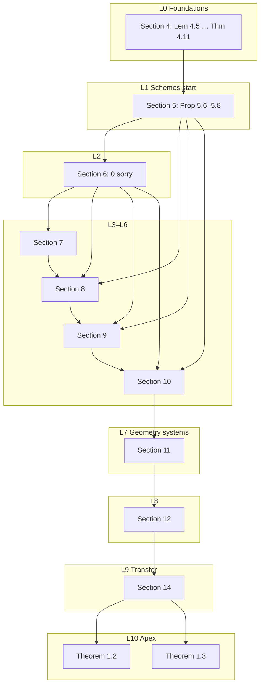

# Proof holes (BFS dependency order)

Inventory of Lean `sorry` holes in this repository, ordered **prove-first**: Layer 0
are holes with no remaining unfinished prerequisites; later layers wait on earlier
ones. Apex theorems 1.2 and 1.3 are **last**.

**Count:** 40 `sorry`, 0 `admit`.
Sections **2**, **3**, **4**, and **13** have no holes.

**Dependency basis:** paper/logical order from `dependencies.mermaid`
(`A --> B` means B waits on A), reconciled with the current hole set, plus
within-section paper numbering and Lean `Results`→`Results` imports
(S7–S11 on S5/S6).

**Note on Lean-import BFS:** A module-only BFS among hole-bearing `Results.lean`
files would place S1, S12, and S14 in Layer 0 because those stubs do not import
later Results. That ranking is wrong for prove-first work; this file uses the
logical order instead.

**Reconciliation with `dependencies.mermaid`:** The mermaid “Presentations”
subgraph (Lemmas 2.1–2.5, Theorem 2.6, Proposition 2.3 converse) is **filled**
(Section 2 has no `sorry`). Those nodes are omitted from the cluster DAG below.
Section 13 is complete and was never on that chain.

---

## Counts by section

| Section | Holes | File |
|--------:|------:|------|
| 1 | 2 | `AEC/Section1/Results.lean` (2) |
| 2 | 0 | — |
| 3 | 0 | — |
| 4 | 0 | — |
| 5 | 0 | — |
| 6 | 0 | — |
| 7 | 2 | `AEC/Section7/Lemma72Mixed.lean` (1), `AEC/Section7/MixedTiedLift.lean` (1) |
| 8 | 5 | `AEC/Section8/Results.lean` (5) |
| 9 | 6 | `AEC/Section9/Results.lean` (6) |
| 10 | 9 | `AEC/Section10/Results.lean` (9) |
| 11 | 7 | `AEC/Section11/Results.lean` (7) |
| 12 | 4 | `AEC/Section12/Results.lean` (4) |
| 13 | 0 | — |
| 14 | 4 | `AEC/Section14/Results.lean` (4) |
| **Total** | **39** | |

The table is the previous `Results.lean` rollup. The live count of declarations using
`sorry` is **32** (48 at the start of the overnight run). `WorkingScheme.exists_approximationSequence`
was retired (unused; Lemma 6.9 is `SingleModelData.exists_approximationSequence`).
Statement audit: `AEC/Audit/TinyAEC.lean` builds `tinyAEC` (empty language, at most one
element per model); `AEC/Audit/Counterexamples.lean` refutes unconditional Prop 10.2, the old
4th clause of Lemma 11.2, the old Lemma 10.8 statement (when a new realization exists),
unconditional Thm 9.3 (`emptyAEC`), and Thms 9.8, 11.9, 12.2, 14.3 for arbitrary face families /
geometric systems. `AEC/Section5/EmptiedScheme.lean` shows `IsWorkingPackage` is vacuous for
object-free schemes; Thm 8.6, Thm 9.3, Prop 10.6, Prop 11.7 have sorry-free degenerate proofs that way (counted as NOT done; board flag `degenerate`); Prop 11.6 is proved degenerately on a constant
geometric system (now with `[CategoricalUnbounded K]`).
`AEC/Audit/AllSets.lean` builds the AEC of all sets (chain unions are direct limits) and
`AllSetsMinimal.lean` a `MinimalData` on it; they refute Prop 10.7 as stated and the original
point-set hypotheses of Thm 10.9 / Cor 10.10 (restated to `P(B) = f[P(A)]`).
Overnight additions: `AEC/Audit/EqPattern.lean` (an `OrderPresentation` and a `StableDiagram` on the
AEC of all sets) refutes Lemma 12.6 as formalized and the original form of Lemma 12.5 (restated:
query type `ι` inside the hypothesis); `AEC/Audit/BoundaryGlue.lean` refutes Lemma 12.3 and
`AEC/Audit/FaceGlue.lean` refutes Lemma 9.7 (tops may glue faces along a non-face overlap);
`AEC/Audit/Counterexamples.lean` also refutes Claims 11.10 and 11.13 as formalized;
`AEC/Audit/PredSets.lean` (sets with a unary predicate + `MinimalData`) refutes the
unconditional Corollary 14.4 (restated with `[CategoricalUnbounded K]`).
**Degenerate closures are NOT counted as done** (board flag `degenerate`, status blocked):
Thm 8.6, Prop 9.1, Cor 9.2, Thm 9.3, Thm 9.6, Lem 10.1, Prop 10.6, Prop 11.6, Prop 11.7,
Claim 11.12 (the last via `AEC/Section11/Repiece.lean`). Each carries a proposed honest
restatement in `holes-graph.json`, as does every refuted-as-formalized node.
`AEC/Audit/NoPairs.lean` (a `MinimalData` with no independent pairs) refutes Lemma 10.4 and
Theorem 10.5 as stated: the abstract `productCopies` needs more axioms.

---

## Remaining hole clusters (prove-first DAG)

Within a layer, siblings are listed in paper number order.

---

## BFS layers (individual holes)

### L0 — Independent foundations (0 open)

No unfinished Results prerequisites. Section 3 is complete (Theorem 3.11 closed by the
`θ⁺ · a^θ` renaming kill); Section 4 (the diagrams/orbits stack) is complete (Theorem 4.11 closed
by the countable tower of Lemma 4.10 lifts into one categorical `E(J)`).

**Live board:** [`holes.html`](holes.html) + [`holes-graph.json`](holes-graph.json).
Edge **B→A** means the English proof of A requires B (no soft/narrative-only edges).
Blue = done; green = open; grey = blocked. No separate failed status unless a
counterexample refutes the program.

**Dependency rule:** edge B→A only if the English proof of A requires B, or A
needs an explicit Lean infra subgoal B (not a paper-number chain).

**Blocked (split):** `infra_78_mixed_level_isolation` — **grokbot cycle 31:** split into tracked sub-tips (`infra_78_fixed_list_eventually_free` **done**; `infra_78_same_level_type_amalgam` **done** (cycle 32), `infra_78_nonfree_extension_tied` **done** (cycle 33); `infra_78_bookkeeping_closure` split (cycle 34: `infra_78_mixed_ls_pair` **done**; `infra_78_code_copies_bounded` **done** (cycle 35); `infra_78_copies_persist_at_limits` **done** (cycle 36); `infra_78_bookkeeping_assembly` split (cycle 37: `infra_78_cardinal_closure` **done**; `infra_78_bookkeeping_sets_construction` split (cycle 38: `infra_78_bookkeeping_sets_abstract` **done**; cycle 39: `infra_78_bookkeeping_sets_instantiate` **done** ([`Bookkeeping.lean`](AEC/Section7/Bookkeeping.lean)), closing `infra_78_bookkeeping_sets_construction`; `infra_78_bookkeeping_req1_high_cof` / `req2_high_cof` now **open**; the matrix composition law and continuity at limits are tracked outputs of `infra_78_matrix_construction`; cycle 40: `infra_78_bookkeeping_req1_high_cof` **done** (with `Infra78Matrix.CompLaw` as explicit hypothesis); cycle 41: `infra_78_bookkeeping_req2_high_cof` **done** (with `CompLaw` + `ContAtLimits`), closing `infra_78_bookkeeping_assembly` and `infra_78_bookkeeping_closure`; `infra_78_matrix_construction` now **open**; cycle 42: `infra_78_matrix_construction` split (`infra_78_bookkeeping_stage_local` **done**, `infra_78_matrix_successor_step` / `infra_78_matrix_limit_step` open, `infra_78_matrix_recursion` blocked); cycle 43: `infra_78_matrix_successor_step` **done** ([`SuccessorStep.lean`](AEC/Section7/SuccessorStep.lean)), `infra_78_matrix_recursion` now blocked only on `infra_78_matrix_limit_step`; cycle 44: `infra_78_matrix_limit_step` split (`infra_78_chain_union_kappa` **done** ([`LimitStep.lean`](AEC/Section7/LimitStep.lean)), `infra_78_limit_pair` / `infra_78_limit_invariant5` open; cycle 45: `infra_78_limit_pair` **done**, identity law `Infra78Matrix.IdLaw` tracked on `infra_78_matrix_construction`; cycle 46: `infra_78_limit_invariant5` **done** for `|b| < cf δ` (all finite marks), bounded marks at small cofinality = paper's Def 7.7 hypothesis tracked as `infra_78_def77_bounded_marks`; `infra_78_matrix_limit_step` open (assembly); cycle 47: `infra_78_matrix_limit_step` **done**, `infra_78_matrix_recursion` now **open**; cycle 48: `infra_78_matrix_recursion` split (`infra_78_recursion_succ_stage` **done** ([`MatrixRecursion.lean`](AEC/Section7/MatrixRecursion.lean)), `infra_78_recursion_plumbing` open, `infra_78_recursion_outputs` blocked; cycle 49: `infra_78_recursion_plumbing` split (`infra_78_coherent_chain_engine` **done** ([`ChainEngine.lean`](AEC/Section7/ChainEngine.lean)), `infra_78_engine_matrix_instantiate` open; cycle 50: `infra_78_engine_matrix_instantiate` split (`infra_78_pair_chain_matrix` **done** ([`MatrixEngine.lean`](AEC/Section7/MatrixEngine.lean)), `infra_78_matrix_operators` open; cycle 51: `infra_78_matrix_operators` split (`infra_78_matrix_mark_ops` **done** ([`MatrixOperators.lean`](AEC/Section7/MatrixOperators.lean)), `infra_78_matrix_bookkeeping_ops` open; cycle 52: `infra_78_matrix_bookkeeping_ops` split (`infra_78_cand_coverage` **done**, coverage = all `S_i`-lists per the paper, `infra_78_rnext_closure` open; cycle 53: `infra_78_rnext_closure` **done** ([`RnextClosure.lean`](AEC/Section7/RnextClosure.lean): closure for the new pair, sizes, forward closure, continuity, pair closure, `S_i ≠ ∅`, requirements 1/2), closing `infra_78_matrix_bookkeeping_ops`, `infra_78_matrix_operators`, `infra_78_engine_matrix_instantiate` and `infra_78_recursion_plumbing`; `infra_78_recursion_outputs` now **open**; cycle 54: `infra_78_recursion_outputs` **done** ([`RecursionOutputs.lean`](AEC/Section7/RecursionOutputs.lean): seeds with base `X_0` and identity base map, (5) at every stage by induction incl. limits on the engine's cocone, `b ⊆ S_k`, `I_p ⊆ R_k`, failing-list property at every stage), closing `infra_78_matrix_recursion` and `infra_78_matrix_construction`; `infra_78_isolated_stage` now **open**; cycle 55: `infra_78_isolated_stage` split (`infra_78_isolated_stage_core` **done** ([`IsolatedStage.lean`](AEC/Section7/IsolatedStage.lean): Fodor contradiction for `cIdx`-lists, local character in the whole `ρ⁺`-union), `infra_78_isolated_stage_padding` open (shorter lists by padding / subtuple projection); cycle 56: `infra_78_isolated_stage_padding` **done** (pad with a point `p_i(x_i) ∈ S_i`, competitor padded with the same base point added to the fragment, injective diagram reindexing only), closing `infra_78_isolated_stage`; `infra_78_theta_shrink` now **open**; cycle 57: `infra_78_theta_shrink` split — `infra_78_theta_union` **done**, `infra_78_theta_chain` **open**, `infra_78_theta_free_identity` **open** (tied `IsTiedFreeMixed`); theta_shrink **blocked**; cycle 57b: `infra_78_theta_chain` **done** (+`infra_78_theta_chain_rc`), theta_shrink blocked on `infra_78_theta_free_identity`; cycle 58: `infra_78_theta_free_identity` **done** (tied), `infra_78_theta_shrink_inj` **done** (repetition-free `(b,c)`), `infra_78_theta_shrink_repeats` **open**, theta_shrink blocked on it; cycle 59: list-indexed requirement 2 → `infra_78_theta_shrink_repeats` **done**, `infra_78_theta_shrink` **done**, `infra_78_isolation_transfer` **open**; new open obligation `infra_78_theta_shrink_closure_level` (`λ ≤ σ` not implied by Lean `proposition_7_8` as stated); cycle 60: `infra_78_theta_shrink_closure_level` **done** via the better-closed existential tail `infra_78_closedTail` (paper: closure uniform in bounded arities, θ not fixed before the level; no hypothesis added to 7.8); cycle 61: `infra_78_isolation_transfer` split — `infra_78_isolation_over_A`, `infra_78_anchor_iso` **done**; `infra_78_marginal_anchor`, `infra_78_iso_rename` **open**; correction: the matrix level is chosen after θ, so λ ≤ σ is met by σ := λ; `infra_78_closedTail` remains the 7.8 tail (Lemma 7.6 closure at every θ < λ)))))))); open: `infra_78_bookkeeping_sets_instantiate`); blocked: `infra_78_bookkeeping_req1_high_cof`, `infra_78_bookkeeping_req2_high_cof`)); blocked: `infra_78_matrix_construction`, `infra_78_isolated_stage`, `infra_78_theta_shrink`, `infra_78_isolation_transfer`); the full claim stays tracked. **grokbot_02:** mixed-level tied freeness and Lemma 7.6 for `ν ≤ μ` are now proved (`infra_78_tied_free_lift_mixed` in `MixedTiedLift.lean`, `infra_78_lemma_7_6_mixed` in `MixedDescent.lean`); what remains is the `ρ⁺` matrix argument itself; its stationary combinatorics are done (`infra_78_stationary_combinatorics`: `infra_78_stationary_high_cof`, `infra_78_bounded_in_earlier_stage`, `infra_78_stationary_fixed_list`). **Audit (grokbot_02):** the untied `IsFreeFrom` is vacuous (`AEC/Audit/FreeFromVacuous.lean`: it holds whenever the restriction has an approximation sequence), so `lemma_6_11` and `proposition_6_13` were demoted to degenerate/NOT done (`proposition_6_13` is now restated with `IsTiedFree` and **done** in `AEC/Section6/LocalCharacterTied.lean`), and the fixed-list local-character contradiction is split off as open tip `infra_78_tied_local_character` (tied local character + base monotonicity), now **done** (`infra_78_tied_local`, with the testing reduction `infra_78_tiedFree_of_upTo`), so `infra_78_mixed_level_isolation` is open again. Follow-up audit: `proposition_6_12`, `lemma_6_17` and `infra_78_finite_continuity` also rest on the untied notion and were demoted to degenerate/NOT done (tied restatements proposed in `holes-graph.json`; `infra_78_finite_continuity` is now restated with `IsTiedFree` and **done**). Hard-edge counts in `holes-edges.txt` and `holes-graph.json` reconciled (4 file-only edges added to the JSON). Earlier notes: Proposition 7.8 shrinks a level-`κ` matrix `X_i ≤ Y_i` (`ρ⁺` stages, Fodor) to level-`λ` pairs `A ≤ U` and applies Lemma 7.6 with `A` at level `λ < κ`; the Lean tied-freeness / move / descent infrastructure is same-level only (`infra_73_move_iso` is a structural iso). Needed: mixed-level tied freeness and Lemma 7.6 for `ν < μ`. `proposition_7_8` is **blocked** on it (and its Lean statement, over an arbitrary `WorkingScheme`, should first be restated for `SingleModelData`). **Done this round:** `infra_76_arbitrary_fragment` / `lemma_7_6_tied` ([`TiedDescent.lean`](AEC/Section7/TiedDescent.lean): English Lemma 7.6 for an arbitrary isolating fragment along a tied-free lift; symmetry of the tied answer `infra_76_tied_majority`, fragment = an approximation list of `tp(W/A)`). `infra_73_block_restriction` ([`BlockRestriction.lean`](AEC/Section7/BlockRestriction.lean): block presentation `A ≅ E(σ⁺ ×ₗ μ)`, `J₀` = sequence supports ∪ a `χ₀⁺` reservoir per block, placements of `q` and `q'` (Prop 4.9 with `χ^σ = χ`), a block `b` met by neither placement, `A* = E(J₀ ∪ b)` with `g : A ≅ A*` fixing the sequence, differing tests moved inside `b` into the reservoir); hence `infra_73_alt2_tied_marginal` and the unconditional English uniform shrink `proposition_7_3_uniform`. **Done this run:** `infra_610_tied_free_lift` ([`TiedFreeLift.lean`](AEC/Section7/TiedFreeLift.lean)), `infra_73_tied_of_isolated` (restated: `hMargFree : IsFreeLift` → `hMargTied : IsTiedFree` on the `u`-marginal; the old form was false), `infra_72_over_B_isolation`, `lemma_7_2` (English form `lemma_7_2_tied`), `objectOfEmptyChain` sorry removed (`lemma_5_4` gains `hObj`). Retired and removed: `infra_69_transfer_sequence`, `infra_610_same_head_transfers_joint`. `lemma_7_6` done (English form `lemma_7_6_tied`). `proposition_7_5` stays done. `infra_78_finite_continuity` done (Def 7.7 for finite marks via the tied Prop 6.13).

**Definition 5.2 repairs (made for Proposition 5.6).** The planned statement of Proposition 5.6 (a working package with an object at every eligible level) was refutable from the definitions; each obstruction was checked in Lean before the repair.
1. `WorkingScheme.diagram_iso` is now for lists with `#α < μ`, and `WorkingScheme.diagram_preserved` for lists with `#α < μ` and `#α < ν` (`AEC/Section5/WorkingScheme.lean`). Unbounded, the two fields applied to the list of all occurrences of an object made every permitted arrow between objects at one level vertexwise bijective; the stable diagram `D` only controls bounded lists. `diagram_refl`, `diagram_symm`, `diagram_trans`, `diagram_reindex`, `diagram_restrict`, `diagram_empty` are unchanged.
2. `IsSaturated.saturated` now assumes `∀ i, ext (Sum.inl i) = base i` (`AEC/Section5/PackageClauses.lean`): the witness extends the list whose diagram is that of the actual list. Before, `ext` was unrelated to `base` and `xs`, and the clause failed for a constant `ext` over an injective `xs`.
3. `HasChainUnions.union` now assumes the cocone condition `∀ i j, SystemArrow.comp (le i j) (toZ j) = toZ i` in its universal property (`AEC/Section5/PackageClauses.lean`). This repair was not planned: after 1 and 2 the statement was still refutable, since for a two-element constant family the clause identified any two permitted arrows `X → Z`, which with mixed downward closure refutes every package that has an object.

Callers: `namedWorkingScheme` now takes `hι : #ι < μ0`, `hTail : ∀ μ ∈ T, μ0 ≤ μ`, `hinf : ∀ μ ∈ T, ℵ₀ ≤ μ` (a bounded list together with the names is bounded); `named_index_lt_of_tail` and `sum_mk_lt_of_lt` moved to `NamedWorkingScheme.lean`. Props 5.7, 5.8, 5.9 remain proved without `sorry`.

**Known residual in `HasChainUnions`.** The clause quantifies over arrows `le i j` for *every* ordered pair `(i, j)`, composing strictly, so its families consist of mutually inverse isomorphisms; with the cocone condition the clause holds in every scheme (take `U := obj i₀`). A faithful clause would index `le` over `i ≤ j` in a directed order. It was left unchanged (minimal repairs); the real content for single models is `SingleModelData.exists_directed_union`. Re-index the clause when Sections 6–11 first need a chain union.

**Lemma 6.1 is done, with a repaired statement** (`AEC/Section6/ParameterOrbits.lean`). The bare-scheme statement was refutable (`DiagramEq` may be equality of lists). Assuming a working package with presentations is not enough: `IsWorkingPackage` and `HasPresentations` do not make the automorphisms of the vertex models, which Lemma 4.5 produces, structural isomorphisms of the scheme (counterexample pattern, not formalized: isomorphisms that preserve a colouring by more than `χ` colours). The statement now has:
1. `hiso : AssemblesStructIso W b` (new definition): at every object there is a set `B` of at most `b` occurrences such that strong vertex automorphisms fixing `B` and commuting with the specified maps are the vertex maps of a structural isomorphism. The English bound `b` and `hb : b + σ < χ` are kept.
2. `hχ : ls K + 2^(2^σ) ≤ χ`, the bound of Lemma 4.5, `hcat : ∀ μ ∈ W.eligible, Categorical K μ`, and `[CategoricalUnbounded K]`.
3. `hedge : ∀ i j, ¬ S.specified i j`: the shape has no specified map. Lemma 4.5 gives vertex automorphisms one vertex at a time, and they need not commute with the maps of a system. Any finite number of vertices is covered. A one-vertex hypothesis was not used: it is not needed, and it does not suffice for this proof (one vertex with a specified map to itself).

`IsWorkingPackage` and `HasPresentations` are not hypotheses; the proof does not use them. `hiso` holds for the Prop 5.6 scheme with `b = 0` (`SingleModelData.assemblesStructIso`, from `assemblesStructIso_bijective`) and for the Prop 5.7 named scheme with `b + #names` (`WorkingScheme.assemblesStructIso_named`). `SingleModelData.exists_parameter_orbit_reps` is the lemma for the Prop 5.6 scheme with no scheme hypothesis left. `proposition_5_6` does not export `hedge`, `hcat` or `hiso` for its existential scheme: callers of Lemma 6.1 use `SingleModelData.scheme` directly, or the statement of Prop 5.6 has to be extended. Shapes with specified maps remain open for Lemma 6.1 (they need orbits of system automorphisms, not of vertex automorphisms). Hard edge `4.5 → 6.1` added; Prop 6.3 is done (PlacedTester packaging); Lemma 6.4 is done; Lemma 6.5 is done (next paragraph).

**Lemma 6.5 is done, with a repaired statement** (`AEC/Section6/PlacedComparisons.lean`). The old Lean form had `SameGaloisType` (scheme amalgamation) on the left of the iff; that is Theorem 6.6, and English Lemma 6.5 says its argument "does not require an amalgamation relation on types". Its `g` was only monotone (the iff fails for small `g`), and a bare `WorkingScheme` has no presentation in which to place a tuple. The statement is now at the level of a presentation, like Prop 6.3 and Lemma 6.4: `hL : ClosedLevel K E D g μ`, `I` a well-order of size `μ`, `A = E(I)`, and tuples `d₀`, `d₁` of length at most `σ < μ` in strong `μ`-extensions `B₀`, `B₁` of `A`. It has three clauses:
1. existence: some placement over `I` lifts the bounded diagrams of `d₀` (`Placement.LiftsBounded`), from `exists_boundedDiagramLift` (Lemma 4.10);
2. uniqueness: two such placements agree over all of `A` (`Placement.AgreeOn … Set.univ`), from `Placement.LiftsBounded.agreeOn_univ`. This clause is not in the planned statement; it is the English sentence "unique as a diagram over all of `A`";
3. testing: for lifts `P₀` of `d₀` and `P₁` of `d₁`, `P₀.AgreeOn E D P₁ Set.univ` iff the diagrams of `d₀` and `d₁` agree at the bounded levels `ρ < μ` over all `p : β → A` with `#β ≤ g σ + ls K` (the right side of Theorem 4.11 (2)). `←` is `agreeOn_univ_of_tests` (the placed tester). `→` is new, `Placement.LiftsBounded.same_of_agreeOn`: equal comparisons make `P₀` lift `d₁` as well (`Placement.LiftsBounded.of_agreeOn`), so both tuples have the diagram of its placed tuple; it holds for every bounded query, without the bound on `#β`.

`σ` is any infinite bound on the length, in place of `|v| + ℵ₀`. The separate hypothesis `hg : PlacedTester K E D g` of the planned statement is omitted, since it is the field `hL.tester`. `hs₁ : K.Strong incl₁` is kept but not used by the proof (a comparison of `d₁` is a hypothesis of clause 3). The last sentence of the English statement (other natural parameter layouts) is not formalized: `NaturalParameterLayout` has no placement data. Hard edges `4.10 → 6.5`, `4.8 → 6.5` and `6.3 → 6.5` added (the English proof says Proposition 6.3 identifies the full placed comparisons; in Lean its `PlacedTester` is the tester of `ClosedLevel`); `6.4 → 6.5` stays hard (the English proof applies Lemma 6.4, and the Lean proof reaches the same `compact_placement` through Lemma 4.10). Theorem 6.6 is done (next paragraph). By hard edges alone `lemma_5_4`, `lemma_5_5`, `proposition_5_8`, `proposition_5_9` and `lemma_6_1` do not reach the apex (`lemma_6_1` has only the soft edge to `proposition_6_3`); the header of `holes-edges.txt` now says so.

**Theorem 6.6 is done, with a repaired statement.** The old Lean form quantified over a bare `WorkingScheme` with unconstrained `g` and ad-hoc vertex matching (`SameGaloisType` / scheme amalgamation), which is refutable. It is now the presentation-level packaging of `ClosedLevel.amalgamation` and `ClosedLevel.tuple_amalgamation_iff` under `hL : ClosedLevel K E D g μ`: strong `μ`-extensions of a `μ`-model amalgamate, and an amalgam identifying two bounded tuples exists iff their diagrams agree on parameter queries of size at most `g(σ) + ℓ` at levels `ρ < μ`. The English ω-tower / Lem 6.4–6.5 argument is already the engine of Theorem 4.11 (2); Section 6 numbering packages that. Hard edge `4.11 → 6.6`; `6.5 → 6.6` softened (English narrative). Corollary 6.7 is done (next paragraph).

**Corollary 6.7 is done, with a repaired statement** (`AEC/Section6/LargerLevelRealization.lean`). The old Lean form quantified over a bare `WorkingScheme` (`Tail` / `SystemArrow` / `permitted`) with no closed levels, strongness, sizes or testing bound for the Theorem 4.11 engine to use, and it had neither the prescribed tuple nor the type clause of the English statement. It is now at the level of a presentation, like Theorem 6.6, under two closed levels `hν : ClosedLevel K E D g ν`, `hμ : ClosedLevel K E D g μ`, `ν < μ`, for a strong `f : A → B` of `ν`-models and a strong `i : A → N` into a `μ`-model. It has three clauses:
1. realization: a strong `F : B → N` with `F ∘ f = i` (`exists_strong_embedding_into_larger_base`, the empty tuple in clause 2);
2. prescribed tuple: for `d : α → B`, `z : α → N` with `#α < ν`, if the diagrams of `(d, f p)` and `(z, i p)` agree at the bounded levels `ρ < ν` over all `p : β → A` with `#β ≤ g(#α ⊔ ℵ₀) + ls K`, there is such an `F` with `F ∘ d = z` (`exists_strong_embedding_into_larger`);
3. actual `ν`-types: a tuple `x : α → N` with `#α < ν` lies in a strong `ν`-submodel `B'` of `N` containing `A`, and the diagrams of `(x, i p)` in `N` and of its copy in `B'` agree at every bounded level `ρ < ν` (`exists_actual_nu_type`: exact-size strong hull, coherence, `D.of_strong`).

Proof of clause 2. Identify `N` with its chart `E(Below μ)` (categoricity at `μ`). The images of `A` and `z` are at most `ν` terms, so they lie in `N₀ = E(S)` for a suborder `S ⊆ Below μ` of size `ν` (`exists_suborder_cover`), and `A → N₀` is strong by coherence. `B` and `N₀` are `ν`-sized strong extensions of `A` whose tuples pass the tests, so Theorem 4.11 (2) at `ν` (`ClosedLevel.exists_tuple_amalgam`) gives a `ν`-sized amalgam `P` over `A` identifying `d` with `z`. Now `N₀ → N` is an order map of the presentation and `μ ≥ t(ν)` is a categoricity cardinal, so the countable tower of Theorem 4.11 at the source level `ν` (`exists_strong_embedding_over`, with target chart `J = Below μ`) embeds `P` into `N` over `N₀`; the target is not enlarged. The English proof runs the exhaustion of Theorem 6.6 directly into `N`: it places each new tuple in a chart of `N` and uses saturation at `μ` to realize the joint diagram of the placed tuple, `A` and the previously assigned list back in `N`. That saturation step is not formalized. A direct Lean version by lift extensions was tried and not closed: a lift found over the chart of `A` lives in a presentation `E(J₁)`, and `D.exists_transport` into `N` matches the previously assigned list but not the image of `A`; fixing all of `A` would take a comparison of length `ν` between its images in `N` and in `E(J₁)`, and `D.of_strong` from the `ν`-model `A` does not give one (`t(ν) > ν`). Passing through `N₀ = E(S)` makes the inclusion into `N` an order map, where the level-`ν` comparisons of Theorem 4.11 apply. Hard edge `4.11 → 6.7`; `6.6 → 6.7` softened (the English proof reuses the exhaustion of Theorem 6.6; the Lean proof calls `ClosedLevel.exists_tuple_amalgam` and `exists_strong_embedding_over`, not `theorem_6_6`). Soft edge `corollary_6_7 → lemma_6_9` (English 6.9 does not use Cor 6.7). Theorem 6.10 is unblocked (hard `lemma_6_9 → theorem_6_10`).

**Lemma 6.9 is done for `SingleModelData`.** The chain is `infra_69_recursion_tail`, then `infra_69_assemble` at a same-level tuple `p.ν = μ`. Theorem 6.10 is restated the same way. `stationary_free_extension_exists` packages `IsFreeLift` by amalgamating `p`'s host with `B` and pushing majority values along the `B` leg. A single head in `B` for every parameter list is retired (`qPres_empty_joint_on_I`, `preserves_atomic`). Per-query realization is `qPres_empty_free`. Demoted: `same_head`. Soft-pad placeRoot / global `placement_to_B` stay retired. Majority uniqueness is proved. No constant-family alternate.

**Lemma 6.11 has a sorry-free same-level `SingleModelData` proof (demoted grokbot_02: degenerate, untied `IsFreeFrom` conclusion is vacuous).** `infra_611_fresh_code` builds a Lemma 6.9 code for `p = q.restrict`. The given sequence and that code meet in `infra_611_bridge` (`infra_610_majority_eq_type`, `infra_610_majority_unique`). `infra_611_code_majority` transports the majority onto `q ↾ Z`. Parameter queries are moved by `infra_610_move_query` (`infra_611_image_agree`); `infra_610_same_galois` is the testing criterion. `IsFreeFrom` is that `IsFreeLift`. Mixed `ν < μ` is deferred. Proposition 6.12 is done for same-level existence and anchored independence. Proposition 6.13 (**demoted grokbot_02: degenerate, its untied `IsFreeFrom` conclusion is vacuous**) has sorry-free same-level local character and continuity (`SameLevelChain`, stage-trapped Lemma 6.9 code, `infra_611_isFreeFrom`, `infra_613_freeFrom_trans`). Hard board edges into §7: `proposition_7_8`, `lemma_7_11`, `theorem_7_13` (Def 7.7 / local character). Soft only to `proposition_6_15`. Mixed levels stay deferred. Proposition 6.15 is done for the two-sided strip (`G = P.E`); `infra_615_terminal` is the one-sided specialization. Corollary 6.16 is done for `SingleModelData` (μ blocks on `lvlOrder μ ×ₗ (ℕ ×ₗ lvlOrder μ)`, middle-strip exhaustion postcomposed back onto `A`). Lemma 6.17 has a sorry-free mixed `ν ≤ μ` proof (`DescentRetraction.lean`) but is demoted (grokbot_02: untied `IsFreeLift` conclusion, degenerate). `infra_610_tied_free_lift` done. Open tip: `infra_78_mixed_level_isolation` (blocks `proposition_7_8`). Lemma 7.2 English-complete (`lemma_7_2_tied`); Prop 7.3 English uniform green (`proposition_7_3_uniform`); Lemma 7.6 English green (`lemma_7_6_tied`); Path A Lean Results stay green.

**Wired (intended use, reach apex):** `5.6 → 9.3, 10.2`; `5.7 → 9.3, 10.6, 10.8`;
`2.3 → 1.2`; `3.11 → 4.2, 5.8`; `4.2 → 4.9, 4.10, 4.11`; `4.3 → 4.10, 4.11`; `4.5 → 6.1`; `4.6 → 4.9`; `4.7 → 4.8, 12.5`; `4.8 → 4.10, 4.11, 6.3, 6.5`; `4.10 → 4.11, 6.5`; `6.3 → 6.5`; `6.4 → 6.5`; `4.11 → 5.6, 6.6, 6.7`; `infra_69_place_on_fills → infra_69_assemble → 6.9` (hard; 6.9 done for `SingleModelData`); `infra_610_move_query → infra_610_free_root / infra_610_param_freeing_qPres → infra_610_chart_support → infra_610_moved_majority → infra_610_root_majority + infra_610_root_galois → infra_610_chart_prescriptions → infra_610_place_prescriptions → infra_610_majority_of_placement → infra_610_majority_prescription → infra_610_place_on_B → stationary_free_extension_exists → 6.10` with `infra_610_majority_matches_root → infra_610_majority_prescription` and `infra_610_galois_tests_of_placement → infra_610_majority_prescription` with `infra_610_closed_level → infra_610_same_galois → infra_610_isFreeLift_same_galois` (hard restore tip; majority path soft on same_galois; E5 tipport / moved_majority / root_majority done; E5d′/E5e reflected done; `IsFreeLift` majority-only)
Full hard-edge list: [`holes-edges.txt`](holes-edges.txt). Target: every Results/paper
node reaches Thm 1.2 or 1.3; completed work should admit dead-code analysis of each edge.

| Decl | Title | Location |
|------|-------|----------|
| `theorem_3_11` | Theorem 3.11 | `AEC/Section3/Results.lean` (**done**: no `sorryAx`; recurring-profile pigeonhole `exists_asymmetric_common_setup` in `ReversalKill.lean`, Prop 3.9 alignment, `θ⁺ · a^θ` kill `exists_killed_copy` in `RenamingKill.lean` via chains of strong self-maps `selfChainRec`) |
| `proposition_4_3` | Proposition 4.3 | `AEC/Section4/Results.lean` (**done**: `prop43_hull_back_and_forth` in `Prop43BAF.lean`; hull back-and-forth on `HullMatch` stages, uses the new `StableDiagram.trans` field) |
| `lemma_4_5` | Lemma 4.5 | `AEC/Section4/Results.lean` (**done**: no `sorryAx`; mixed S⊕new occupancy closed in `fingerprint_same_order_and_occupancy`) |
| `lemma_4_6` | Lemma 4.6 | `AEC/Section4/BlockInterchange.lean` (**done**: English tree/repeat/orbit via `BlockRegions` + `lemma_4_5_with_E`; `DisjointBlockSwap` packaging is degenerate) |
| `lemma_4_7` | Lemma 4.7 | `AEC/Section4/Results.lean` (**done**: `type_u_witness_set_param`) |
| `proposition_4_8` | Proposition 4.8 | `AEC/Section4/Results.lean` (**done**: no `sorryAx`; `g σ = max ℵ₀ σ`, test set = joint support `testingSet`; `sameNaturalDiagram_restrict_iff` via the cut-lex amalgam `exists_linearOrder_amalgam` in `UniformTesting.lean`. Statement changes: `DiagramsDifferOnSubset` now compares the restrictions of the given placements, and the hypothesis `ℵ₀ ≤ σ` was added since `StableDiagram.of_strong` is only available for infinite `σ`) |
| `proposition_4_9` | Proposition 4.9 | `AEC/Section4/Results.lean` (**done**: no `sorryAx`; English support-profile obstruction `compact_placement` in `CompactPlacement.lean`: profiles over `S_X` (`SameProfile`, `SupportProfile.ofTerms`, at most `χ` codes `mk_profileCode_le`), no-event continuations `exists_inert_continuation`, no-event comparison by Lemma 4.6 on the slots `sameNaturalDiagram_of_sameProfile_noEvent`, local realizability by Prop 4.2 `exists_local_placement`, `σ⁺` stages with at most `σ` new events. Statement changes: added `[CategoricalUnbounded K]`, `ℵ₀ ≤ σ`, the natural-parameter clause `hnat` and the coherence clause `hcoh`; possibility needs no hypothesis since the prescription for `p` is the diagram of the tuple `q p` of `E(I)`) |
| `lemma_4_10` | Lemma 4.10 | `AEC/Section4/Results.lean` (**done**: no `sorryAx`; `boundedDiagramLift` in `BoundedDiagramLift.lean`: cofinal `χ = 2^(κ ⊔ σ)`, prescription `(φ ∘ d, p)` for a strong `φ : B → E(I)` fixing `p` (`exists_paramFixing`), `compact_placement` at `χ` (`exists_placement_lifting`), agreement of two lifts on `≤ g(σ)` positions (`agreeOn_of_lifts`) and hence everywhere by the placed tester, uniqueness `Placement.LiftsBounded.agreeOn_univ`, restriction `Placement.LiftsBounded.reindex`; the placed tester is the English Prop 4.8 over the base, `exists_placedTester` in `PlacedTesting.lean` (`FrozenData`, `Layout`, Lemma 4.7), exposed as `proposition_4_8_over_base`. Statement changes: the old statement was vacuous (each test clause assumed `D.t μ ≤ Model.card B` with `Model.card B = μ < D.t μ`); the lift clauses are now at bounded levels `ρ < μ`, `J` is produced with `D.t μ ≤ ‖E(J)‖`, uniqueness is the level-`μ` comparison over all of `A`; added `[CategoricalUnbounded K]`, `hcat : Categorical K μ`, `ℵ₀ ≤ σ`, `hg : PlacedTester K E D g`) |
| `theorem_4_11` | Theorem 4.11 | `AEC/Section4/Results.lean` (**done**: no `sorryAx`; `S` = closure points `μ > ℓ` of `{t, g}`, unbounded by `exists_closurePoint_ge` and categorical by Prop 4.3 (`categorical_of_closurePoint`) in `ClosedLevels.lean`. `ClosedLevelAmalgam.lean`: `A ≅ E(I)`, `I` of order type `μ`; `G = E(J)` of a categoricity size `≥ t(μ)`; `LiftsTuple` (a tuple of `E(J)` lifting the bounded diagrams over `A`), one step `exists_lift_extension` (Lemma 4.10 lift, uniqueness at level `μ`, transport into `G` by `StableDiagram.exists_transport`), countable tower of small strong submodels `exists_strong_tower`, each lifted stage strong by `to_strong` (`exists_strong_of_liftsTuple`), union `exists_strong_of_nat_exhaustion`, giving `exists_strong_embedding_over` and the amalgams `exists_amalgam_of_common_lift` / `exists_amalgam_of_agreeOn`; clause 2 from the placed tester `agreeOn_univ_of_tests` and necessity `StableDiagram.same_of_amalgam`. `ClosedLevelTypes.lean`: clauses `ClosedLevel.amalgamation`, `ClosedLevel.tuple_amalgamation_iff`, `ClosedLevel.singleton_types`; singleton codes = label + cuts of the finite support in `I` (`Placement.singletonCode`, `mk_singletonCode_le`, `Placement.AgreeOn.of_sameProfile_univ`). Statement changes: added `[CategoricalUnbounded K]`, `E : OrderPresentation K`, `hg : PlacedTester K E D g` (replacing monotone `g`); clause 2: added `ℵ₀ ≤ σ`, and the old right side, vacuous under `D.t μ ≤ Model.card Bᵢ`, is now the tests at the bounded levels `ρ < μ` over **all** parameter lists `p : β → A` with `#β ≤ g σ + ls K` (`β` is quantified inside the iff: with one fixed `β` the iff fails for small `β`; `+ ls K` because `PlacedTester` bounds positions of `I`, and `≤ g(σ)` positions support `≤ g(σ) + ℓ` elements); clause 3: the old form compared `x, y ∈ A` under `g₀ = g₁` on `A`, which forces `x = y` and is satisfied by any injection `A → μ`; now `code B f x` for elements of all `μ`-extensions `(B, f)` of `A`, with equal codes iff an amalgam over `A` identifies them (the old form is the case `B₀ = B₁ = A`)) |

Section 4 is complete: Theorem 4.11, its last hole, is done (hard deps 4.2, 4.3, 4.8, 4.10 closed).

### L1 — Section 5 after diagrams (0 open)

Proposition 5.6 is done (single-model working package on the closure points of `{t, g}` above `ℓ`). The former seed-object hole `objectOfEmptyChain` is closed: it now takes the hypothesis `hObj : ∀ μ hμ, Nonempty (W.Object μ hμ)` (the existence half of Definition 5.2(2), not recorded by `HasPresentations`), which `lemma_5_4` takes and `proposition_5_6` supplies for single models. Section 5 has no `sorry`.

| Decl | Title | Location |
|------|-------|----------|
| `proposition_5_6` | Proposition 5.6 | `AEC/Section5/Results.lean` (**done**: no `sorryAx`; `SingleModelData.scheme` in `SingleModelScheme.lean` and `SingleModelData.isWorkingPackage` in `SingleModelPackage.lean`. One vertex; objects at `μ` = `K`-structures on the carrier `μ.ord.ToType` in `K` (`SMObject`); arrows = strong maps; eligible = closure points of `{D.t, g}` above `ls K`; `E` from `exists_orderPresentation_of_categoricalUnbounded`, with `CategoricalUnbounded K` from `D`. `DiagramEq` compares two lists by `D.same` inside the presentation `E(ρ)` at every eligible `ρ` above both levels and the length, after canonical charts (`chart`, `push`); for lists bounded at both levels it is `D.same` in the models (`diagramEq_iff_sameD`); `diagram_iso` by Prop 4.3. Saturation `exists_saturation`: a Prop 4.3 automorphism of `E(max μ ν)` moves the base of the witness onto the actual list, then a strong hull of size `μ`. Statement changes: inputs stay `(K) (D) (g)`; the conclusion is now `∃ S W, IsWorkingPackage W ∧ HasPresentations W W.template ∧ (∀ μ hμ, Nonempty (W.Object μ hμ)) ∧ Nonempty S.Vertex ∧ Subsingleton S.Vertex ∧ (∀ κ, ∃ μ, κ ≤ μ ∧ μ ∈ W.eligible) ∧ ∀ μ ∈ W.eligible, IsClosurePoint {D.t, g} μ`, the hypotheses that Proposition 5.7 consumes. Needed the Definition 5.2 repairs above. Feeds Thm 9.3, Prop 10.2) |
| `infra_single_model_scheme` | Single-model WorkingScheme | `AEC/Section5/SingleModelScheme.lean` (**done**: `oneVertexShape`, `SMObject`, `SingleModelData`, `SingleModelData.DiagramEq`, `SingleModelData.scheme`; no `sorry`) |
| `infra_single_model_package` | Single-model package clauses | `AEC/Section5/SingleModelPackage.lean` (**done**: `nonempty_object`, `hasPresentations`, `hasMixedDownward`, `isSaturated`, `satisfiesExhaustion`, `hasChainUnions`, `isWorkingPackage`, `exists_directed_union`; no `sorry`) |
| `proposition_5_7` | Proposition 5.7 | `AEC/Section5/Results.lean` (**done**: no `sorryAx`; `exists_named_realization_of_arrow` via `wellOrder_arrow` + `diagram_preserved` in `NamedRealizationExistence.lean`; packaged with `namedWorkingScheme` / `isWorkingPackage_namedWorkingScheme` on `eligibleTail (μ0 ⊔ ℵ₀)`; the named scheme takes `#ι < μ0` and the tail bounds after the Definition 5.2 repairs) |
| `infra_template_fixed_support` | Template F(J+H) | `AEC/Section5/TermTemplate.lean` (**done**: `withFixedSupport`, `sumLexEmbedRight` / `sumLexEmbedLeftIncl`, `fixedSupportArrow`) |
| `infra_eligible_reclass` | Convention 5.3 tails / Lim | `AEC/Section5/EligibleSubclass.lean` (**done**: `eligibleTail`, `EligibleSubclass.tail` / `lim` / `aboveNamingThreshold`) |
| `infra_named_working_scheme` | Named WorkingScheme ctor | `AEC/Section5/NamedWorkingScheme.lean` (**done**: `WorkingScheme.IsStructIso` + `namedWorkingScheme` packer; no `sorry`) |
| `infra_named_working_package` | Named package transfer | `AEC/Section5/NamedPackageTransfer.lean` (**done**: `isWorkingPackage_namedWorkingScheme`; no `sorry`) |
| `objectOfEmptyChain` | Seed object at eligible level | `AEC/Section5/Results.lean` (**done**: takes `hObj` instead of a `sorry`; `lemma_5_4` gains `hObj`; `infra_69_present_padded`/`infra_69_chart_iso` use `A` itself and no longer call `lemma_5_4`) |
| `proposition_5_8` | Proposition 5.8 | `AEC/Section5/Results.lean` (**done**: Lean residual via `diagram_iso` + `structural_iso`) |

### L2 — Section 6 unlock (Lem 6.9 infra board + package)

Waits on Section 5 working package. Lean: later Results import this module.

| Decl | Title | Location |
|------|-------|----------|
| `lemma_6_1` | Lemma 6.1 | `AEC/Section6/Results.lean` (**done**: no `sorryAx`; `WorkingScheme.exists_parameter_orbit_reps` in `ParameterOrbits.lean`: Lemma 4.5 at each vertex over the parameters and the exceptional occurrences (`exists_vertexwise_orbit_reps`), `AssemblesStructIso`, `W.diagram_iso` for the list of length `≤ χ < μ`; tail = eligible levels above `χ` and the threshold of Lemma 4.5. Statement changes: added `[CategoricalUnbounded K]`, `hedge`, `hcat`, `hχ`, `hiso : AssemblesStructIso W b`; `b` and `b + σ < χ` kept; see the paragraph above) |
| `proposition_6_3` | Proposition 6.3 | `AEC/Section6/Results.lean` (**done**: no `sorryAx`; `exists_layoutTestingFunction` in `LayoutTesting.lean` packages `exists_placedTester` as `TestingFunction layout` with `g.g σ = max σ g0 σ`. Statement repair: dropped `SameGaloisType`/`Tail`/`WorkingScheme` (English placed comparisons; amalgamation is Lem 6.5); inputs `[CategoricalUnbounded K]`, `E`, `D`, `layout`. Softened false `6.1→6.3` and `6.3→6.4`; hard `4.8→6.3`, `4.7→6.3`) |
| `lemma_6_4` | Lemma 6.4 | `AEC/Section6/Results.lean` (**done**: no `sorryAx`; alias of `proposition_4_9` / `compact_placement`. Statement repair: presentation-level with `hnat`/`hcoh`; dropped bare `WorkingScheme` and unused `b`; `hχ = ls K + σ < χ`. Hard `4.9→6.4`) |
| `lemma_6_5` | Lemma 6.5 | `AEC/Section6/Results.lean` (**done**: no `sorryAx`; `placedComparisons` in `PlacedComparisons.lean`: `exists_placedComparison` (`exists_boundedDiagramLift`), `placedComparison_unique` (`Placement.LiftsBounded.agreeOn_univ`), `placedComparison_agree_iff_tests` (← `agreeOn_univ_of_tests`, → `Placement.LiftsBounded.same_of_agreeOn`). Statement repair: dropped `SameGaloisType`/`Tail`/`WorkingScheme` and the monotone-only `g`; presentation-level under `ClosedLevel K E D g μ`, with existence, uniqueness over all of `A`, and the testing iff at bounded levels `ρ < μ` with `#β ≤ g σ + ls K`. Hard `4.10→6.5`, `4.8→6.5`, `6.3→6.5`; `6.4→6.5` kept hard) |
| `theorem_6_6` | Theorem 6.6 | `AEC/Section6/Results.lean` (**done**: no `sorryAx`; packages `ClosedLevel.amalgamation` and `ClosedLevel.tuple_amalgamation_iff`. Statement repair: dropped bare `WorkingScheme`/`SameGaloisType`/unconstrained `g`; presentation-level under `ClosedLevel K E D g μ`. Hard `4.11→6.6`; soft `6.5→6.6`) |
| `corollary_6_7` | Corollary 6.7 | `AEC/Section6/Results.lean` (**done**: no `sorryAx`; `exists_strong_embedding_into_larger`, `exists_strong_embedding_into_larger_base`, `exists_actual_nu_type` in `LargerLevelRealization.lean`: chart `N ≅ E(Below μ)`, suborder `S` of size `ν` covering the images of `A` and the tuple (`exists_suborder_cover`), `ClosedLevel.exists_tuple_amalgam` at `ν`, then `exists_strong_embedding_over` at `ν` into the chart of `N`. Statement repair: dropped bare `WorkingScheme`/`Tail`/`SystemArrow`; presentation-level under `ClosedLevel` at `ν < μ`, with realization, prescribed tuple (tests `#β ≤ g(#α ⊔ ℵ₀) + ls K` at `ρ < ν`) and actual `ν`-types. Hard `4.11→6.7`; soft `6.6→6.7`) |
| `infra_55_one_point_cut` | Infra: one-point cut | `AEC/Section5/OrderPatternRealization.lean` (**open**) |
| `infra_55_enumerate_added` | Infra: enumerate added | `AEC/Section5/OrderPatternRealization.lean` (**open**) |
| `infra_55_pattern_realize` | Infra: pattern realize | `AEC/Section5/OrderPatternRealization.lean` (**open**: was `order_pattern_realized_over_old`) |
| `infra_69_present_padded` | Infra: present padded | `AEC/Section6/UniformApproximations.lean` (**open**) |
| `infra_69_chart_iso` | Infra: chart iso | `AEC/Section6/UniformApproximations.lean` (**open**) |
| `infra_69_place_type` | Infra: place type | `AEC/Section6/UniformApproximations.lean` (**done**: placement ≤τ on the IsPadded well-ordered skeleton; that skeleton does not fill cuts) |
| `infra_69_pad_recursion` | Infra: σ⁺ profile recursion | `AEC/Section6/PaddedPlacement.lean` (**done**: `β₀`, `2^β+σ+b`, suprema at limits) |
| `infra_69_pad_recursion_closed` | Infra: recursion below the level | `AEC/Section6/PaddedPlacement.lean` (**done**: the hypothesis, not a `{D.t,g}`-closure theorem) |
| `infra_69_pad_exists_closed` | Infra: recursion-closed levels | `AEC/Section6/PaddedPlacement.lean` (**done**: cofinality-`ℵ₀` strong limits above one full recursion) |
| `infra_69_pad_downset` | Infra: down-set profile code | `AEC/Section6/PaddedPlacement.lean` (**done**: no `leastElt`; equal codes are `SameProfile`) |
| `infra_69_pad_count` | Infra: down-set profile count | `AEC/Section6/PaddedPlacement.lean` (**done**: at most `2^{\|S\|+σ+b}`) |
| `infra_69_pad_stage_card` | Infra: σ⁺ stage cardinals | `AEC/Section6/PaddedPlacement.lean` (**done**: stages and their union stay under the recursion) |
| `infra_69_pad_obstruction` | Infra: padded profile obstruction | `AEC/Section6/PaddedPlacement.lean` (**done**: `σ⁺` first-time events; reuses inert continuation, no-event comparison, event codes, local placement) |
| `infra_69_place_on_fills` | Infra: place on cut-filling chart | `AEC/Section6/UniformApproximations.lean` (**done**: under `infra_69_pad_recursion_closed`; one `Placement` over the padded chart lifting joints of size at most `max σ τ`) |
| `infra_69_shared_supports` | Infra: shared supports | `AEC/Section6/UniformApproximations.lean` (**open**) |
| `infra_69_cut_clusters` | Infra: cut clusters | `AEC/Section6/UniformApproximations.lean` (**open**) |
| `infra_69_separators` | Infra: separators | `AEC/Section6/UniformApproximations.lean` (**open**) |
| `infra_69_include_shared` | Infra: include shared | `AEC/Section6/UniformApproximations.lean` (**open**) |
| `infra_69_anchor_bound` | Infra: anchor bound | `AEC/Section6/UniformApproximations.lean` (**open**) |
| `infra_69_slot_assignment` | Infra: slot assignment | `AEC/Section6/UniformApproximations.lean` (**open**) |
| `infra_69_disjoint_regions` | Infra: disjoint regions | `AEC/Section6/UniformApproximations.lean` (**open**) |
| `infra_69_copy_cluster` | Infra: copy cluster | `AEC/Section6/UniformApproximations.lean` (**open**) |
| `infra_69_richness_arity` | Infra: richness arity | `AEC/Section6/UniformApproximations.lean` (**open**) |
| `infra_69_interpret_copies` | Infra: interpret copies | `AEC/Section6/UniformApproximations.lean` (**open**) |
| `infra_69_choose_supports` | Infra: choose supports | `AEC/Section6/UniformApproximations.lean` (**open**) |
| `infra_69_whole_block_diff` | Infra: whole-block diff | `AEC/Section6/UniformApproximations.lean` (**open**) |
| `infra_69_no_internal_hits` | Infra: no internal hits | `AEC/Section6/UniformApproximations.lean` (**open**) |
| `infra_69_lem61_off_hits` | Infra: Lem 6.1 off hits | `AEC/Section6/UniformApproximations.lean` (**done**: `SameNaturalDiagram` by `lemma_4_6_blockInterchange` on `ChartOffHit` / `CopyInterchange` in `OffHitBlock.lean`. Statement narrowed: the scheme sentence is `OffHitCopyDiagramEq`) |
| `infra_69_off_hit_diagramEq` | Infra: off-hit DiagramEq | `AEC/Section6/UniformApproximations.lean` (**done**: `OffHitCopyDiagramEq` on `SingleModelData`. `ChartOffHit.readCopy` is the occurrence reading of `movedJoint`; `Placement.Lifts`, `SameNaturalDiagram.same`, and `diagramEq_iff_sameD` give `D(vᵢ, Z) = p↾Z`. Caller supplies `hplaced` and `hread`) |
| `infra_69_hit_bound` | Infra: hit bound | `AEC/Section6/UniformApproximations.lean` (**open**) |
| `infra_69_finitary_exceptions` | Infra: finitary exceptions | `AEC/Section6/UniformApproximations.lean` (**open**) |
| `infra_69_subtuple_uniform` | Infra: subtuple uniform | `AEC/Section6/UniformApproximations.lean` (**open**) |
| `infra_69_uniformity_bounds` | Infra: uniformity bounds | `AEC/Section6/UniformApproximations.lean` (**open**) |
| `infra_69_assemble` | Infra: assemble approx seq | `AEC/Section6/UniformApproximations.lean` (**done** under `infra_69_pad_recursion_closed`: `present_padded`, chart equivalence, `place_on_fills`, `support_copy_sequence`) |
| `infra_69_recursion_tail` | Infra: recursion-closed tail | `AEC/Section6/UniformApproximations.lean` (**done**: eligible levels closed under `{D.t, g}` and under the `σ⁺` profile recursion at every smaller test size) |
| `infra_69_transfer_tuple` | Infra: push occurrences | `AEC/Section6/UniformApproximations.lean` (**done**: occurrence list along a carrier equivalence) |
| `infra_69_diagram_transport` | Infra: diagram transport | `AEC/Section6/UniformApproximations.lean` (**done** inside `P.scheme`: carrier equiv → permitted bijective arrow → `DiagramEq`) |
| `infra_69_transfer_sequence` | Infra: transfer approximation sequence | `AEC/Section6/UniformApproximations.lean` (**retired**, removed from Lean: unused, under-hypothesized, had a `sorry`; not the path to Theorem 6.10) |
| `lemma_6_9` | Lemma 6.9 | `AEC/Section6/Results.lean` (**done** for `SingleModelData` on `infra_69_recursion_tail`, by `infra_69_assemble`) |
| `infra_610_move_query` | Infra: move query B→A | `AEC/Section6/StationaryFreeExtension.lean` (**done**: saturate over concat, `diagram_iso` pullback into `A`) |
| `infra_610_chart_of_B` | Infra: E5a chart of B | `AEC/Section6/StationaryFreeExtension.lean` (**done**) |
| `infra_610_choose_chi` | Infra: E5a′ power-fixed χ | `AEC/Section6/StationaryFreeExtension.lean` (**done**) |
| `infra_610_free_root` | Infra: E5a″ empty-good free-root | `AEC/Section6/StationaryFreeExtension.lean` (**done**) |
| `infra_610_param_freeing_qPres` | Infra: E5b legacy param-freeing q/hnat/hcoh | `AEC/Section6/StationaryFreeExtension.lean` (**done**; retired from support) |
| `infra_610_majority_qPres` | Infra: E5b majority-valued q/hnat/hcoh/hinr | `AEC/Section6/StationaryFreeExtension.lean` (**done**) |
| `infra_610_chart_support` | Infra: E5c support package | `AEC/Section6/StationaryFreeExtension.lean` (**done**: majority `qPres`, `χ = seq.τ`) |
| `infra_610_moved_majority` | Infra: E5d moved majority | `AEC/Section6/StationaryFreeExtension.lean` (**done**) |
| `infra_610_majority_matches_root` | Infra: E5d′ match majority to placed root | `AEC/Section6/StationaryFreeExtension.lean` (**done**: reflected `eB∘qPres`; `diagram_refl`) |
| `infra_610_root_majority` | Infra: E5d″ root majority field | `AEC/Section6/StationaryFreeExtension.lean` (**done**: packaging of `moved_majority`) |
| `infra_610_root_galois` | Infra: E5e placed-root Galois tests | `AEC/Section6/StationaryFreeExtension.lean` (**done**: reflected `eB∘qPres` RHS; majority transport; no Thm 6.6) |
| `infra_610_chart_prescriptions` | Infra: E5 assembler | `AEC/Section6/StationaryFreeExtension.lean` (**done**) |
| `infra_610_place_prescriptions` | Infra: E6 Lem 6.4 place prescriptions | `AEC/Section6/StationaryFreeExtension.lean` (**done**: `proposition_4_9` + chart-root `TupleOver` over `B` with `q.ν = μ`) |
| `infra_610_majority_of_placement` | Infra: majority clause after placement | `AEC/Section6/StationaryFreeExtension.lean` (**done**: packaging of chart-root `hmajority`) |
| `infra_610_galois_tests_of_placement` | Infra: E7 Galois diagram tests | `AEC/Section6/StationaryFreeExtension.lean` (**done**: unfold chart-root packaging of `data.hgalois`) |
| `infra_610_majority_prescription` | Infra: E5–E7 assembler | `AEC/Section6/StationaryFreeExtension.lean` (**done**: amalgam `IsFreeLift`) |
| `infra_610_place_on_B` | Infra: place majority on B | `AEC/Section6/StationaryFreeExtension.lean` (**done**: packaging wrapper of `infra_610_majority_prescription`) |
| `infra_610_closed_level` | Infra: ClosedLevel for `P.g` | `AEC/Section6/StationaryFreeExtension.lean` (**done**: `ClosedLevel.of_closurePoint P.tester`; `SingleModelData` carries `PlacedTester`) |
| `infra_610_same_galois` | Infra: SameGaloisType free lift | `AEC/Section6/StationaryFreeExtension.lean` (**done**) |
| `infra_610_diagramEq_sum_elim_inl` | Infra: Path A DiagramEq head pad | `AEC/Section6/StationaryFreeExtension.lean` (**retired**: no English sentence) |
| `infra_610_place_z_prop49` | Infra: Prop 4.9 z/hPlace package | `AEC/Section6/StationaryFreeExtension.lean` (**done**) |
| `infra_610_hPlace_empty` | Infra: empty hPlace z~qPres0 | `AEC/Section6/StationaryFreeExtension.lean` (**done**) |
| `infra_610_hPlace_full` | Infra: full hPlace joint | `AEC/Section6/StationaryFreeExtension.lean` (**done**) |
| `infra_610_qPres_matches_empty_joint` | Infra: qPres~empty joint on E(I) | `AEC/Section6/StationaryFreeExtension.lean` (**retired**: no §6.2 sentence; soft-pad) |
| `infra_610_qPres_inl_matches_empty` | Infra: qPres head ~ empty via hcoh | `AEC/Section6/StationaryFreeExtension.lean` (**done**) |
| `infra_610_placement_mu_hull` | Infra: μ-hull of chart∪z in E(J) | `AEC/Section6/StationaryFreeExtension.lean` (**done**) |
| `infra_610_placement_to_B` | Infra: global φ : N → B fixing eB | `AEC/Section6/StationaryFreeExtension.lean` (**retired**: impossible; no §6.2 sentence) |
| `infra_610_pull_z_to_B` | Infra: pull zN into B | `AEC/Section6/StationaryFreeExtension.lean` (**done**) |
| `infra_610_transport_joint` | Infra: per-param transport joint into B | `AEC/Section6/StationaryFreeExtension.lean` (**done**) |
| `infra_610_qPres_empty_joint_on_I` | Infra: empty head + params ~ qPres on E(I) | `AEC/Section6/StationaryFreeExtension.lean` (**retired**: soft-pad; `preserves_atomic`) |
| `infra_610_qPres_empty_free` | Infra: type-good push realizes qPres on B | `AEC/Section6/StationaryFreeExtension.lean` (**done**: E4 majority uniqueness) |
| `infra_610_pull_root_agrees_free_ref` | Infra: per-query freeness wrapper | `AEC/Section6/StationaryFreeExtension.lean` (**done**: wrapper of `qPres_empty_free`) |
| `infra_610_same_head_transfers_joint` | Infra: same head transfers joint | `AEC/Section6/StationaryFreeExtension.lean` (**retired**, removed from Lean: unused and false as stated; had a `sorry`) |
| `infra_610_placement_saturate_to_B` | Infra: per-query prescription on B | `AEC/Section6/StationaryFreeExtension.lean` (**done**: type-good push) |
| `infra_610_placement_root_on_B` | Infra: Lem 6.4 placement root on B | `AEC/Section6/StationaryFreeExtension.lean` (**done**: per query) |
| `infra_610_reflect_joint_eB` | Infra: reflect joint E(I)→B | `AEC/Section6/StationaryFreeExtension.lean` (**done**) |
| `infra_610_reflected_matches_chartRoot` | Infra: reflected prescription realized on B | `AEC/Section6/StationaryFreeExtension.lean` (**done**: per-query head) |
| `infra_610_place_z_as_free_lift` | Infra: Galois tests of p vs eB∘qPres | `AEC/Section6/StationaryFreeExtension.lean` (**done**: `hgalois`) |
| `infra_610_isFreeLift_same_galois` | Infra: IsFreeLift via amalgam | `AEC/Section6/StationaryFreeExtension.lean` (**done**: amalgam + majority transport) |
| `stationary_free_extension_exists` | Infra: free-lift existence | `AEC/Section6/StationaryFreeExtension.lean` (**done**: amalgam `IsFreeLift`) |
| `theorem_6_10` | Theorem 6.10 | `AEC/Section6/Results.lean` (**done** for `SingleModelData`) |
| `lemma_6_11` | Lemma 6.11 | `AEC/Section6/AverageDescentTied.lean` (**done**; no `sorry`. Restated to the full English `ν ≤ μ` with tied conclusion `IsTiedFreeMixed`; `ν = μ` by `infra_611_tied`, `ν < μ` by `infra_611_tied_mixed`. Old degenerate wrapper renamed `lemma_6_11_untied`) |
| `infra_611_tied` | Lemma 6.11 same level (tied) | `AEC/Section7/TiedLocalCharacter.lean` (**done**; no `sorry`) |
| `infra_611_tied_mixed` | Lemma 6.11 mixed `ν < μ` (tied) | `AEC/Section6/AverageDescentTied.lean` (**done**; no `sorry`: level-`ν` realization of `q ↾ A`, its mixed tied free lift, Theorem 6.6 at `μ`) |
| `proposition_6_12` | Proposition 6.12 | `AEC/Section6/ProductTied.lean` (**restated to the full English** with tied products `IsProductTied`/`IsFiniteProductTied`: existence, independence, symmetry, associativity, permutation invariance, projections, base change, across levels; **done** cycle 93, sorry-free: (2)–(7) restated to the actual-μ-type copy form per Cor 6.7 and proved. Old degenerate wrapper renamed `proposition_6_12_untied`) |
| `infra_612_tied_exists` | Prop 6.12 (1) existence | `AEC/Section6/ProductTied.lean` (**done**; no `sorry`) |
| `infra_612_tied_independence` | Prop 6.12 (2) independence | `AEC/Section6/ProductTied.lean` (**done** cycle 93: clause 2 restated to the English actual-μ-type form (Cor 6.7) — any μ-level copies of two products have one Galois type — and proved by `infra_612_tied_indep_copies`; the old common-top form was stronger than the English) |
| `infra_612_tied_indep_level_joints` | Prop 6.12 (2), joints at A's level, x/y any level | `AEC/Section6/ProductTied.lean` (**done**; no `sorry`) |
| `infra_612_tied_indep_copies` | Prop 6.12 (2), mu-level copies of joints at any level | `AEC/Section6/ProductTied.lean` (**done**; no `sorry`) |
| `infra_612_galois_trans_cross_level` | Galois transitivity via a mu-level middle, ends above mu | [`GaloisCrossLevel.lean`](AEC/Section6/GaloisCrossLevel.lean) (**blocked**, split cycle 67; statement `infra_612_galois_trans_cross_level_statement` = `infra_612_galois_trans_cross_level_of_base_end` (done) + `infra_612_galois_trans_cross_level_both_off` (open)) |
| `infra_612_same_galois_left_large` | Thm 6.6 testing criterion, first host at any level | [`GaloisCrossLevel.lean`](AEC/Section6/GaloisCrossLevel.lean) (**done**, cycle 67; sub-presentation `E(I)` of the chart, level-`μ` amalgam, `exists_strong_embedding_over`) |
| `infra_612_exists_level_copy` | level-`μ` copy of a tuple hosted at any level (direct witness) | [`GaloisCrossLevel.lean`](AEC/Section6/GaloisCrossLevel.lean) (**done**, cycle 67) |
| `infra_612_galois_trans_cross_level_of_base_end` | Galois transitivity via a mu-level middle, one end at mu | [`GaloisCrossLevel.lean`](AEC/Section6/GaloisCrossLevel.lean) (**done**, cycle 67; `_right_base`, `_left_base`) |
| `infra_612_galois_trans_cross_level_both_off` | Galois transitivity via a mu-level middle, both ends above mu | board-only (**open**; needs a common top for two large hosts (straightening of arbitrary strong embeddings `E(I) → E(K)`); off-path since cycle 93: `infra_612_tied_independence` now uses the faithful copy form) |
| `infra_612_tied_indep_same_level` | Prop 6.12 (2) independence, single level | `AEC/Section6/ProductTied.lean` (**done**; no `sorry`) |
| `infra_612_tied_symmetry` | Prop 6.12 (3) symmetry | `AEC/Section6/ProductTied.lean` (**done** cycle 93: restated to the actual-μ-type copy form, `infra_612_tied_symm_copies` via `infra_612_tied_symm_core`; at-level case is a corollary) |
| `infra_612_tied_symm_level_joints` | Prop 6.12 (3) symmetry, joints at A's level | `AEC/Section6/ProductTied.lean` (**done**; no `sorry`) |
| `infra_612_tied_assoc` | Prop 6.12 (4) associativity | `AEC/Section6/ProductTied.lean` (**done** cycle 93: restated to the actual-μ-type copy form, `infra_612_tied_assoc_copies` via `infra_612_isProductTied_copy`; at-level case is a corollary) |
| `infra_612_tied_assoc_level_joints` | Prop 6.12 (4) associativity, products at A's level | `AEC/Section6/ProductTied.lean` (**done**; no `sorry`) |
| `infra_612_tied_finite` | Prop 6.12 (5,6) finite products | `AEC/Section6/ProductTied.lean` (**done** cycle 93: restated to the actual-μ-type copy form, partial products μ-types; `infra_612_finiteLevel_copy`) |
| `infra_612_tied_finite_perm_level` | Prop 6.12 (5) permutation invariance, products at A's level | `AEC/Section6/ProductTied.lean` (**done**; no `sorry`) |
| `infra_612_tied_finite_proj_level` | Prop 6.12 (6) projections, products at A's level | `AEC/Section6/ProductTied.lean` (**done**; no `sorry`) |
| `infra_612_tied_base_change` | Prop 6.12 (7) base change | `AEC/Section6/ProductTied.lean` (**done** cycle 93: restated to the actual-type copy form, `infra_612_tied_base_change_copies` via `infra_612_tiedFreeMixed_copy`) |
| `infra_612_tied_base_change_level_joints` | Prop 6.12 (7) base change, joints at base levels | `AEC/Section6/ProductTied.lean` (**done**; no `sorry`) |
| `proposition_6_13` | Proposition 6.13 | `AEC/Section6/LocalCharacterTied.lean` (**done**, honest tied restatement: local character `infra_78_tied_local` and continuity `infra_78_tied_continuity` with `IsTiedFree`; no `sorry`. Old untied wrapper renamed `proposition_6_13_untied` in `Section6/Results.lean`, degenerate) |
| `infra_78_tiedFree_trans` | Transitivity of tied freeness | `AEC/Section7/TiedLocalCharacter.lean` (**done**; no `sorry`) |
| `infra_615_terminal` | Infra: terminal fresh strip | `AEC/Section6/FreshStrip.lean` (**done**; demoted from false paper 6.15 close) |
| `proposition_6_15` | Proposition 6.15 | `AEC/Section6/Results.lean` (**done** for the two-sided strip, `G = P.E`; `FreshStrip.lean`) |
| `corollary_6_16` | Corollary 6.16 | `AEC/Section6/Results.lean` (**done** for `SingleModelData`: `μ`-indexed approximate retractions; `ApproxRetractionProof.lean`) |
| `lemma_6_17` | Lemma 6.17 | `AEC/Section6/DescentRetractionTied.lean` (**done**; no `sorry`. Restated to the English with tied conclusion `IsTiedFreeMixed`; proof via mixed Lemma 6.11 `infra_611_tied_mixed` and Corollary 6.7. Old degenerate wrapper renamed `lemma_6_17_untied`) |

(`lemma_6_14` is proved, widened to χ-indexed queries plus a fixed `T★`, and is a hard dependency of `proposition_6_15`. `lemma_6_1` is done and stays in the table for its statement changes.)

### L3 — Section 7 (4 sorry)

Lean: imports `AEC.Section6.Results`.

| Decl | Title | Location |
|------|-------|----------|
| `lemma_7_2` | Lemma 7.2 | `AEC/Section7/Results.lean` (**done**: Path A `lemma_7_2`; English form `lemma_7_2_tied` via `infra_72_over_B_isolation` under tied-free `u`-marginal) |
| `proposition_7_3` | Proposition 7.3 | `AEC/Section7/Results.lean` (done: Path A dichotomy green; English uniform shrink `proposition_7_3_uniform` in `BlockRestriction.lean` = `proposition_7_3_uniform_of_block` + `infra_73_block_restriction`) |
| `proposition_7_5` | Proposition 7.5 | `AEC/Section7/Results.lean` (**done**: clauses 1–2) |
| `lemma_7_6` | Lemma 7.6 | `AEC/Section7/Results.lean` (done: Path A push-only green; English arbitrary-fragment form `lemma_7_6_tied` in `TiedDescent.lean`) |
| `proposition_7_8` | Proposition 7.8 | `AEC/Section7/Results.lean` (**done**, cycle 67, statement unchanged: `infra_78_closedTail` + `infra_78_marginal_general_level`; no `sorryAx`); cycle 95: restated with the English "more generally" bounded-mark clause (Def 7.7 hypothesis), proved by `infra_78_general` |
| `theorem_7_9` | Theorem 7.9 | `AEC/Section7/Results.lean` (**done**; cycle 95: restated to include the English "More generally this holds for a bounded marginal satisfying Definition 7.7" clause (existence + embedding, ambient at any level `ν ≥ μ`), proved by `infra_79_existence_general` and bounded primeness; axioms clean) |
| `infra_79_existence` | Thm 7.9 existence of an all-dominated realization | [`RetractionPair.lean`](AEC/Section7/RetractionPair.lean) (**done**, cycle 72; `infra_79_existence_of_parts` on `infra_79_tail` + `infra_79_retraction_pair`; statement `infra_79_existence_statement` unchanged) |
| `infra_79_primeness_same_level` | Thm 7.9 embedding into a same-level ambient | [`Theorem79.lean`](AEC/Section7/Theorem79.lean) (**done**, cycle 68; `infra_612_galois_trans_mid_any` + `infra_75_embed`) |
| `infra_79_primeness_mixed` | Thm 7.9 embedding into an ambient above the level of `X` | [`Theorem79.lean`](AEC/Section7/Theorem79.lean) (**done**, cycle 69; level-`μ` copy `N0 → N`, `infra_612_galois_trans_last_base`, `infra_75_embed`) |
| `infra_612_exists_level_copy_arrow` | level-`μ` copy of a tuple with its arrow into the original host | [`Theorem79.lean`](AEC/Section7/Theorem79.lean) (**done**, cycle 69) |
| `infra_612_galois_trans_last_base` | Galois transitivity, last host at `μ`, first and middle at any level | [`Theorem79.lean`](AEC/Section7/Theorem79.lean) (**done**, cycle 69) |
| `infra_79_assemble` | Thm 7.9 from its parts | [`Theorem79.lean`](AEC/Section7/Theorem79.lean) (**done**, cycle 68) |
| `infra_612_galois_trans_mid_any` | Galois transitivity, ends at `μ`, middle at any level | [`Theorem79.lean`](AEC/Section7/Theorem79.lean) (**done**, cycle 68) |
| `infra_79_lift_isolate` | Thm 7.9 lift to a closed `λ > ν`, Prop 7.8 there with `θ = ν` | [`Theorem79Existence.lean`](AEC/Section7/Theorem79Existence.lean) (**done**, cycle 70; presentation arrow, `infra_78_tied_free_lift_mixed`, `infra_78_marginal_general_level`) |
| `infra_79_tiedFreeMixed_right_congr` | mixed tied freeness along a Galois type of the upper tuple | [`Theorem79Existence.lean`](AEC/Section7/Theorem79Existence.lean) (**done**, cycle 70) |
| `infra_79_descent` | Thm 7.9 descent: isolation over `A` to all-dominated over `A' + b'` | [`Theorem79Existence.lean`](AEC/Section7/Theorem79Existence.lean) (**done**, cycle 70; tied Lemma 6.17 + mixed Lemma 7.6 `infra_78_tied_descent_mixed`) |
| `infra_79_identify` | Thm 7.9 `φ : X ≅ A'` carrying the marginal of `b'` to `p` | [`Theorem79Existence.lean`](AEC/Section7/Theorem79Existence.lean) (**done**, cycle 70; `infra_78_tied_at_mixed` sequence + `infra_78_marginal_identify_level`) |
| `infra_79_existence_of_parts` | Thm 7.9 existence clause from tail + retraction pair | [`Theorem79Existence.lean`](AEC/Section7/Theorem79Existence.lean) (**done**, cycle 70; tail `infra_78_closedTail ∩ infra_615_closed`) |
| `infra_79_retraction_pair` | Thm 7.9 level-`ν` pair `A' ≤ U'` closed under `ν` Cor 6.16 retractions | [`RetractionPair.lean`](AEC/Section7/RetractionPair.lean) (**done**, cycle 72; `ν` of the `λ` Cor 6.16 retractions, `ω`-chain of `infra_78_mixed_ls_pair` stages (`Classical.epsilon`), `infra_78_factor_arrow` chain arrows, `infra_78_theta_union` over `ULift ℕ`) |
| `infra_79_tail` | Thm 7.9 tail: `infra_78_closedTail ∩ infra_615_closed` unbounded | [`Theorem79Existence.lean`](AEC/Section7/Theorem79Existence.lean) (**done**, cycle 71; witness `⨆ n, infra_78_closedTower P κ n` is in both sets by `infra_78_closedTower_sup_mem` (`ClosureLevel.lean`); no `ω`-sup closure assumed) |
| `lemma_7_11` | Lemma 7.11 | `AEC/Section7/Results.lean` (**done**, cycle 83; tied statement unchanged since cycle 73, matches the English; proof `infra_711_induction P (infra_711_successor P)`; `#print axioms`: propext, Classical.choice, Quot.sound) |
| `infra_711_tied_chain` | Def 7.10 tied list-linked chain | [`TiedListChain.lean`](AEC/Section7/TiedListChain.lean) (**done**, cycle 73; `free` = tied `tp(bᵢ/Mᵢ) = tp(bᵢ/A)^fr`) |
| `infra_711_limit` | Lemma 7.11 limit step | [`Lemma711Limit.lean`](AEC/Section7/Lemma711Limit.lean) (**done**, cycle 73b; stages below `j` as a `SameLevelChain` via `Ordinal.enum`, union `M_j`; second clause of the tied Prop 6.13) |
| `infra_711_successor` | Lemma 7.11 successor step | [`Lemma711Successor.lean`](AEC/Section7/Lemma711Successor.lean) **done** (cycle 83; `infra_711_successor` = `infra_711_successor_of_product` ∘ `infra_711_succ_product`, axioms clean) |
| `infra_711_succ_assembly` | 7.11 successor from the product over `Mᵢ` | **done** (cycle 80) |
| `infra_711_succ_product` | 7.11 successor: tied product of `tp(x/Mᵢ)`, `tp(bᵢ/Mᵢ)` | **done** (cycle 83; `infra_711_succ_product` from pair + base change, axioms clean) |
| `infra_711_succ_pair` | 7.11: `(x, bᵢ)` has tied products with selections below `i` | **done** (cycle 83; `infra_711_succ_pair`, axioms clean) |
| `infra_711_succ_base_change` | 7.11: products lift freely to `Mᵢ` | **done** (cycle 83; `infra_711_succ_base_change`, axioms clean) |
| `infra_711_succ_product_glue` | 7.11: product over `Mᵢ` from its parts | **done** (cycle 81) |
| `infra_75_product_free_level` | Prop 7.5(3) tied, actual coupling, level joints | [`ProductFreeLevel.lean`](AEC/Section7/ProductFreeLevel.lean) (**done**, cycle 80: `infra_75_product_free_level`; levels also closed at `infra_75_wide P σ`) |
| `infra_75_tests_reduction` | Prop 7.5(3) level: testing reduction | [`ProductFreeLevel.lean`](AEC/Section7/ProductFreeLevel.lean) (**done**, cycle 77; `infra_75_tiedFree_of_tests`, `infra_75_product_free_level_of_eval`; bounded tests via `infra_73_differing_test`, no amalgam) |
| `infra_75_free_eval_level` | Prop 7.5(3) level: free evaluation on bounded tests | **done** (cycle 80: glue of `infra_75_eval_product` + `infra_75_eval_project`) |
| `infra_75_eval_product` | 7.5(3) (i)-(iii): x has tied product with (b,Z) over X, every bounded test Z | **done** (cycle 80: `infra_75_eval_product` via `infra_75_product_extend`; level-μ amalgam + Lemma 7.2 tied, no large amalgam) |
| `infra_75_eval_project` | 7.5(3) (iv): symmetry + projection give free evaluation | **done** (cycle 79: `infra_75_eval_project` via `infra_75_eval_one`; symmetry at arity `infra_75_wide P σ`; the level 7.5(3) statements now also assume closure at that arity) |
| `infra_75_free_eval_glue` | free evaluation from the two steps | **done** (`infra_75_free_eval_of_parts`) |
| `infra_75_product_free` | Prop 7.5(3) tied: product with `b` + all-dominated `Y` ⇒ `tp(x/Y)` free from `X` | **open**, off-path (cycle 93: closure at `σ` only; the paper clause is `proposition_7_5_product_free`, **done**) |
| `infra_612_finiteLevel_exists` | Prop 6.12 (5,6) soundness: level-form finite products exist | `AEC/Section6/ProductTied.lean` (**done** cycle 93; soft edge into `proposition_6_12`) |
| `proposition_7_5_product_free` | Prop 7.5(3), paper clause (tail of sufficiently closed levels) | `AEC/Section7/ProductFreeLevel.lean` (**done** cycle 93) |
| `infra_711_induction` | Lemma 7.11 induction assembly | [`Lemma711Induction.lean`](AEC/Section7/Lemma711Induction.lean) (**done**, cycle 75; `lemma_7_11` from `infra_711_successor_statement`; first stage via `infra_711_tiedFree_of_bijective`, limit via tied 6.13) |
| `lemma_7_12` | Lemma 7.12 | `AEC/Section7/Results.lean` (**done**, cycle 89: sorry-free, axioms propext / Classical.choice / Quot.sound; restated cycle 76 to the tied notions: `ProductIndependentTied`, `TiedListWitnessingChain`) |
| `lemma_7_12_existence` | Lemma 7.12(1) | done (cycle 87/88): lemma_7_12_existence + lemma_7_12_existence_tail (tail infra_712_levels) |
| `infra_712_prechain` | 7.12(1) pre-chain construction | **done** (cycle 86; `infra_712_prechain_of_recursion P (infra_712_recursion P)`) |
| `infra_712_succ` | 7.12(1) successor step | **done** (cycle 85c; `infra_712_succ` via level-wise `infra_79_existence_at` + `infra_79_primeness_same_level`; axioms clean) |
| `infra_712_limit` | 7.12(1) limit step | **done** (cycle 85d; `infra_712_limit` via `infra_78_chain_union_kappa`; axioms clean) |
| `infra_712_recursion` | 7.12(1) recursion assembly | [`Lemma712Recursion.lean`](AEC/Section7/Lemma712Recursion.lean) (**done**, cycle 86; strong subsets of `L.host` via the chain engine; factor arrows strong by coherence; axioms clean) |
| `infra_712_free_marks` | 7.12(1) all marks free | done (cycle 87): AEC/Section7/Lemma712Products.lean |
| `infra_712_free_step` | 7.12(1) one freeness step | done (cycle 87): AEC/Section7/Lemma712Products.lean |
| `infra_712_products` | 7.12(1) products of `bᵢ` with earlier marks | done (cycle 87): AEC/Section7/Lemma712Products.lean |
| `infra_712_products_level` | 7.12: plain finite tied products → level | [`Lemma712Products.lean`](AEC/Section7/Lemma712Products.lean) (**done**, cycle 86; level copies + one-amalgam pullback; axioms clean) |
| `lemma_7_12_uniqueness` | Lemma 7.12(2) | done (cycle 89): lemma_7_12_of_marks + infra_712u_marks |
| `lemma_7_12_bounded` | Lemma 7.12(2), bounded individual tuples | **done** (cycle 90, sorry-free; `TupleList.FiniteEach` refactor) |
| `infra_712b_free_pull` | 7.12(2) bounded: `free_pull_of_lt` | **done** (cycle 90) |
| `infra_712b_chain_succ` | 7.12(2) bounded: successor step at arity `max(#idx, ℵ₀) < μ` | **done** (cycle 90) |
| `theorem_7_13` | Theorem 7.13 | `AEC/Section7/Results.lean` (**done**, cycle 94, sorry-free: lift, continuity, realize; restated cycle 90 to tied notions; Def 7.7 tail ⊆ `infra_78_closedTail` per ruling (a)) |
| `infra_713_unique_short` | Thm 7.13 (1a), `|δ| ≤ μ` | **done** (cycle 90, `Theorem713.lean`) |
| `infra_713_unique_long` | Thm 7.13 (1a), `|δ| > μ` | **done** (cycle 91, `infra_713_unique`) |
| `infra_713_lift` | Thm 7.13 (1b) | **done** (cycle 92: both halves proved) |
| `infra_713_lift_pi` | Thm 7.13 (1b-i), tied free lift is PI | **done** (cycle 92, `infra_713_lift_pi_permitted`; (1b) now assumes `permitted f`, as the English extension `B ≥ X`) |
| `infra_713_tiedFree_reindex` | finite projections of tied free lifts | **done** (cycle 92, `TiedFreeProject.lean`) |
| `infra_713_productTied_congr_joint` | tied product: replace the joint by a same-Galois level joint | **done** (cycle 92, `Theorem713Products.lean`) |
| `infra_713_tied_exists_level` | tied product exists with a level joint | **done** (cycle 92, `Theorem713Products.lean`) |
| `infra_713_productTied_base_change` | binary tied product under tied free base change (level) | **done** (cycle 92, `Theorem713Products.lean`) |
| `infra_713_finite_base_change` | finite level tied product under tied free base change | **done** (cycle 92, `Theorem713Products.lean`) |
| `infra_713_pi_core` | finite products from tied free factor/selection lifts | **done** (cycle 92, `Theorem713.lean`) |
| `infra_713_lift_det` | Thm 7.13 (1b-ii), determined by finite data | **done** (cycle 92, `infra_713_lift_det_permitted`) |
| `infra_713_tiedFree_of_finite` | tied freeness of a bounded PI list from its finite subtuples | **done** (cycle 92, `Theorem713.lean`; toward `infra_713_continuity`) |
| `infra_713_continuity` | Thm 7.13 (2), tied Def 7.7 | **done** (cycle 93: same-level + higher levels) |
| `infra_713_finite_continuity_level` | level-wise finite tied continuity from `X₀` | **done** (cycle 93) |
| `infra_713_continuity_same_level` | Thm 7.13 (2), level `μ' = μ` | **done** (cycle 93) |
| `infra_713_continuity_up` | Thm 7.13 (2), levels `μ' > μ` (mixed base) | **done** (cycle 93, via `infra_713_continuity_up_of_pi_mixed`) |
| `infra_713_lift_pi_mixed` | Thm 7.13 (1b) across levels: mixed tied free lift of a PI list is PI | **done** (cycle 93; no cross-level transitivity needed) |
| `infra_713_productTied_base_change_mixed` / `infra_713_finite_base_change_mixed` / `infra_713_tiedFreeMixed_base_sameGalois` | mixed base change and source transfer | **done** (cycle 93) |
| `infra_713_tied_move_mixed` | mixed tied move | **done** (cycle 93) |
| `infra_713_tiedFree_reindex_mixed` | finite projections of mixed tied free lifts | **done** (cycle 93) |
| `infra_713_realize` | Thm 7.13 (3) | [`Prop78General.lean`](AEC/Section7/Prop78General.lean) (**done**, cycle 94: finite + infinite cases) |
| `infra_713_realize_finite` | Thm 7.13 (3), finite list | **done** (cycle 93, via Thm 7.9 at the level) |
| `infra_713_realize_infinite` | Thm 7.13 (3), infinite list | [`Prop78General.lean`](AEC/Section7/Prop78General.lean) (**done**, cycle 94, from `infra_79_general`) |
| `infra_79_general` | Thm 7.9 general form (bounded marginal with Def 7.7) | [`Prop78General.lean`](AEC/Section7/Prop78General.lean) (**done**, cycle 94: `infra_79_existence_at_bounded` + `infra_79_general_primeness`) |
| `infra_78_general` | Prop 7.8 general form (bounded mark with Def 7.7, `|b| ≤ θ`) | [`Prop78General.lean`](AEC/Section7/Prop78General.lean) (**done**, cycle 94: `infra_78_general` from `infra_78_general_of_tail_meet` + `infra_78_def77_tail_meet`) |
| `infra_78_general_small_cof` | Prop 7.8 general: invariant (5) at limits with `cf δ ≤ |b|` via Def 7.7 | **done** (cycle 93: `infra_78_rc_inv5_all_def77`, `infra_78_limit_inv5_cocone_def77`, `infra_78_matrix_limit_step_def77`, cancellation `infra_78_tiedFree_cancel`, `infra_78_chain_stage_free`, `infra_78_rc_stage_seed`) |
| `infra_78_general_assembly` | Prop 7.8 general: matrix assembly for bounded marks | **done** (cycle 93: `infra_78_general_assembly_closed`, Def 7.7 at every closed matrix level) |
| `infra_78_def77_tail_meet` | Def 7.7 tail vs the matrix closure tail | [`Prop78General.lean`](AEC/Section7/Prop78General.lean) (**done**, cycle 94; ruling (a): `SatisfiesContinuityTied` requires `T ⊆ infra_78_closedTail P`, English "every sufficiently closed eligible level"; supplied by `infra_713_continuity` with `T = infra_712_levels P`) |

### L4 — Section 8 (5 sorry)

Lean: imports `Section5.Results` and `Section6.Results`. Soft paper chain after S7.

| Decl | Title | Location |
|------|-------|----------|
| `lemma_8_2` | Lemma 8.2 | `AEC/Section8/Results.lean:76` (restated to the English, cycle 95) |
| `infra_82_marked_pair_exists` | Lemma 8.2 (1), Prop 5.6 scheme: every object sits in a marked pair | [`MarkedPairExists.lean`](AEC/Section8/MarkedPairExists.lean) (**done**, cycle 94) |
| `infra_82_pair_extend` | Lemma 8.2 (2), Prop 5.6 scheme: base embedding extends to a marked-pair arrow | [`MarkedPairExists.lean`](AEC/Section8/MarkedPairExists.lean) (**done**, cycle 94: `infra_82_pair_extend_same_level`) |
| `infra_82_lemma_8_2_single` | Lean `lemma_8_2` statement for `W := P.scheme` | [`MarkedPairExists.lean`](AEC/Section8/MarkedPairExists.lean) (**done**, cycle 94; `lemma_8_2` itself, over an arbitrary scheme, stays open) |
| `infra_8_general_calculus` | Sections 6–7 calculus for a general working scheme | `AEC/Section8/Results.lean` (blocked; needed by restated 8.2–8.5) |
| `infra_81_prescription_iso` | Def 8.1 prescription commutes with isomorphisms | `AEC/Section8/StationaryPrescription.lean` (**done**, cycle 95: `StationaryPrescription.CommutesWithIso` hypothesis predicate) |
| `infra_82_mixed_reflection` | Lemma 8.2 clause (5), mixed-level reflection | `AEC/Section8/Results.lean` (blocked; both_off for `P.scheme`) |
| `infra_82_iso_single` | Lemma 8.2 clause (2) pair iso for `P.scheme` | [`PairIsoSingle.lean`](AEC/Section8/PairIsoSingle.lean) (**done**, cycle 95) |
| `infra_82_pointed_single` | Lemma 8.2 clause (3) pointed iff for `P.scheme` | [`PairPointedSingle.lean`](AEC/Section8/PairPointedSingle.lean) (**done**, cycle 95) |
| `infra_82_iso_any` | Lemma 8.2(2) for `P.scheme` at every level | [`PairIsoSingle.lean`](AEC/Section8/PairIsoSingle.lean) (**done**, cycle 95) |
| `infra_83_single_parts` | Lemma 8.3 for `P.scheme`: template, values, same-size arrows, pairs are values | [`Lemma83Single.lean`](AEC/Section8/Lemma83Single.lean) (**done**, cycle 95) |
| `infra_83_order_arrows_mixed` | Lemma 8.3(2) cross-level order arrows for `P.scheme` | [`Lemma83Single.lean`](AEC/Section8/Lemma83Single.lean) (**done**, cycle 95) |
| `infra_82_pair_extend_mixed` | Cross-level marked-pair extension for `P.scheme` | [`Lemma83Single.lean`](AEC/Section8/Lemma83Single.lean) (**done**, cycle 95) |
| `infra_83_lemma_8_3_full_single` | Lemma 8.3 for `P.scheme`, faithful (cycle 101) form `Lemma83Conclusion` | [`Lemma83Single.lean`](AEC/Section8/Lemma83Single.lean) (open, cycle 101; stated with sorry) |
| `infra_83_lemma_8_3_weak_single` | Weaker cycle-95 form of Lemma 8.3 for `P.scheme` (vertexwise isos only) | [`Lemma83Single.lean`](AEC/Section8/Lemma83Single.lean) (**done**, cycle 95; weaker than the English) |
| `infra_83_lemma_8_3_single` | Lean `lemma_8_3` statement for `W := P.scheme` | [`MarkedPairExists.lean`](AEC/Section8/MarkedPairExists.lean) (**done**, cycle 94, categoricity; `lemma_8_3` itself stays open) |
| `infra_85_lemma_8_5_single` | Lean `lemma_8_5` statement for `W := P.scheme` | [`MarkedPairExists.lean`](AEC/Section8/MarkedPairExists.lean) (**done**, cycle 94, categoricity + pair extension; audit: Lean 8.5 lacks the chain/union clause, restatement needed) |
| `infra_82_orbit_preservation_single` | Lemma 8.2(4) for `P.scheme`: same-level arrows preserve pair orbits (under Def 8.1 `CommutesWithIso` + `TiedAlong`) | [`TiedAlong.lean`](AEC/Section8/TiedAlong.lean) (**done**, cycle 97) |
| `infra_82_orbit_criterion_single` | Lemma 8.2(4) reduction for `P.scheme`: base automorphism criterion | [`PairOrbitSingle.lean`](AEC/Section8/PairOrbitSingle.lean) (**done**, cycle 96) |
| `infra_82_mark_type_auto_single` | Lemma 8.2(4) for `P.scheme`: base automorphisms keep tp(b/X) | [`PairOrbitSingle.lean`](AEC/Section8/PairOrbitSingle.lean) (**done**, cycle 96) |
| `infra_82_base_homogeneity_single` | Lemma 8.2(4) for `P.scheme`: bounded diagram homogeneity in the base | [`PairOrbitSingle.lean`](AEC/Section8/PairOrbitSingle.lean) (**done**, cycle 96) |
| `infra_82_marked_arrow_ext_single` | Lemma 8.2(4) for `P.scheme`: marked arrows extend tp(b,t/X) | [`PairOrbitSingle.lean`](AEC/Section8/PairOrbitSingle.lean) (**done**, cycle 96) |
| `infra_82_orbit_diagram_single` | Lemma 8.2(4) for `P.scheme`: diagram transport | [`PairOrbitSingle.lean`](AEC/Section8/PairOrbitSingle.lean) (**done**, cycle 96) |
| `infra_82_orbit_base_auto_single` | Lemma 8.2(4) for `P.scheme`: the base automorphism | [`PairOrbitSingle.lean`](AEC/Section8/PairOrbitSingle.lean) (**done**, cycle 96) |
| `infra_82_orbit_preservation_of_tied_single` | Lemma 8.2(4) for `P.scheme` given tied mark freeness (tail `infra_615_closed`) | [`PairOrbitSingle.lean`](AEC/Section8/PairOrbitSingle.lean) (**done**, cycle 96) |
| `infra_82_base_homogeneity_cross_single` | Lemma 8.2(5) for `P.scheme`: homogeneity between two bases | [`PairOrbitSingle.lean`](AEC/Section8/PairOrbitSingle.lean) (**done**, cycle 96) |
| `infra_82_orbit_diagram_cross_single` | Lemma 8.2(5) for `P.scheme`: diagram transport between two pairs | [`PairOrbitSingle.lean`](AEC/Section8/PairOrbitSingle.lean) (**done**, cycle 96) |
| `infra_82_comparison_single` | Lemma 8.2(5) for `P.scheme`: comparisons preserved and reflected | [`ReflectSingle.lean`](AEC/Section8/ReflectSingle.lean) (**done**, cycle 99) |
| `infra_82_mark_type_iso_single` | Lemma 8.2(5) for `P.scheme`: base isomorphisms carry the mark type | [`PairOrbitSingle.lean`](AEC/Section8/PairOrbitSingle.lean) (**done**, cycle 96) |
| `infra_72_ext_align_mixed` | Lemma 7.2 mixed, step (b): `hExt` alignment across levels | [`Lemma72Mixed.lean`](AEC/Section7/Lemma72Mixed.lean) (**done**, cycle 96) |
| `infra_72_tied_move_mixed` | Lemma 7.2 mixed: tied moves across levels | [`Lemma72Mixed.lean`](AEC/Section7/Lemma72Mixed.lean) (**done**, cycle 96) |
| `infra_72_tied_unique_mixed` | Lemma 7.2 mixed: uniqueness of mixed tied-free extensions | [`Lemma72Mixed.lean`](AEC/Section7/Lemma72Mixed.lean) (**done**, cycle 96) |
| `infra_72_tiedFreeMixed_of_sameGalois` | Lemma 7.2 mixed, step (d): mixed tied freeness transfers along equal types over `B` | [`Lemma72Mixed.lean`](AEC/Section7/Lemma72Mixed.lean) (**done**, cycle 96) |
| `infra_72_marginal_over_A_mixed` | Lemma 7.2 mixed, step (a): same `u`-marginal over `A` (bounds at `A`'s level only) | [`Lemma72Mixed.lean`](AEC/Section7/Lemma72Mixed.lean) (**done**, cycle 97) |
| `infra_72_level_hull` | Level-`ν` hull between `A` and `B` containing a small list (for the mixed `tied_answer`) | [`Lemma72Mixed.lean`](AEC/Section7/Lemma72Mixed.lean) (**done**, cycle 97) |
| `infra_72_tiedFree_restrict_factor` | Mixed tied freeness restricts to a level-`ν` factor `A → B₀ → B` | [`Lemma72Mixed.lean`](AEC/Section7/Lemma72Mixed.lean) (**done**, cycle 97) |
| `infra_72_tied_of_isolated_mixed` | Lemma 7.2 mixed tied step (bounds at `A`'s level only) | [`Lemma72Mixed.lean`](AEC/Section7/Lemma72Mixed.lean) (**done**, cycle 97) |
| `infra_72_mixed_level_closed` | Lemma 7.2 mixed clause 2 with `B`'s level recursion closed (only extra hypothesis since cycle 98; helper for 8.2(5); English-exact form stays open) | [`Lemma72Mixed.lean`](AEC/Section7/Lemma72Mixed.lean) (**done**, cycle 97) |
| `infra_82_mark_tied_along_mixed` | Tied freeness of the mark along marked arrows, mixed levels | [`TiedAlong.lean`](AEC/Section8/TiedAlong.lean) (**done**, cycle 98) |
| `infra_82_mark_positional_mixed` | Marked arrows' mark maps are positional up to type (mixed levels; input to 8.2(5)) | [`TiedAlong.lean`](AEC/Section8/TiedAlong.lean) (**done**, cycle 98) |
| `infra_72_tied_unique_mixed_rec` | Mixed tied move/uniqueness from recursion closure at the base level | [`Lemma72Mixed.lean`](AEC/Section7/Lemma72Mixed.lean) (**done**, cycle 98) |
| `infra_82_mark_transport_cross_single` | Mark transport between pairs at a larger level (with `infra_82_markedComp`) | [`ComparisonSingle.lean`](AEC/Section8/ComparisonSingle.lean) (**done**, cycle 98) |
| `infra_82_comparison_preservation_single` | Lemma 8.2(5) for P.scheme, preservation direction | [`ComparisonSingle.lean`](AEC/Section8/ComparisonSingle.lean) (**done**, cycle 98) |
| `infra_82_mark_reflect_single` | Lemma 8.2(5) reflection: mark marginal transported to the small level | [`ComparisonSingle.lean`](AEC/Section8/ComparisonSingle.lean) (**done**, cycle 98) |
| `infra_82_reflect_small_realization` | 8.2(5) reflection: realize the transported approximation list inside the small base | [`ReflectSingle.lean`](AEC/Section8/ReflectSingle.lean) (**done**, cycle 99) |
| `infra_82_reflect_type_transport` | 8.2(5) reflection: small isomorphism transports the joint type | [`ReflectSingle.lean`](AEC/Section8/ReflectSingle.lean) (**done**, cycle 99) |
| `infra_82_saturate_inside` | Saturation realized inside the object (8.2(5) reflection) | [`ReflectSingle.lean`](AEC/Section8/ReflectSingle.lean) (**done**, cycle 99) |
| `infra_82_isolated_fixing_iso` | Isolated types invariant under base self-arrows fixing the fragment | [`ReflectSingle.lean`](AEC/Section8/ReflectSingle.lean) (**done**, cycle 99) |
| `infra_82_reflect_realize_single` | 8.2(5) reflection core: large-base lists realized in the small pair with the same joint diagram | [`ReflectSingle.lean`](AEC/Section8/ReflectSingle.lean) (**done**, cycle 99) |
| `infra_82_comparison_reflection_single` | 8.2(5) reflection for P.scheme (N-orbit equality implies M-orbit equality) | [`ReflectSingle.lean`](AEC/Section8/ReflectSingle.lean) (**done**, cycle 99) |
| `infra_82_diagram_iso_cross` | Cross-system diagram_iso at equal levels (bijective permitted iso matching lists) | [`ReflectSingle.lean`](AEC/Section8/ReflectSingle.lean) (**done**, cycle 99) |
| `infra_82_diag_eq_transfer` | Equal entries transfer along DiagramEq at equal levels | [`ReflectSingle.lean`](AEC/Section8/ReflectSingle.lean) (**done**, cycle 99) |
| `infra_84_joint_C_extension_single` | Lemma 8.4 (P.scheme): joint tests with a fixed bounded U-part extend in the C-part | [`Lemma84Single.lean`](AEC/Section8/Lemma84Single.lean) (**done**, cycle 99) |
| `infra_84_U_part_bound` | Lemma 8.4 (P.scheme): uniform bound on the U-part of joint tests (natural layout (8)) | [`Lemma84Single.lean`](AEC/Section8/Lemma84Single.lean) (open, cycle 99) |
| `infra_84_testing_of_common_base` | Lemma 8.4 (P.scheme): joint testing through a common generated object D | [`Lemma84Single.lean`](AEC/Section8/Lemma84Single.lean) (**done**, cycle 99) |
| `infra_84_layout_amalgam` | Lemma 8.4 (P.scheme): natural layout (8), common object of U and C in T, T' | [`Lemma84Single.lean`](AEC/Section8/Lemma84Single.lean) (open, cycle 99) |
| `infra_84_layout_diagrams_of_type` | Layout (8), diagram level: equal types over C give equal bounded joint diagrams | [`Layout84Single.lean`](AEC/Section8/Layout84Single.lean) (**done**, cycle 100) |
| `infra_84_layout_diagrams_single` | Layout (8) for Lemma 8.4: bounded joint diagrams of U (with mark) and C agree in T, T' | [`Layout84Single.lean`](AEC/Section8/Layout84Single.lean) (**done**, cycle 100) |
| `infra_84_strip_realize_single` | Cor 6.7 strip step for Lemma 8.4 (diagram level): A_{H'} realized inside C over A | [`Layout84Single.lean`](AEC/Section8/Layout84Single.lean) (**done**, cycle 100) |
| `infra_84_two_segment_tester` | Prop 6.3 for the two-segment layout (8): template-only placed testing bound | [`Layout84Single.lean`](AEC/Section8/Layout84Single.lean) (**done**, cycle 100) |
| `infra_84_two_segment_placement` | Lemma 6.4 over the two-segment layout (8) | [`Layout84Single.lean`](AEC/Section8/Layout84Single.lean) (**done**, cycle 100) |
| `infra_84_layout_one_ambient` | Layout (8): equal layout diagrams move T' comparisons into one ambient | [`Layout84Single.lean`](AEC/Section8/Layout84Single.lean) (**done**, cycle 100) |
| `infra_84_local_realization_single` | Layout (8): bounded tests realized locally at level nu over A | [`Layout84Single.lean`](AEC/Section8/Layout84Single.lean) (**done**, cycle 100) |
| `infra_84_two_segment_witness` | Layout (8): small placed witness split into U-part and A_{H'}-part | [`Layout84Single.lean`](AEC/Section8/Layout84Single.lean) (**done**, cycle 100) |
| `infra_84_layout_type_determined` | Layout (8): Lemma 7.2 determines the joint type of (U-tuple, b) over A_{H'} or C | [`Layout84Single.lean`](AEC/Section8/Layout84Single.lean) (**done**, cycle 100) |
| `infra_84_two_segment_placed_comparison` | Lemma 6.5 over the two-segment layout (8) | [`Layout84Single.lean`](AEC/Section8/Layout84Single.lean) (**done**, cycle 100) |
| `infra_84_layout_testing_presented` | Layout (8): testing over the presented two-segment layout (template-only bound) | [`Layout84Single.lean`](AEC/Section8/Layout84Single.lean) (**done**, cycle 100) |
| `infra_84_closedLevel_single` | Eligible levels of P are closed levels of its presentation data | [`Layout84Single.lean`](AEC/Section8/Layout84Single.lean) (**done**, cycle 100) |
| `infra_84_same_relevel_single` | Change of bound for D.same at an eligible size | [`Layout84Single.lean`](AEC/Section8/Layout84Single.lean) (**done**, cycle 100) |
| `infra_84_layout_testing_single_presented` | Layout (8) testing for P over the presented two-segment layout (SameD form) | [`Layout84Single.lean`](AEC/Section8/Layout84Single.lean) (**done**, cycle 100) |
| `infra_84_scheme_diagramEq_iff_sameD` | Bridge: P.scheme diagrams are canonical-bound D-diagrams | [`Layout84Single.lean`](AEC/Section8/Layout84Single.lean) (**done**, cycle 100) |
| `infra_84_local_realization_sameD` | Layout (8): bounded test in T as a D-diagram at level nu over A | [`Layout84Single.lean`](AEC/Section8/Layout84Single.lean) (**done**, cycle 100) |
| `infra_84_object_testing_single` | Layout (8) testing over a level-nu base object via a two-segment chart | [`Layout84Single.lean`](AEC/Section8/Layout84Single.lean) (**done**, cycle 100) |
| `infra_84_sameD_of_eq` | Pointwise rewriting in D-diagram equality | [`Layout84Single.lean`](AEC/Section8/Layout84Single.lean) (**done**, cycle 100) |
| `infra_84_object_witness_single` | Layout (8): small witness of a disagreement over a level-nu base | [`Layout84Single.lean`](AEC/Section8/Layout84Single.lean) (**done**, cycle 100) |
| `infra_84_U_tests_single` | Lemma 8.4 (P.scheme): tests from U alone, uniform bound (C-free part) | [`Layout84Single.lean`](AEC/Section8/Layout84Single.lean) (**done**, cycle 100) |
| `infra_84_U_tests_single'` | Lemma 8.4 (P.scheme): U-only tests, uniform bound, chart discharged | [`Layout84Single.lean`](AEC/Section8/Layout84Single.lean) (**done**, cycle 100) |
| `infra_84_testing_of_small_common_base` | Lemma 8.4 (P.scheme): joint testing through a common generated base at level nu | [`Layout84Single.lean`](AEC/Section8/Layout84Single.lean) (**done**, cycle 100) |
| `infra_84_UA_tests_single` | Lemma 8.4 (P.scheme): joint tests with C-part in A, uniform bound | [`Layout84Single.lean`](AEC/Section8/Layout84Single.lean) (**done**, cycle 100) |
| `infra_84_term_generation_single` | Lemma 8.4 (P.scheme): bounded lists are term values over bounded generator positions | [`TermGen84Single.lean`](AEC/Section8/TermGen84Single.lean) (**done**, cycle 101) |
| `infra_84_transfer_of_agreeOn` | Lemma 8.4 (P.scheme): agreement on generators transfers to term parameters | [`TermGen84Single.lean`](AEC/Section8/TermGen84Single.lean) (**done**, cycle 101) |
| `infra_84_agreeOn_of_generator_tests` | Lemma 8.4 (P.scheme): generator tests give placed agreement on the generators | [`TermGen84Single.lean`](AEC/Section8/TermGen84Single.lean) (**done**, cycle 101) |
| `infra_84_transfer_of_agreeOn_values` | Lemma 8.4 (P.scheme): agreement on S transfers to parameters in E(S) | [`TermGen84Single.lean`](AEC/Section8/TermGen84Single.lean) (**done**, cycle 101) |
| `infra_84_generator_transfer_iff` | Lemma 8.4 (P.scheme): bounded generator tests iff all tests over the generated sub-presentation | [`TermGen84Single.lean`](AEC/Section8/TermGen84Single.lean) (**done**, cycle 101) |
| `infra_84_range_map_subset` | Order presentations: images of E(A) lie in the generated sub-presentation | [`TermGen84Single.lean`](AEC/Section8/TermGen84Single.lean) (**done**, cycle 101) |
| `infra_84_two_segment_generated` | Lemma 8.4 (P.scheme): both segments lie in the jointly generated sub-presentation | [`TermGen84Single.lean`](AEC/Section8/TermGen84Single.lean) (**done**, cycle 101) |
| `infra_84_pair_bounded_generation` | Lemma 8.4 (P.scheme): bounded generation in the two-segment presentation | [`TermGen84Single.lean`](AEC/Section8/TermGen84Single.lean) (**done**, cycle 101) |
| `infra_84_pair_generator_tests_agree` | Lemma 8.4 (P.scheme): bounded generator tests over the segments give full placed agreement | [`TermGen84Single.lean`](AEC/Section8/TermGen84Single.lean) (**done**, cycle 101) |
| `infra_83_template_presents_pair` | Lemma 8.3 audit: F^b(I) must present the marked pair itself (edge/mark-compatible isos) | [`Results.lean`](AEC/Section8/Results.lean) (**done**, cycle 101: restated as `Lemma83Conclusion`) |
| `infra_84_mixed_tests_of_amalgam` | Lemma 8.4 (P.scheme): mixed-term tests from a common amalgam over the pair | [`TermGen84Single.lean`](AEC/Section8/TermGen84Single.lean) (**done**, cycle 101) |
| `infra_84_agree_of_amalgam` | Lemma 8.4 (P.scheme): placed agreement from a common amalgam over the pair | [`TermGen84Single.lean`](AEC/Section8/TermGen84Single.lean) (**done**, cycle 101) |
| `infra_84_tests_of_sameGaloisType` | Lemma 8.4: equal Galois types give all bounded tests over the base | [`TermGen84Single.lean`](AEC/Section8/TermGen84Single.lean) (**done**, cycle 101) |
| `infra_84_layout_tests_determined` | Lemma 8.4 (P.scheme): Lemma 7.2 determines the layout tests | [`TermGen84Single.lean`](AEC/Section8/TermGen84Single.lean) (**done**, cycle 101) |
| `infra_84_layout_agree_single` | Lemma 8.4 (P.scheme): layout extensions have the same placed comparison over the presented pair | [`TermGen84Single.lean`](AEC/Section8/TermGen84Single.lean) (**done**, cycle 101) |
| `infra_84_layout_agree_presented` | Lemma 8.4 (P.scheme): two-segment chart of the layout object with placed agreement | [`TermGen84Single.lean`](AEC/Section8/TermGen84Single.lean) (**done**, cycle 101) |
| `infra_84_segment_chart_of_diagramEq` | Lemma 8.4 (P.scheme): segment-compatible chart from a diagram condition | [`TermGen84Single.lean`](AEC/Section8/TermGen84Single.lean) (**done**, cycle 101) |
| `infra_84_segment_model_homogeneity` | Lemma 8.4 (P.scheme): small submodel copies in a level-mu object have the same diagram | [`TermGen84Single.lean`](AEC/Section8/TermGen84Single.lean) (open, off-path: rerouted via faithful 8.3 clause (2), cycle 101) |
| `infra_83_clause3_single` | Lemma 8.3 (P.scheme): faithful clause (3) for any values of the right levels | [`Lemma83Single.lean`](AEC/Section8/Lemma83Single.lean) (**done**, cycle 101) |
| `infra_83_samples` | Lemma 8.3 proof (P.scheme): samples X = F(J) <= Y ~ F(Z) inside L = F(J+W) | [`Lemma83Single.lean`](AEC/Section8/Lemma83Single.lean) (**done**, cycle 102) |
| `infra_83_hull_extraction` | Lemma 8.3 proof (P.scheme): homogeneous finite hulls give the pair template F^b | [`Lemma83Single.lean`](AEC/Section8/Lemma83Single.lean) (open, cycle 101) |
| `infra_83_template_strong` | Lemma 8.3 proof (P.scheme): template values and order maps are componentwise strong | [`OrderColimit83.lean`](AEC/Section8/OrderColimit83.lean) (**done**, cycle 108) |
| `infra_83_bounded_arity_free` | Lemma 8.3 proof (P.scheme): bounded-arity mark realizes p and free extension (7) | [`Lemma83Single.lean`](AEC/Section8/Lemma83Single.lean) (open, cycle 101) |
| `infra_83_all_dominated` | Lemma 8.3 proof (P.scheme): template values are all-dominated | [`Lemma83Single.lean`](AEC/Section8/Lemma83Single.lean) (open, cycle 101) |
| `infra_83_marked_pair_transport` | Lemma 8.3 proof (P.scheme): marked pairs invariant under an onto arrow of the upper object (realizes + all-domination) | [`MarkedPairTransport.lean`](AEC/Section8/MarkedPairTransport.lean) (**done**, cycle 109) |
| `infra_83_marked_sub_pair` | Lemma 8.3 proof (P.scheme): sub-pairs of marked pairs containing the mark are marked (realizes + all-dominated) | [`MarkedPairTransport.lean`](AEC/Section8/MarkedPairTransport.lean) (**done**, cycle 109) |
| `infra_83_conclusion_of_marked_values` | Lemma 8.3 proof (P.scheme): faithful conclusion from a pair template whose values are marked pairs (clauses (1)-(3), realEq) | [`Lemma83Assembly.lean`](AEC/Section8/Lemma83Assembly.lean) (**done**, cycle 109) |
| `infra_83_dominated_of_realizes_onto` | Lemma 8.3 proof (P.scheme): realizing mark + onto prime arrow over X gives all-domination | [`MarkedPairTransport.lean`](AEC/Section8/MarkedPairTransport.lean) (**done**, cycle 109) |
| `infra_83_realizes_descend` | Lemma 8.3 proof (P.scheme): realizing the prescribed type descends along pair arrows, across levels | [`MarkedPairTransport.lean`](AEC/Section8/MarkedPairTransport.lean) (**done**, cycle 109) |
| `infra_83_values_realize_down` | Lemma 8.3 proof (P.scheme): realizing p propagates down the pair template along order embeddings | [`Lemma83Assembly.lean`](AEC/Section8/Lemma83Assembly.lean) (**done**, cycle 109) |
| `infra_83_conclusion_of_realizing_onto_values` | Lemma 8.3 proof (P.scheme): faithful conclusion from template values that realize p and have onto prime arrows | [`Lemma83Assembly.lean`](AEC/Section8/Lemma83Assembly.lean) (**done**, cycle 109) |
| `infra_83_values_realize_of_cofinal` | Lemma 8.3 proof (P.scheme): values realize p everywhere once they do on a cofinal class of levels | [`Lemma83Assembly.lean`](AEC/Section8/Lemma83Assembly.lean) (**done**, cycle 109) |
| `infra_83_full_single_reduction` | Lemma 8.3 (P.scheme): faithful conclusion for the constructed template reduced to (R) realizing + (O) onto prime arrows | [`Lemma83Assembly.lean`](AEC/Section8/Lemma83Assembly.lean) (**done**, cycle 109) |
| `infra_83_isolation_descend_pair` | Lemma 8.3 proof (P.scheme): Lemma 7.6 applied to (7) along pair arrows — isolation and all-domination descend | [`Lemma83Isolation.lean`](AEC/Section8/Lemma83Isolation.lean) (**done**, cycle 110) |
| `infra_83_dominated_of_retraction_pair` | Lemma 8.3 proof (P.scheme): (7) via Lemma 6.17 retractions + Lemma 7.6 gives all-domination along a pair arrow | [`Lemma83Isolation.lean`](AEC/Section8/Lemma83Isolation.lean) (**done**, cycle 110) |
| `infra_83_samples_core` | Lemma 8.3 proof (P.scheme): sample pair with base E(J) embedded into E(J + W) over the base | [`Lemma83Samples.lean`](AEC/Section8/Lemma83Samples.lean) (**done**, cycle 101) |
| `infra_83_samples_order_exists` | Lemma 8.3 proof (P.scheme): the W of the samples exists | [`Lemma83Samples.lean`](AEC/Section8/Lemma83Samples.lean) (**done**, cycle 101) |
| `infra_83_samples_retractions` | Lemma 8.3 proof (P.scheme): retraction family of the samples | [`Lemma83Samples.lean`](AEC/Section8/Lemma83Samples.lean) (**done**, cycle 101) |
| `infra_83_padded_dense_exists` | Lemma 8.3 proof: padded dense orders exist | [`Lemma83Samples.lean`](AEC/Section8/Lemma83Samples.lean) (**done**, cycle 101) |
| `infra_83_samples_strip` | Lemma 8.3 proof (P.scheme): samples for any J, Y into E(J+) over the base (Prop 6.15) | [`Lemma83Samples.lean`](AEC/Section8/Lemma83Samples.lean) (**done**, cycle 101) |
| `infra_83_color_tower` | Lemma 8.3 proof: generic coherent color extraction (Theorem 2.6 tower) | [`HullExtract83.lean`](AEC/Section8/HullExtract83.lean) (**done**, cycle 102) |
| `infra_83_pair_sample_family` | Lemma 8.3 proof: expanded pair samples as a thinning-closed colored sample family | [`HullExtract83.lean`](AEC/Section8/HullExtract83.lean) (**done**, cycle 105: `infra_83_pairM_colors_demand` in [`Lemma83PairDemandM.lean`](AEC/Section8/Lemma83PairDemandM.lean)) |
| `infra_83_template_from_colors` | Lemma 8.3 proof: EM-limit pair template from coherent colors | [`HullExtract83.lean`](AEC/Section8/HullExtract83.lean) (open, cycle 102) |
| `infra_83_order_sat_extension` | Lemma 8.3 proof: order saturation extension lemma | [`OrderSat83.lean`](AEC/Section8/OrderSat83.lean) (**done**, cycle 102) |
| `infra_83_saturated_orders_exist` | Lemma 8.3 proof: saturated padded dense orders at tail levels | [`Lemma83Samples.lean`](AEC/Section8/Lemma83Samples.lean) (**done**, cycle 102) |
| `infra_83_color_tower_section2` | Lemma 8.3 reuse check: Section 2 colors as instance of the generic tower | [`HullExtract83Section2.lean`](AEC/Section8/HullExtract83Section2.lean) (**done**, cycle 102) |
| `infra_83_order_sat_lex` | Lemma 8.3 proof: lex product with a complete well-order preserves order saturation | [`OrderSat83.lean`](AEC/Section8/OrderSat83.lean) (**done**, cycle 102) |
| `infra_83_small_saturated_order` | Lemma 8.3 proof: some κ-order-saturated order exists | [`OrderSat83.lean`](AEC/Section8/OrderSat83.lean) (**done**, cycle 102) |
| `infra_83_order_sat_pilex` | Lemma 8.3 proof: saturation of a lexicographic power | [`OrderSat83.lean`](AEC/Section8/OrderSat83.lean) (**done**, cycle 102) |
| `infra_83_pilex_params` | Lemma 8.3 proof: index and value orders for the lex power | [`OrderSat83.lean`](AEC/Section8/OrderSat83.lean) (**done**, cycle 102) |
| `infra_83_large_saturated_samples` | Lemma 8.3 proof: arbitrarily large order-saturated pair samples | [`Lemma83Samples.lean`](AEC/Section8/Lemma83Samples.lean) (**done**, cycle 102) |
| `infra_83_color_coherence` | Lemma 8.3 proof: coherence of extracted colors under sub-tuple restriction | [`HullExtract83.lean`](AEC/Section8/HullExtract83.lean) (**done**, cycle 102) |
| `infra_83_em_pieces_system` | Lemma 8.3 proof: generic EM directed system from finite pieces | [`EMExtend83.lean`](AEC/Section8/EMExtend83.lean) (**done**, cycle 102) |
| `infra_83_em_extension_generic` | Lemma 8.3 proof: generic EM order presentation from finite pieces | [`EMPresent83.lean`](AEC/Section8/EMPresent83.lean) (**done**, cycle 103) |
| `infra_83_pair_pieces` | Lemma 8.3 proof: finite-piece functors for the pair components | [`OrderColimit83.lean`](AEC/Section8/OrderColimit83.lean) (**done**, cycle 108) |
| `infra_83_em_functor_generic` | Lemma 8.3 proof: functoriality of generic EM values | [`EMExtend83.lean`](AEC/Section8/EMExtend83.lean) (**done**, cycle 102) |
| `infra_83_em_natural_maps` | Lemma 8.3 proof: natural maps of EM values from natural maps of pieces | [`EMExtend83.lean`](AEC/Section8/EMExtend83.lean) (**done**, cycle 102) |
| `infra_83_em_presentation_section2` | Lemma 8.3 reuse check: Section 2 pieces as a generic presentation instance | [`EMPresent83.lean`](AEC/Section8/EMPresent83.lean) (**done**, cycle 103) |
| `infra_83_type_colors` | Lemma 8.3 proof: coherent type colors for samples in an expanded language | [`HullTypes83.lean`](AEC/Section8/HullTypes83.lean) (**done**, cycle 103) |
| `infra_83_type_hull_pieces` | Lemma 8.3 proof: term hulls and template pieces from coherent types (expanded language) | [`HullPieces83.lean`](AEC/Section8/HullPieces83.lean) (**done**, cycle 103) |
| `infra_83_hull_finpieces` | Lemma 8.3 proof: hull pieces with vertex LS witnesses form `FinPieces K` | [`HullReduct83.lean`](AEC/Section8/HullReduct83.lean) (**done**, cycle 103) |
| `infra_83_hull_presentation` | Lemma 8.3 proof: enumerated hull pieces and EM order presentation of expanded samples | [`HullReduct83.lean`](AEC/Section8/HullReduct83.lean) (**done**, cycle 103) |
| `infra_83_sublanguage_hulls` | Lemma 8.3 proof: sort hulls in nested sublanguages, strong inclusions | [`HullSub83.lean`](AEC/Section8/HullSub83.lean) (**done**, cycle 103) |
| `infra_83_sort_pieces_hom` | Lemma 8.3 proof: sublanguage pieces with strong natural maps into the full pieces | [`HullSub83.lean`](AEC/Section8/HullSub83.lean) (**done**, cycle 103) |
| `infra_83_bundled_type_colors` | Lemma 8.3 proof: coherent type colors for bundled (multi-sort) samples | [`HullTypes83.lean`](AEC/Section8/HullTypes83.lean) (**done**, cycle 103) |
| `infra_83_bundled_finpieces` | Lemma 8.3 proof: finite pieces of `K` from bundled samples | [`HullBundle83.lean`](AEC/Section8/HullBundle83.lean) (**done**, cycle 103) |
| `infra_83_bundled_presentation` | Lemma 8.3 proof: EM order presentation of bundled hull pieces | [`HullBundle83.lean`](AEC/Section8/HullBundle83.lean) (**done**, cycle 103) |
| `infra_83_subbundle_hom` | Lemma 8.3 proof: hulls of selected sort coordinates, strong natural inclusion | [`HullBundle83.lean`](AEC/Section8/HullBundle83.lean) (**done**, cycle 103) |
| `infra_83_pieces_hom_comp` | Lemma 8.3 proof: composition of piece transformations and induced template maps | [`HullBundle83.lean`](AEC/Section8/HullBundle83.lean) (**done**, cycle 103) |
| `infra_83_piece_into_sample` | Lemma 8.3 proof: template pieces embed in homogeneous samples at enumerated bundles | [`HullBundle83.lean`](AEC/Section8/HullBundle83.lean) (**done**, cycle 103) |
| `infra_83_joint_demand` | Lemma 8.3 proof: color extraction with size and saturation as one demand | [`HullTypes83.lean`](AEC/Section8/HullTypes83.lean) (**done**, cycle 103) |
| `infra_83_hullstrong_substructures` | Lemma 8.3 proof: strong closed substructures give strong term hulls | [`HullReduct83.lean`](AEC/Section8/HullReduct83.lean) (**done**, cycle 103) |
| `infra_83_vertex_ls_expansion` | Lemma 8.3 proof: LS witness expansion so nonempty closed substructures are strong | [`LSExpansion83.lean`](AEC/Section8/LSExpansion83.lean) (**done**, cycle 104) |
| `infra_83_ls_system` | Lemma 8.3 proof: coherent finite-subset LS system over any index type | [`LSSystem83.lean`](AEC/Section8/LSSystem83.lean) (**done**, cycle 103) |
| `infra_83_directed_cover_strong` | Lemma 8.3 proof: models covered by strong directed systems are strong | [`LSSystem83.lean`](AEC/Section8/LSSystem83.lean) (**done**, cycle 103) |
| `infra_83_hull_closed_strong` | Lemma 8.3 proof: submodels closed under finite LS hulls are strong | [`LSSystem83.lean`](AEC/Section8/LSSystem83.lean) (**done**, cycle 103) |
| `infra_83_chain_ls_expansion` | Lemma 8.3 proof: LS witness expansion respecting a strong chain X ⊆ Y ⊆ L | [`LSNested83.lean`](AEC/Section8/LSNested83.lean) (**done**, cycle 104) |
| `infra_83_ls_expanded_samples` | Lemma 8.3 proof: large samples X ≤ Y ≤ L with L expanded by LS witnesses, X and Y closed | [`Lemma83ExpSamples.lean`](AEC/Section8/Lemma83ExpSamples.lean) (**done**, cycle 104) |
| `infra_83_ls_pair_lang` | Lemma 8.3 proof: HullStrong for further expansions of the LS language; hulls stay in closed sorts | [`LSPairLang83.lean`](AEC/Section8/LSPairLang83.lean) (**done**, cycle 104) |
| `infra_83_ls_presentation` | Lemma 8.3 proof (single sort): order presentation from coherent types of LS-closed expansions | [`LSPairLang83.lean`](AEC/Section8/LSPairLang83.lean) (**done**, cycle 104) |
| `infra_83_pair_sort_chain` | Lemma 8.3 proof: sort chain X → Y → L of bundled hull pieces | [`PairChain83.lean`](AEC/Section8/PairChain83.lean) (**done**, cycle 104) |
| `infra_83_hull_in_sort` | Lemma 8.3 proof: hulls of tuples from a closed strong sort are strong in that sort | [`LSPairLang83.lean`](AEC/Section8/LSPairLang83.lean) (**done**, cycle 104) |
| `infra_83_J_colors` | Lemma 8.3 proof: coherent colors of the J-skeleton in LS-expanded samples | [`Lemma83JColors.lean`](AEC/Section8/Lemma83JColors.lean) (**done**, cycle 104) |
| `infra_83_JZ_colors` | Lemma 8.3 proof: coherent colors of two-sort (J in X, Z in Y) skeleton bundles | [`Lemma83JColors.lean`](AEC/Section8/Lemma83JColors.lean) (**done**, cycle 104) |
| `infra_83_JZ_template` | Lemma 8.3 proof: X → Y template from two-sort skeleton colors | [`Lemma83JColors.lean`](AEC/Section8/Lemma83JColors.lean) (**done**, cycle 104) |
| `infra_83_JZW_template` | Lemma 8.3 proof: X → Y → L template from three-sort skeleton colors | [`Lemma83JColors.lean`](AEC/Section8/Lemma83JColors.lean) (**done**, cycle 104) |
| `infra_83_ret_symbol` | Lemma 8.3 proof: retraction-evaluation symbol in the LS language | [`LSRet83.lean`](AEC/Section8/LSRet83.lean) (**done**, cycle 104) |
| `infra_83_ret_interpretation` | Lemma 8.3 proof: interpret ret by the samples' approximate retraction family | [`Lemma83RetSamples.lean`](AEC/Section8/Lemma83RetSamples.lean) (**done**, cycle 104) |
| `infra_83_ret_template` | Lemma 8.3 proof: X → Y → L template of the retraction-expanded samples | [`Lemma83RetSamples.lean`](AEC/Section8/Lemma83RetSamples.lean) (**done**, cycle 104) |
| `infra_83_label_symbols` | Lemma 8.3 proof: old template labels as function symbols; skeleton generates E(I) | [`LabLang83.lean`](AEC/Section8/LabLang83.lean) (**done**, cycle 104) |
| `infra_83_label_sort_match` | Lemma 8.3 proof: hull of the J-skeleton in the labelled pair language is X | [`LabLang83.lean`](AEC/Section8/LabLang83.lean) (retired, cycle 108: superseded by the chart route) |
| `infra_83_pair_language` | Lemma 8.3 proof: pair language τ + LS witnesses + ret + template labels | [`PairLang83.lean`](AEC/Section8/PairLang83.lean) (**done**, cycle 104) |
| `infra_83_pair_samples_X` | Lemma 8.3 proof: pair-language samples, X closed and generated by the J-skeleton | [`Lemma83PairSamples.lean`](AEC/Section8/Lemma83PairSamples.lean) (**done**, cycle 104) |
| `infra_83_label_transport` | Lemma 8.3 proof: labels transported along E(I) → N (Y-sort labels) | [`LabLang83.lean`](AEC/Section8/LabLang83.lean) (**done**, cycle 104) |
| `infra_83_pair2_samples` | Lemma 8.3 proof: samples in the two-copy pair language, X and Y closed in the sublanguage | [`Lemma83PairSamples.lean`](AEC/Section8/Lemma83PairSamples.lean) (**done**, cycle 105) |
| `infra_83_Y_iso_over_X` | Lemma 8.3 proof: iso Y ≅ F(Z) over X ≅ F(J) | [`Lemma83PairSamples.lean`](AEC/Section8/Lemma83PairSamples.lean) (retired, cycle 105: superseded by mixed-sublanguage chain) |
| `infra_83_sublang_bundle_chain` | Lemma 8.3 proof: sort chain X_H → Y_H (sublanguage) → L_H via bundled subPiecesHom | [`HullSubBundle83.lean`](AEC/Section8/HullSubBundle83.lean) (**done**, cycle 105) |
| `infra_83_pair2_template` | Lemma 8.3 proof: concrete three-sort pair2 template, strong natural X→Y→L | [`Lemma83PairTemplate.lean`](AEC/Section8/Lemma83PairTemplate.lean) (**done**, cycle 105) |
| `infra_83_X_hull_eq_FJ` | Lemma 8.3 proof: X-sort pieces are F(J_H) | [`OrderColimit83.lean`](AEC/Section8/OrderColimit83.lean) (**done**, cycle 108) |
| `infra_83_sublang_mix_hom` | Lemma 8.3 proof: X_H (X-language) → Y_H (Y-language) bundled sort map | [`HullSubMix83.lean`](AEC/Section8/HullSubMix83.lean) (**done**, cycle 105) |
| `infra_83_pair3_samples` | Lemma 8.3 proof: three-copy pair samples (X-, Y-, full labels) | [`Lemma83PairSamples3.lean`](AEC/Section8/Lemma83PairSamples3.lean) (**done**, cycle 105) |
| `infra_83_pair3_template` | Lemma 8.3 proof: three-language template, strong natural X→Y→L | [`Lemma83PairTemplate3.lean`](AEC/Section8/Lemma83PairTemplate3.lean) (**done**, cycle 105) |
| `infra_83_Y_hull_eq_FZ` | Lemma 8.3 proof: Y-sort pieces are F(Z_H) | [`OrderColimit83.lean`](AEC/Section8/OrderColimit83.lean) (**done**, cycle 108) |
| `infra_83_pair3_template_strong` | Lemma 8.3 proof: pair3 template sort maps and order-embedding maps strong and commuting | [`Lemma83PairTemplate3.lean`](AEC/Section8/Lemma83PairTemplate3.lean) (**done**, cycle 105) |
| `infra_83_chart_generation` | Lemma 8.3 proof: S ∩ X = F(J_S) for sets closed under X-labels and representation positions | [`LabRep83.lean`](AEC/Section8/LabRep83.lean) (**done**, cycle 105) |
| `infra_83_rep_language` | Lemma 8.3 proof: representation-position functions and pair languages pairLangR/R2/R3 | [`PairLangR83.lean`](AEC/Section8/PairLangR83.lean) (**done**, cycle 105) |
| `infra_83_pairR_samples` | Lemma 8.3 proof: samples with representation positions; X-closed sets meet X in F(J_S) | [`Lemma83PairSamplesR.lean`](AEC/Section8/Lemma83PairSamplesR.lean) (**done**, cycle 105) |
| `infra_83_pairR_template` | Lemma 8.3 proof: template with representation positions; strong natural X→Y→L | [`Lemma83PairTemplateR.lean`](AEC/Section8/Lemma83PairTemplateR.lean) (**done**, cycle 105) |
| `infra_83_sample_X_hull_eq_FJ` | Lemma 8.3 proof: sample X-language hull of chart points = F(J_H) | [`LabRepHull83.lean`](AEC/Section8/LabRepHull83.lean) (**done**, cycle 105) |
| `infra_83_chart_generation_Y` | Lemma 8.3 proof: S ∩ Y = e(F(Z_S)) via transported labels and representation positions | [`LabRepT83.lean`](AEC/Section8/LabRepT83.lean) (**done**, cycle 105) |
| `infra_83_sample_Y_hull_eq_FZ` | Lemma 8.3 proof: sample Y-language hull = e(F(Z_H)) | [`LabRepHull83.lean`](AEC/Section8/LabRepHull83.lean) (**done**, cycle 105) |
| `infra_83_chart_relations` | Lemma 8.3 proof: chart relations in pairLangR4 and template with them | [`Lemma83PairTemplateR4.lean`](AEC/Section8/Lemma83PairTemplateR4.lean) (**done**, cycle 105) |
| `infra_83_saturation_demand` | Lemma 8.3 proof: coherent colors under the joint size / order-saturation demand | [`Lemma83PairDemand.lean`](AEC/Section8/Lemma83PairDemand.lean) (**done**, cycle 105) |
| `infra_83_mark_language` | Lemma 8.3 proof: mark constants (designated terms) | [`MarkLang83.lean`](AEC/Section8/MarkLang83.lean) (**done**, cycle 105) |
| `infra_83_mark_values` | Lemma 8.3 proof: sample mark values in Y, Y closed under mark constants | [`Lemma83MarkValues.lean`](AEC/Section8/Lemma83MarkValues.lean) (**done**, cycle 105) |
| `infra_83_pairM_template` | Lemma 8.3 proof: template with mark constants and chart relations; strong natural X→Y→L | [`Lemma83PairTemplateM.lean`](AEC/Section8/Lemma83PairTemplateM.lean) (**done**, cycle 105) |
| `infra_83_pairM_colors_demand` | Lemma 8.3 proof: marked template colors under the joint demand | [`Lemma83PairDemandM.lean`](AEC/Section8/Lemma83PairDemandM.lean) (**done**, cycle 105) |
| `infra_83_colors_formula` | Lemma 8.3 proof: colors recording coordinate formulas (witness coordinates are chart points) | [`HullColorsFormula83.lean`](AEC/Section8/HullColorsFormula83.lean) (**done**, cycle 106) |
| `infra_83_X_pieces_setlevel` | Lemma 8.3 proof: sample-like admitted class; X-pieces equal F(J_H) through g | [`Lemma83SampleLike.lean`](AEC/Section8/Lemma83SampleLike.lean) (**done**, cycle 106) |
| `infra_83_X_pieces_iso` | Lemma 8.3 proof: X-pieces τ-isomorphic to F(J_k) | [`Lemma83SampleLike.lean`](AEC/Section8/Lemma83SampleLike.lean) (**done**, cycle 106) |
| `infra_83_pairMS_template` | Lemma 8.3 proof: marked template over sample-like structures with X_k ≅ F(J_k) | [`Lemma83SampleLike.lean`](AEC/Section8/Lemma83SampleLike.lean) (**done**, cycle 106) |
| `infra_83_Y_samplelike` | Lemma 8.3 proof: Y-side sample-like data, Y-hull = e₀(F(Z_H)), colors over S2 | [`Lemma83SampleLikeY.lean`](AEC/Section8/Lemma83SampleLikeY.lean) (**done**, cycle 106) |
| `infra_83_pairMS2_template` | Lemma 8.3 proof: pair template with X_k ≅ F(J_k), Y_k ≅ F(Z_k) | [`Lemma83SampleLikeY.lean`](AEC/Section8/Lemma83SampleLikeY.lean) (**done**, cycle 106) |
| `infra_83_pairMS2_limit_local` | Lemma 8.3 proof: local form of the limit pieces F_X(I), F_Y(I) | [`Lemma83SampleLikeY.lean`](AEC/Section8/Lemma83SampleLikeY.lean) (**done**, cycle 106) |
| `infra_83_pairMS2_X_pieces_coord` | Lemma 8.3 proof: X_k ≅ F(J_k) maps coordinates to skeleton points j a (j injective) | [`Lemma83SampleLikeY.lean`](AEC/Section8/Lemma83SampleLikeY.lean) (**done**, cycle 106) |
| `infra_83_pairMS2_Y_pieces_coord` | Lemma 8.3 proof: Y_k ≅ F(Z_k) maps coordinates to skeleton points z a (z injective) | [`Lemma83SampleLikeY.lean`](AEC/Section8/Lemma83SampleLikeY.lean) (**done**, cycle 106) |
| `infra_83_pieces_coord_natural` | Lemma 8.3 proof: piece maps move coordinates to coordinates | [`HullSubBundle83.lean`](AEC/Section8/HullSubBundle83.lean) (**done**, cycle 106) |
| `infra_83_pairMS2_X_charts_coherent` | Lemma 8.3 proof: coherent coordinate charts of the X-pieces | [`Lemma83SampleLikeY.lean`](AEC/Section8/Lemma83SampleLikeY.lean) (**done**, cycle 106) |
| `infra_83_pairMS2_Y_charts_coherent` | Lemma 8.3 proof: coherent coordinate charts of the Y-pieces | [`Lemma83SampleLikeY.lean`](AEC/Section8/Lemma83SampleLikeY.lean) (**done**, cycle 106) |
| `infra_83_pairMS2_X_chart_maps` | Lemma 8.3 proof: transported X-piece maps on F(H_k) form a functor moving skeleton coordinates | [`Lemma83SampleLikeY.lean`](AEC/Section8/Lemma83SampleLikeY.lean) (**done**, cycle 106) |
| `infra_83_pairMS2_Y_chart_maps` | Lemma 8.3 proof: transported Y-piece maps on F(H_k) form a functor moving skeleton coordinates | [`Lemma83SampleLikeY.lean`](AEC/Section8/Lemma83SampleLikeY.lean) (**done**, cycle 106) |
| `infra_83_pairMS2_X_chart_pieces` | Lemma 8.3 proof: X-pieces naturally ≅ chart pieces k ↦ F(H_k) | [`Lemma83SampleLikeY.lean`](AEC/Section8/Lemma83SampleLikeY.lean) (**done**, cycle 106) |
| `infra_83_pairMS2_Y_chart_pieces` | Lemma 8.3 proof: Y-pieces naturally ≅ chart pieces k ↦ F(H_k) | [`Lemma83SampleLikeY.lean`](AEC/Section8/Lemma83SampleLikeY.lean) (**done**, cycle 106) |
| `infra_83_pairMS2_chart_limits` | Lemma 8.3 proof: F_X(I) ≅ F_X^c(I), F_Y(I) ≅ F_Y^c(I) (strong bijective) | [`Lemma83SampleLikeY.lean`](AEC/Section8/Lemma83SampleLikeY.lean) (**done**, cycle 106) |
| `infra_83_chart_order_colors` | Lemma 8.3 proof: chart-order clauses + colors recording two-variable formulas on increasing pairs | [`HullColorsFormula83.lean`](AEC/Section8/HullColorsFormula83.lean) (**done**, cycle 107) |
| `infra_83_chart_coords_increasing` | Lemma 8.3 proof: chart coordinate maps j_k, z_k strictly increasing | [`Lemma83SampleLikeY.lean`](AEC/Section8/Lemma83SampleLikeY.lean) (**done**, cycle 107) |
| `infra_83_pieces_rel_natural` | Lemma 8.3 proof: piece maps preserve and reflect full-language relations of hull elements | [`HullSubBundle83.lean`](AEC/Section8/HullSubBundle83.lean) (**done**, cycle 107) |
| `infra_83_pairMS2_X_chart_skeleton` | Lemma 8.3 proof: X-piece maps send chart skeleton points to skeleton points, in order | [`Lemma83SampleLikeY.lean`](AEC/Section8/Lemma83SampleLikeY.lean) (**done**, cycle 107) |
| `infra_83_pairMS2_X_chart_orderEmb` | Lemma 8.3 proof: X-piece maps induce chart order embeddings h_e with θ_e(skel p) = skel(h_e p) | [`Lemma83SampleLikeY.lean`](AEC/Section8/Lemma83SampleLikeY.lean) (**done**, cycle 107) |
| `infra_83_labFun_natural` | Lemma 8.3 proof: label functions natural under E(f) | [`LabLang83.lean`](AEC/Section8/LabLang83.lean) (**done**, cycle 107) |
| `infra_83_X_label_clause` | Lemma 8.3 proof: X-labels act as labFun in X-sample-like structures | [`Lemma83SampleLike.lean`](AEC/Section8/Lemma83SampleLike.lean) (**done**, cycle 107) |
| `infra_83_pairMS2_X_chart_natural` | X-chart naturality: ε_l ∘ F_X(e) = E.map h_e ∘ ε_k | [`Lemma83SampleLikeY.lean`](AEC/Section8/Lemma83SampleLikeY.lean) (**done**, cycle 107) |
| `infra_83_Y_label_clause` | Lemma 8.3 proof: Y-labels act as e₀ ∘ labFun in Y-sample-like structures | [`Lemma83SampleLikeY.lean`](AEC/Section8/Lemma83SampleLikeY.lean) (**done**, cycle 107) |
| `infra_83_pairMS2_Y_coord_charts` | Lemma 8.3 proof: Y-piece charts characterize skeleton points, chart order and labels | [`Lemma83SampleLikeY.lean`](AEC/Section8/Lemma83SampleLikeY.lean) (**done**, cycle 107) |
| `infra_83_pairMS2_Y_chart_natural` | Y-chart naturality: ε_l ∘ F_Y(e) = E.map h_e ∘ ε_k | [`Lemma83SampleLikeY.lean`](AEC/Section8/Lemma83SampleLikeY.lean) (**done**, cycle 107) |
| `infra_83_pairMS2_X_chart_functor` | X-chart order embeddings h_e form a functor | [`Lemma83SampleLikeY.lean`](AEC/Section8/Lemma83SampleLikeY.lean) (**done**, cycle 107) |
| `infra_83_pairMS2_Y_chart_functor` | Y-chart order embeddings h_e form a functor | [`Lemma83SampleLikeY.lean`](AEC/Section8/Lemma83SampleLikeY.lean) (**done**, cycle 107) |
| `infra_83_pairMS2_X_F_pieces` | X-pieces naturally iso to F∘H (k ↦ F(H_k), e ↦ F(h_e)); limit values identified | [`Lemma83SampleLikeY.lean`](AEC/Section8/Lemma83SampleLikeY.lean) (**done**, cycle 107) |
| `infra_83_pairMS2_Y_F_pieces` | Y-pieces naturally iso to F∘H (k ↦ F(H_k), e ↦ F(h_e)); limit values identified | [`Lemma83SampleLikeY.lean`](AEC/Section8/Lemma83SampleLikeY.lean) (**done**, cycle 107) |
| `infra_83_orderPieces_hom` | Natural order embeddings induce strong PiecesHom between F-along-order functors | [`Lemma83SampleLikeY.lean`](AEC/Section8/Lemma83SampleLikeY.lean) (**done**, cycle 107) |
| `infra_83_orderPieces_iso_limit` | F faithful on order embeddings; natural order isos identify EM values of F-along-order functors | [`Lemma83SampleLikeY.lean`](AEC/Section8/Lemma83SampleLikeY.lean) (**done**, cycle 107) |
| `infra_83_map_unique_of_surj` | Chart transition order embeddings are unique | [`Lemma83SampleLikeY.lean`](AEC/Section8/Lemma83SampleLikeY.lean) (**done**, cycle 107) |
| `infra_83_orderPieces_cocone` | Order cocones induce strong maps (F∘H)(I) → F(J) | [`Lemma83SampleLikeY.lean`](AEC/Section8/Lemma83SampleLikeY.lean) (**done**, cycle 107) |
| `infra_83_orderPieces_cocone_bij` | Covering order cocones identify (F∘H)(I) with F(J) | [`Lemma83SampleLikeY.lean`](AEC/Section8/Lemma83SampleLikeY.lean) (**done**, cycle 107) |
| `infra_83_pairMS2_X_limit_of_cocone` | F_X(I) ≅ F(J) from a covering cocone of the X-chart orders | [`Lemma83SampleLikeY.lean`](AEC/Section8/Lemma83SampleLikeY.lean) (**done**, cycle 107) |
| `infra_83_pairMS2_Y_limit_of_cocone` | F_Y(I) ≅ F(J) from a covering cocone of the Y-chart orders | [`Lemma83SampleLikeY.lean`](AEC/Section8/Lemma83SampleLikeY.lean) (**done**, cycle 107) |
| `infra_83_order_colimit` | Directed colimit J_I of chart orders: linear order, compatible ι_s, F(ι_s) cover F(J_I) | [`OrderColimit83.lean`](AEC/Section8/OrderColimit83.lean) (**done**, cycle 107) |
| `infra_83_pairMS2_X_hull_eq_FJ` | F_X(I) ≅ F(J_I), J_I the colimit of the X-chart orders (pointwise in I) | [`OrderColimit83.lean`](AEC/Section8/OrderColimit83.lean) (**done**, cycle 107) |
| `infra_83_pairMS2_Y_hull_eq_FZ` | F_Y(I) ≅ F(Z_I), Z_I the colimit of the Y-chart orders (pointwise in I) | [`OrderColimit83.lean`](AEC/Section8/OrderColimit83.lean) (**done**, cycle 107) |
| `infra_83_order_colimit_card` | Size bounds for J_I: upper bound via supports, I ↪o J_I from coherent coordinates | [`OrderColimit83.lean`](AEC/Section8/OrderColimit83.lean) (**done**, cycle 107) |
| `infra_83_chart_coord_natural` | Chart transition order embeddings move coordinates: h_e ∘ j_k = j_l ∘ e | [`Lemma83SampleLikeY.lean`](AEC/Section8/Lemma83SampleLikeY.lean) (**done**, cycle 107) |
| `infra_83_hull_eq_coord_embedding` | I ↪o J_I (resp. Z_I) via chart coordinates, with F_X(I) ≅ F(J_I) | [`OrderColimit83.lean`](AEC/Section8/OrderColimit83.lean) (**done**, cycle 107) |
| `infra_83_hull_eq_card` | Chart colimit orders: I ↪o J_I and #J_I ≤ #(Finset I)·LS(K) | [`OrderColimit83.lean`](AEC/Section8/OrderColimit83.lean) (**done**, cycle 107) |
| `infra_83_order_colimit_natural` | J_I universal property and naturality in I (J_f : J_I ↪o J_I') | [`OrderColimit83.lean`](AEC/Section8/OrderColimit83.lean) (**done**, cycle 107) |
| `infra_83_pairMS2_hull_natural` | F_X(I) ≅ F(J_I), F_Y(I) ≅ F(Z_I) naturally in I (squares with F(J_f) commute) | [`OrderColimit83.lean`](AEC/Section8/OrderColimit83.lean) (**done**, cycle 107) |
| `infra_83_pairMS2_c_parametric` | Lemma 8.3 proof: X/Y chart chain parametric in the colors c | [`OrderColimit83.lean`](AEC/Section8/OrderColimit83.lean) (**done**, cycle 108) |
| `infra_83_pairMS2_joint` | Lemma 8.3 proof: one color family for X, Y, L with both identifications | [`OrderColimit83.lean`](AEC/Section8/OrderColimit83.lean) (**done**, cycle 108) |
| `infra_83_pairMS2_Y_marks` | Lemma 8.3 proof: marks as designated terms of the Y-template | [`OrderColimit83.lean`](AEC/Section8/OrderColimit83.lean) (**done**, cycle 108) |
| `infra_83_XY_incl_transport` | Lemma 8.3 proof: X ⊆ Y transported to F(J_I) → F(Z_I), natural | [`OrderColimit83.lean`](AEC/Section8/OrderColimit83.lean) (**done**, cycle 108) |
| `infra_83_colim_card_eq` | Lemma 8.3 proof: colimit orders have size \|I\| at tail levels | [`OrderColimit83.lean`](AEC/Section8/OrderColimit83.lean) (**done**, cycle 108) |
| `infra_83_value_object` | Lemma 8.3 proof: template values are scheme objects at level \|I\| | [`OrderColimit83.lean`](AEC/Section8/OrderColimit83.lean) (**done**, cycle 108) |
| `infra_83_value_pair` | Lemma 8.3 proof: template inclusion as an inclusion of scheme objects at level \|I\| | [`OrderColimit83.lean`](AEC/Section8/OrderColimit83.lean) (**done**, cycle 108) |
| `infra_83_value_arrow` | Lemma 8.3 proof: template maps give commuting arrows of the value pairs | [`OrderColimit83.lean`](AEC/Section8/OrderColimit83.lean) (**done**, cycle 108) |
| `infra_83_pair_term_template` | Lemma 8.3 proof: pair template F^b as a TermTemplate on the doubled shape | [`OrderColimit83.lean`](AEC/Section8/OrderColimit83.lean) (**done**, cycle 108) |
| `infra_83_pair_values` | Lemma 8.3 clauses (1)–(2) without the mark: scheme-object values and arrows | [`OrderColimit83.lean`](AEC/Section8/OrderColimit83.lean) (**done**, cycle 108) |
| `infra_83_pair_template_clauses` | Lemma 8.3 clauses (1)–(2) unmarked, in Lemma83Conclusion format | [`OrderColimit83.lean`](AEC/Section8/OrderColimit83.lean) (**done**, cycle 108) |
| `infra_72_mixed_level` | Lemma 7.2 last sentence (A at a smaller level than B), stated with sorry (audit) | [`Lemma72Mixed.lean`](AEC/Section7/Lemma72Mixed.lean) (open, cycle 96) |
| `infra_82_tiedFreeMixed_base_equiv` | Mixed tied freeness under a reindexed change of base tuple | [`TiedAlong.lean`](AEC/Section8/TiedAlong.lean) (**done**, cycle 97) |
| `infra_82_mark_tied_along_single` | Lemma 8.2(4) for `P.scheme`: tied freeness of the mark along arrows (Def 8.1 tied, cycle 97 ruling) | [`TiedAlong.lean`](AEC/Section8/TiedAlong.lean) (**done**, cycle 97) |
| `infra_82_orbit_tail_single` | Lemma 8.2(4) for `P.scheme`: diagonal closure (via `infra_615_closed`) | [`PairOrbitSingle.lean`](AEC/Section8/PairOrbitSingle.lean) (**done**, cycle 96) |
| `infra_82_pointed_all` | Lemma 8.2(3) for `P.scheme` at every level | [`PairPointedSingle.lean`](AEC/Section8/PairPointedSingle.lean) (**done**, cycle 96) |
| `infra_84_base_testing_single` | Lemma 8.4 for `P.scheme`: one-base testing bound | [`Lemma84Single.lean`](AEC/Section8/Lemma84Single.lean) (**done**, cycle 96) |
| `infra_84_diagonal_tail` | Lemma 8.4 uniformity: diagonal recursion tail | [`Lemma84Single.lean`](AEC/Section8/Lemma84Single.lean) (**done**, cycle 96) |
| `infra_84_C_tests_single` | Lemma 8.4 for `P.scheme`: tests from C alone, uniform k(σ) | [`Lemma84Single.lean`](AEC/Section8/Lemma84Single.lean) (**done**, cycle 96) |
| `infra_84_layout_testing_single` | Lemma 8.4 for `P.scheme`: joint tests with U (natural layout (8)) | `AEC/Section8/Lemma84Single.lean` (open, cycle 96) |
| `infra_84_single` | `Lemma84Conclusion P.scheme Pr` (uniform testing bound; no both_off) | `AEC/Section8/Results.lean` (open, cycle 96) |
| `lemma_8_3` | Lemma 8.3 | `AEC/Section8/Results.lean:197` (restated, cycle 101: `Lemma83Conclusion`) |
| `lemma_8_4` | Lemma 8.4 | `AEC/Section8/Results.lean:242` (restated, cycle 95; conclusion `Lemma84Conclusion`) |
| `lemma_8_5` | Lemma 8.5 | `AEC/Section8/Results.lean:255` (restated, cycle 95) |
| `theorem_8_6` |  Theorem 8.6 | `AEC/Section8/Results.lean` (**restated, open**: nonempty objects, doubled shape, marked-pair correspondence) |

### L5 — Section 9 (6 sorry)

Lean: imports S5/S6 Results. Unlocks boundary story for later geometry.

| Decl | Title | Location |
|------|-------|----------|
| `proposition_9_1` | Proposition 9.1 | `AEC/Section9/Results.lean` (**restated, open**: explicit SchemeProjection) |
| `corollary_9_2` | Corollary 9.2 | `AEC/Section9/Results.lean` (**restated, open**: explicit SchemeProjection) |
| `theorem_9_3` |  Theorem 9.3 | `AEC/Section9/Results.lean` (**restated, open**: ∃ marked `CubeScheme` with proper increments; emptied-scheme proof retired) |
| `lemma_9_5` | Lemma 9.5 | `AEC/Section9/Results.lean` (**done**: `hpres` along `J.incl`, `h.onFace`, `Kf.incl`, joined by `htrans`; cycle 73: axioms clean, edge `theorem_9_3 --> lemma_9_5` relabelled soft) |
| `theorem_9_6` | Theorem 9.6 | `AEC/Section9/Results.lean` (**restated, open**: marked `CubeScheme`, permitted top arrows into a common same-level object; degenerate proof retired; **blocked** on `theorem_9_3`, whose marked-increment scheme the English proof uses) |
| `lemma_9_7` | Lemma 9.7 | `AEC/Section9/Results.lean` (**restated, open**: marked `CubeScheme`, boundary occurrences, scheme `DiagramEq`) |
| `theorem_9_8` |  Theorem 9.8 | `AEC/Section9/Results.lean` (**restated, open**: marked `CubeScheme`, `IsStructIso` extension agreeing with `h` on proper faces) |

### L6 — Section 10 (9 sorry)

Lean: imports S5/S6 Results. Soft chain after S9; feeds Corollary 10.10 into S11.

| Decl | Title | Location |
|------|-------|----------|
| `lemma_10_1` | Lemma 10.1 | `AEC/Section10/Results.lean` (**restated, open**: honest hypotheses incl. `MinimalData.ProductAxioms`; see board detail) |
| `proposition_10_2` | Proposition 10.2 | `AEC/Section10/Results.lean` (open; **statement change**: now assumes `[CategoricalUnbounded K]`; unconditional form refuted by `AEC.Audit.proposition_10_2_unconditional_false`) |
| `lemma_10_4` | Lemma 10.4 | `AEC/Section10/Results.lean` (**restated, open**: honest hypotheses incl. `MinimalData.ProductAxioms`; see board detail) |
| `theorem_10_5` | Theorem 10.5 | `AEC/Section10/Results.lean` (**restated, open**: honest hypotheses incl. `MinimalData.ProductAxioms`; see board detail) |
| `proposition_10_6` |  Proposition 10.6 | `AEC/Section10/Results.lean` (**restated, open**: honest hypotheses incl. `MinimalData.ProductAxioms`; see board detail) |
| `proposition_10_7` | Proposition 10.7 | `AEC/Section10/Results.lean` (**restated, open**: honest hypotheses incl. `MinimalData.ProductAxioms`; see board detail) |
| `lemma_10_8` | Lemma 10.8 | `AEC/Section10/Results.lean` (**restated, open**: honest hypotheses incl. `MinimalData.ProductAxioms`; see board detail) |
| `theorem_10_9` | Theorem 10.9 | `AEC/Section10/Results.lean` (open; **statement change**: hypothesis now `P(B) = f[P(A)]`; original refuted by `AEC.Audit.theorem_10_9_original_false`) |
| `corollary_10_10` | Corollary 10.10 | `AEC/Section10/Results.lean` (open; **statement change**: hypothesis now `P(B) = f[P(A)]`; original refuted by `AEC.Audit.corollary_10_10_original_false`) |

### L7 — Section 11 (7 sorry)

Lean: imports S5/S6 Results. Soft internal chain:
`claim_11_10 → claim_11_11 → claim_11_12 → claim_11_13 → theorem_11_9`
(`lemma_11_2` former last clause dropped as false for abstract `GeometricSystem`).

| Decl | Title | Location |
|------|-------|----------|
| `lemma_11_2` | Lemma 11.2 | `AEC/Section11/Results.lean` (**done**; **statement change**: false 4th clause dropped, refuted by `AEC.Audit.lemma_11_2_inactive_vertex_false`; cycle 73: axioms clean, edge `corollary_10_10 --> lemma_11_2` relabelled soft) |
| `proposition_11_6` | Proposition 11.6 | `AEC/Section11/Results.lean` (**restated, open**: pointed geometric systems `GeometricSystem.IsPointed D`; see board detail; **blocked** on `theorem_10_5` and `corollary_10_10`, used by the English proof) |
| `proposition_11_7` |  Proposition 11.7 | `AEC/Section11/Results.lean` (**restated, open**: pointed geometric systems `GeometricSystem.IsPointed D`; see board detail) |
| `claim_11_10` | Claim 11.10 | `AEC/Section11/Results.lean` (**restated, open**: pointed geometric systems `GeometricSystem.IsPointed D`; see board detail) |
| `claim_11_11` | Claim 11.11 | `AEC/Section11/Results.lean:306` |
| `claim_11_12` | Claim 11.12 | `AEC/Section11/Results.lean` (**restated, open**: pointed geometric systems `GeometricSystem.IsPointed D`; see board detail) |
| `claim_11_13` | Claim 11.13 | `AEC/Section11/Results.lean` (**restated, open**: pointed geometric systems `GeometricSystem.IsPointed D`; see board detail) |
| `theorem_11_9` |  Theorem 11.9 | `AEC/Section11/Results.lean` (**restated, open**: pointed geometric systems `GeometricSystem.IsPointed D`; see board detail) |

### L8 — Section 12 (4 sorry)

Waits on geometric systems / exact boundary story (soft: fewer-axis lifting).

| Decl | Title | Location |
|------|-------|----------|
| `theorem_12_2` |  Theorem 12.2 | `AEC/Section12/Results.lean` (**restated, open**; see board detail) |
| `lemma_12_3` | Lemma 12.3 | `AEC/Section12/Results.lean` (**restated, open**; see board detail) |
| `lemma_12_5` | Lemma 12.5 | `AEC/Section12/Results.lean` (**restated, open**; see board detail) |
| `lemma_12_6` | Lemma 12.6 | `AEC/Section12/Results.lean` (**restated, open**; see board detail) |

### L9 — Section 14 transfer (4 sorry)

Chain: `lemma_14_2 → theorem_14_3 → corollary_14_4 → theorem_14_5`.

| Decl | Title | Location |
|------|-------|----------|
| `lemma_14_2` | Lemma 14.2 | `AEC/Section14/Results.lean` (**restated, open**: pointed systems linked to the assignment; see board detail) |
| `theorem_14_3` |  Theorem 14.3 | `AEC/Section14/Results.lean` (**restated, open**: pointed systems linked to the assignment; see board detail) |
| `corollary_14_4` | Corollary 14.4 | `AEC/Section14/Results.lean:107` (open; **restated** with `[CategoricalUnbounded K]`; unconditional refuted: `AEC.Audit.Pred.corollary_14_4_unconditional_false`) |
| `theorem_14_5` | Theorem 14.5 | `AEC/Section14/Results.lean:112` |

### L10 — Apex (2 sorry)

Uniform eventual categoricity and the qualitative form. Depend on the transfer
layer (and thus the whole stack).

| Decl | Title | Location |
|------|-------|----------|
| `theorem_1_2` | Theorem 1.2 | `AEC/Section1/Results.lean:22` |
| `theorem_1_3` | Theorem 1.3 | `AEC/Section1/Results.lean:28` |

---

## Layer size check

Counts are standalone `sorry` lines in `AEC/` (`git grep -nE '^\s*sorry\s*$'`), by the section of the file; L1 = Section 5, L2 = Section 6, ..., L10 = Section 1 (apex). Synced cycle 68.

| Layer | Count |
|------:|------:|
| L0 | 0 |
| L1 | 0 |
| L2 | 1 |
| L3 | 4 |
| L4 | 5 |
| L5 | 6 |
| L6 | 9 |
| L7 | 7 |
| L8 | 4 |
| L9 | 4 |
| L10 | 2 |
| **Total** | **42** |
| `infra_9_cube_scheme` | infra_9_cube_scheme | `AEC/Section9/CubeScheme.lean` (done: cube shape, `CubeScheme`, `faces`, `IsMarked`) |
| `infra_10_product_axioms` | infra_10_product_axioms | `AEC/Section10/ProductAxioms.lean` (done: `MinimalData.ProductAxioms`, `pointIndep`, `pointClosure`; audit `AEC/Audit/ProductAxiomsAudit.lean`) |
| `infra_11_pointed_system` | infra_11_pointed_system | `AEC/Section11/PointedSystem.lean` (done: `IsPointed`, pointed arrows, `ReflectsPieces`, `GLCategoricalAt`) |
| `infra_78_tied_free_lift_mixed` | infra_78_tied_free_lift_mixed | `AEC/Section7/MixedTiedLift.lean` (**done**, grokbot_02; restriction in diagram form, +hrecμ) |
| `infra_78_cross_level_galois` | infra_78_cross_level_galois | `AEC/Section7/MixedTiedLift.lean` (**done** cycle 93, directly via `infra_612_same_galois_left_large`; no longer uses `infra_78_tuple_amalgam_large`) |
| `infra_78_tuple_amalgam_large` | infra_78_tuple_amalgam_large | `AEC/Section7/MixedTiedLift.lean` (**open**, off-path: Thm 6.6 clause 2 with an arbitrary host of size ≥ μ; no consumer since cycle 93; an amalgamation property over a μ-model with an arbitrary larger model) |
| `infra_78_tuple_amalgam_large_cat` | infra_78_tuple_amalgam_large, `#B₁` categorical and `≥ t(μ)` | `AEC/Section7/MixedTiedLift.lean` (**done** cycle 93) |
| `infra_78_tuple_amalgam_large_categorical` | infra_78_tuple_amalgam_large, any categorical `#B₁` | `AEC/Section7/MixedTiedLift.lean` (**done** cycle 93; residual of the full claim: non-categorical `#B₁`) |
| `infra_78_lemma_7_6_mixed` | infra_78_lemma_7_6_mixed | `AEC/Section7/MixedDescent.lean` (**done**, grokbot_02) |
| `infra_78_mixed_level_isolation` | infra_78_mixed_level_isolation | `AEC/Section7/MixedDescent.lean` (**done**, cycle 67: all hard deps done; conclusion delivered by `infra_78_marginal_general_level`) |
| `infra_78_fixed_list_eventually_free` | Prop 7.8 fixed list eventually free | `AEC/Section7/TiedLocalCharacter.lean` (**done**: past some stage `j`, `p ↾ X_k` is tied free from `X_i` for all `j ≤ i ≤ k`) |
| `infra_78_nonfree_extension_tied` | Prop 7.8 tied nonfree extension | `AEC/Section7/BlockRestriction.lean` (**done**: not relatively isolated ⇒ same-level extension with tied-free marginal and non-tied-free joint; helper `infra_78_tied_dichotomy`) |
| `infra_78_same_level_type_amalgam` | Prop 7.8 amalgamation at κ | `AEC/Section7/MixedLevel.lean` (**done**: same Galois type over level-κ `A` with hosts at κ ⇒ amalgam at level κ identifying the tuples) |
| `infra_78_bookkeeping_closure` | Prop 7.8 bookkeeping `R_i ⊆ S_i` | `AEC/Section7/Bookkeeping.lean` (**done** cycle 41 via `infra_78_bookkeeping_assembly`) |
| `infra_78_mixed_ls_pair` | Prop 7.8 mixed Löwenheim–Skolem for pairs | `AEC/Section7/MixedLevel.lean` (**done**: level-`λ` pair `A ≤ V` over `X ≤ Y` at `κ` containing given `≤ λ` sets) |
| `infra_78_code_copies_bounded` | Prop 7.8 bounded Lemma 6.9 copies | `AEC/Section7/TiedLocalCharacter.lean` (**done**: `seq.τ = ℓ`, `ℓ⁺` copies, `≤ ℓ⁺` coordinates) |
| `infra_78_copies_persist_at_limits` | Prop 7.8 copies persist at cf > λ limits | `AEC/Section6/ProductTied.lean` (**done**: copies from an intervening base push to an approximation sequence over `X_i`; chain form `infra_78_copies_persist_chain`) |
| `infra_78_bookkeeping_assembly` | Prop 7.8 assemble `R_i ⊆ S_i` | `AEC/Section7/Bookkeeping.lean` (**done** cycle 41: requirements 1–2 at non-limit stages and at cf > λ, over a matrix with `CompLaw` + `ContAtLimits`) |
| `infra_78_cardinal_closure` | Prop 7.8 cardinal closure for `λ⁺` steps | `AEC/Section7/MixedDescent.lean` (**done**: `λ < ρ = ρ^λ`, requests of size `≤ ρ` ⇒ closed `R ⊇ R₀` with `#R ≤ ρ`) |
| `infra_78_bookkeeping_sets_construction` | Prop 7.8 build `R_i ⊆ S_i` along a pair-chain | `AEC/Section7/Bookkeeping.lean` (**done** cycle 39 via `infra_78_bookkeeping_sets_instantiate`, over any `Infra78Matrix`) |
| `infra_78_bookkeeping_sets_abstract` | Prop 7.8 bookkeeping sets along a directed system | `AEC/Section7/MixedDescent.lean` (**done**: successor closure / limit union, sizes `≤ ρ`; `ρ⁺` instance `infra_78_bookkeeping_sets_succ`) |
| `infra_78_bookkeeping_sets_instantiate` | Prop 7.8 instantiate on the pair-chain | `AEC/Section7/Bookkeeping.lean` (**done**: carriers `X_i ⊕ Y_i`; pair closure at every stage (comm law only); requirement-1/2 supply at non-limit stages from `infra_78_mixed_ls_pair` / `infra_78_code_copies_bounded`; request bound `infra_78_bkRequests_card`) |
| `infra_78_bookkeeping_req1_high_cof` | Prop 7.8 requirement 1 at cf > λ | `AEC/Section7/Bookkeeping.lean` (**done** cycle 40; explicit hypothesis `Infra78Matrix.CompLaw` = the composition-law obligation of `infra_78_matrix_construction`; combined form `infra_78_bookkeeping_sets_req1`) |
| `infra_78_bookkeeping_req2_high_cof` | Prop 7.8 requirement 2 at cf > λ | `AEC/Section7/Bookkeeping.lean` (**done** cycle 41; hypotheses `Infra78Matrix.CompLaw` + `Infra78Matrix.ContAtLimits`, obligations of `infra_78_matrix_construction`; via `infra_78_stageChain`, `infra_78_tied_local`, `infra_78_seq_host_transfer`, `infra_78_copies_persist_at_limits`) |
| `infra_78_matrix_construction` | Prop 7.8 ρ⁺ matrix with invariant (5) | [`RecursionOutputs.lean`](AEC/Section7/RecursionOutputs.lean) (**done**, cycle 54: all parts done; outputs via `infra_78_recursion_outputs`) |
| `infra_78_bookkeeping_stage_local` | Prop 7.8 stage-local bookkeeping for one pair | `AEC/Section7/Bookkeeping.lean` (**done** cycle 42: `infra_78_pair_bookkeeping_close`) |
| `infra_78_matrix_successor_step` | Prop 7.8 successor step (nonfree extension + amalgam, (5)) | [`SuccessorStep.lean`](AEC/Section7/SuccessorStep.lean) (**done**, cycle 43; host-relation transfer lemmas; non-failing stages use the identity step) |
| `infra_78_matrix_limit_step` | Prop 7.8 limit step (unions, `CompLaw`, `ContAtLimits`, (5) at limits) | [`LimitStep.lean`](AEC/Section7/LimitStep.lean) (**done**, cycle 47; marks with `|b| < cf δ`, all finite marks) |
| `infra_78_chain_union_kappa` | Prop 7.8 limit step: chain unions at level κ (from the AEC chain axioms, no new axioms) | [`LimitStep.lean`](AEC/Section7/LimitStep.lean) (**done**, cycle 44) |
| `infra_78_limit_pair` | Prop 7.8 limit step: union pair, cocone arrows, commuting square, `ContAtLimits` at δ | [`LimitStep.lean`](AEC/Section7/LimitStep.lean) (**done**, cycle 45; uses ρ⁺ < κ; defines `Infra78Matrix.IdLaw`, a tracked output of `infra_78_matrix_construction`) |
| `infra_78_limit_invariant5` | Prop 7.8 limit step: invariant (5) at limits for marks with `|b| < cf δ` (all finite marks) | [`LimitStep.lean`](AEC/Section7/LimitStep.lean) (**done**, cycle 46; via `infra_78_tied_continuity`) |
| `infra_78_def77_bounded_marks` | Def 7.7 for bounded marks (paper hypothesis) | **resolved** (cycle 95): a hypothesis of the "more generally" clauses of `proposition_7_8` / `theorem_7_9`, as in the English; `theorem_7_13` has no such hypothesis (clause (3) uses clause (2)) |
| `infra_78_matrix_recursion` | Prop 7.8 interleaved ρ⁺ recursion of pairs and bookkeeping sets | [`RecursionOutputs.lean`](AEC/Section7/RecursionOutputs.lean) (**done**, cycle 54) |
| `infra_78_recursion_succ_stage` | Prop 7.8 recursion: successor stage in pair form | [`MatrixRecursion.lean`](AEC/Section7/MatrixRecursion.lean) (**done**, cycle 48) |
| `infra_78_recursion_plumbing` | Prop 7.8 recursion: transfinite plumbing over ρ⁺ (coherent partial matrices) | [`RnextClosure.lean`](AEC/Section7/RnextClosure.lean) (**done**, cycle 53: `infra_78_rcMatrix`) |
| `infra_78_coherent_chain_engine` | Prop 7.8 recursion: generic coherent-chain engine (succ/limit operators, non-dependent stage/map data, `WellFounded.fix`, identity + composition laws) | [`ChainEngine.lean`](AEC/Section7/ChainEngine.lean) (**done**, cycle 49) |
| `infra_78_engine_matrix_instantiate` | Prop 7.8 recursion: instantiate the engine for the ρ⁺ matrix (raw carrier maps → `Infra78Matrix`) | [`MatrixEngine.lean`](AEC/Section7/MatrixEngine.lean) (**done**, cycle 53) |
| `infra_78_pair_chain_matrix` | Prop 7.8 recursion: fixed carrier (`rfl`), plain-map/arrow conversion, pair-chain `Infra78Matrix` with `IdLaw`/`CompLaw`/`ContAtLimits` for any successor operator | [`MatrixEngine.lean`](AEC/Section7/MatrixEngine.lean) (**done**, cycle 50) |
| `infra_78_matrix_operators` | Prop 7.8 recursion: concrete successor (recursion_succ_stage + stage-local bookkeeping) and limit operators, mark/base/R as plain stage data | [`MatrixOperators.lean`](AEC/Section7/MatrixOperators.lean) (**done**, cycle 53) |
| `infra_78_matrix_mark_ops` | Prop 7.8 recursion: concrete successor operator `infra_78_succOp` (spec, `hsop`, (5) propagation at successors), limit mark data, mark/base coherence | [`MatrixOperators.lean`](AEC/Section7/MatrixOperators.lean) (**done**, cycle 51) |
| `infra_78_matrix_bookkeeping_ops` | Prop 7.8 recursion: concrete bookkeeping update `Rnext` and candidate-list selection `cand` | [`MatrixOperators.lean`](AEC/Section7/MatrixOperators.lean) (**done**, cycle 53) |
| `infra_78_cand_coverage` | Prop 7.8 recursion: candidates = all lists from `S_i` (paper check: no enumeration needed), list count `≤ ρ`, failing-list/coverage property `infra_78_opMatrix_failing_list` (required input of `infra_78_isolated_stage`) | [`MatrixOperators.lean`](AEC/Section7/MatrixOperators.lean) (**done**, cycle 52) |
| `infra_78_rnext_closure` | Prop 7.8 recursion: concrete `Rnext` via stage-local closure; size, forward closure, continuity, `S_i ≠ ∅`, requirement supply | [`RnextClosure.lean`](AEC/Section7/RnextClosure.lean) (**done**, cycle 53) |
| `infra_78_recursion_outputs` | Prop 7.8 recursion: verification of `CompLaw`, `IdLaw`, `ContAtLimits`, (5), bookkeeping supply, failing lists, interleaving | [`RecursionOutputs.lean`](AEC/Section7/RecursionOutputs.lean) (**done**, cycle 54) |
| `infra_78_isolated_stage` | Prop 7.8 stage with all lists isolated | [`IsolatedStage.lean`](AEC/Section7/IsolatedStage.lean) (**done**, cycle 56: core + padding) |
| `infra_78_isolated_stage_core` | Prop 7.8: a stage `cf(i) > λ` where every `cIdx`-list from `S_i` is isolated (Fodor + `infra_78_matrix_eventually_free` + `infra_78_rc_failing_list`) | [`IsolatedStage.lean`](AEC/Section7/IsolatedStage.lean) (**done**, cycle 55) |
| `infra_78_isolated_stage_padding` | Prop 7.8: shorter lists (`|J| ≤ θ`, incl. empty) at that stage, by padding with a point of `S_i` + projection of relative isolation (`infra_78_isolated_of_pad`) | [`IsolatedStage.lean`](AEC/Section7/IsolatedStage.lean) (**done**, cycle 56) |
| `infra_78_theta_shrink` | Prop 7.8 θ⁺ shrink to `A ≤ U` (every `c ⊆ U`, `|c| ≤ θ`, repetitions allowed; tied `IsTiedFreeMixed`) | [`ThetaShrink.lean`](AEC/Section7/ThetaShrink.lean) (**done**, cycle 59; = `infra_78_theta_shrink_inj` + `infra_78_theta_shrink_repeats`; hypothesis `λ ≤ σ` tracked as `infra_78_theta_shrink_closure_level`) |
| `infra_78_theta_union` | Prop 7.8 θ-shrink: union of a directed family of level-λ pairs into `X_i → Y_i` (legs, `A → X_i`, `U → Y_i`, square, covering) | `AEC/Section7/ThetaShrink.lean` (**done**, cycle 57) |
| `infra_78_theta_chain` | Prop 7.8 θ-shrink: θ⁺ recursion of pairs inside `R_i, S_i` with requirement-2 approximation copies (exactly λ, test size λ) of every top list `c ⊆ U`, `|c| ≤ θ`, inside `A`; `infra_78_theta_chain_rc` at the recursion matrix (requirement 2 at a recursion-closed `σ' ≥ λ`) | [`ThetaShrink.lean`](AEC/Section7/ThetaShrink.lean) (**done**, cycle 57) |
| `infra_78_theta_free_identity` | Prop 7.8 θ-shrink: tied majority identity `IsTiedFreeMixed iA (q.restrict iA) q` from copies inside `A` | [`ThetaShrink.lean`](AEC/Section7/ThetaShrink.lean) (**done**, cycle 58; tied only) |
| `infra_78_theta_shrink_inj` | Prop 7.8 θ-shrink assembled at the recursion matrix: `A ≤ U` and tied free identity for every `c ⊆ U`, `|c| ≤ θ`, with `(b,c)` repetition-free | [`ThetaShrink.lean`](AEC/Section7/ThetaShrink.lean) (**done**, cycle 58) |
| `infra_78_theta_shrink_repeats` | Prop 7.8 θ-shrink for `(b,c)` with repeated entries (list-indexed requirement 2: `infra_78_pairRepCopyReq`, `infra_78_bkListTuple`, `infra_78_bookkeeping_req2_list_high_cof`; injective reindexing only) | [`Bookkeeping.lean`](AEC/Section7/Bookkeeping.lean), [`RnextClosure.lean`](AEC/Section7/RnextClosure.lean), [`ThetaShrink.lean`](AEC/Section7/ThetaShrink.lean) (**done**, cycle 59) |
| `infra_78_theta_shrink_closure_level` | Prop 7.8: a tail of levels `μ` in `infra_73_tailSet P σ` for every infinite `σ < μ`, limits of eligible levels (`infra_78_closedTail`, `infra_78_closedTail_tail`); for every `θ < μ` an eligible `λ`, `ρ = 2^λ` with `θ⁺ ≤ λ = σ`, `ρ^λ = ρ`, `ρ⁺ < μ` — the level hypotheses of `infra_78_theta_shrink`. Faithful: the paper's tail is existential and its closure uniform in the arity | [`ClosureLevel.lean`](AEC/Section7/ClosureLevel.lean) (**done**, cycle 60) |
| `infra_78_isolation_transfer` | Prop 7.8 Lemma 7.6 transfer, `A ≃ X` | [`IsolationTransfer.lean`](AEC/Section7/IsolationTransfer.lean) (**done**, cycle 67; = `infra_78_isolation_over_A` + `infra_78_anchor_iso` + `infra_78_marginal_anchor` + `infra_78_iso_rename`, all done) |
| `infra_78_isolation_over_A` | Prop 7.8: Lemma 7.6 at the shrink — `tp(b,c/A)` (in `U`) isolated over `b`, every `c ⊆ U`, `|c| ≤ θ` (host transfer + `infra_78_tied_descent_mixed`) | [`IsolationTransfer.lean`](AEC/Section7/IsolationTransfer.lean) (**done**, cycle 61) |
| `infra_78_anchor_iso` | Prop 7.8: bounded diagram homogeneity `A ≃ X` carrying the anchors (`diagram_iso`) | [`IsolationTransfer.lean`](AEC/Section7/IsolationTransfer.lean) (**done**, cycle 61) |
| `infra_78_marginal_anchor` | Prop 7.8: `I_p` still determines the marginal; `tp(b/A)` carried to `p` by the anchor isomorphism | [`MarginalAnchor.lean`](AEC/Section7/MarginalAnchor.lean) (**done**, cycle 67; = `anchor_answers` + `anchor_transport` + `marginal_section` + `tiedFreeMixed_trans` + `marginal_identify_level` + `marginal_general_level`, all done) |
| `infra_78_anchor_answers` | Prop 7.8: same approximation answers for two base arrows agreeing on the anchors (tied mixed freeness) | [`MarginalAnchor.lean`](AEC/Section7/MarginalAnchor.lean) (**done**, cycle 63) |
| `infra_78_anchor_transport` | Prop 7.8: `φ : X ≃ A` carrying `I_p`, with the same small-test answers | [`MarginalAnchor.lean`](AEC/Section7/MarginalAnchor.lean) (**done**, cycle 63) |
| `infra_78_marginal_section` | Prop 7.8: the mark in `U` over `X` along `φ ≫ gu` has the type of `q ↾ (φ ≫ jA)` | [`MarginalAnchor.lean`](AEC/Section7/MarginalAnchor.lean) (**done**, cycle 63) |
| `infra_78_tiedFreeMixed_trans` | Prop 7.8: mixed transitivity of tied freeness (seed free lift + invariant (5)) | [`MarginalAnchor.lean`](AEC/Section7/MarginalAnchor.lean) (**done**, cycle 63) |
| `infra_78_tiedFreeMixed_trans_mm` | Thm 7.9 (bounded): mixed–mixed transitivity of tied freeness (`ν ≤ l ≤ μ`) | [`Prop78General.lean`](AEC/Section7/Prop78General.lean) (**done**, cycle 93) |
| `infra_78_tiedFreeMixed_trans_gen2` | Thm 7.9 (bounded): mixed–mixed transitivity, arbitrary marks/bijections | [`Prop78General.lean`](AEC/Section7/Prop78General.lean) (**done**, cycle 94) |
| `infra_78_def77_transfer_lift` | Thm 7.9 (bounded): Def 7.7 transfers to the mixed tied free lift | [`Prop78General.lean`](AEC/Section7/Prop78General.lean) (**done**, cycle 94) |
| `infra_79_lift_isolate_bounded` | Thm 7.9 (bounded): lift and isolate via general Prop 7.8 at λ | [`Prop78General.lean`](AEC/Section7/Prop78General.lean) (**done**, cycle 94) |
| `infra_79_existence_at_bounded` | Thm 7.9 (bounded): existence clause at one level | [`Prop78General.lean`](AEC/Section7/Prop78General.lean) (**done**, cycle 94) |
| `infra_79_existence_general` | Thm 7.9 general existence, any host level | [`Prop78General.lean`](AEC/Section7/Prop78General.lean) (**done**, cycle 95) |
| `infra_79_primeness_mixed_bounded` | Thm 7.9 mixed-level primeness, bounded mark | [`Prop78General.lean`](AEC/Section7/Prop78General.lean) (**done**, cycle 95) |
| `infra_78_marginal_identify_level` | Prop 7.8: `tp(b/A)` carried to `p` for `p` realized at the level of `X` (Theorem 6.6 at that level) | [`MarginalAnchor.lean`](AEC/Section7/MarginalAnchor.lean) (**done**, cycle 63) |
| `infra_78_marginal_general_level` | Prop 7.8: marginal identification for `p` hosted above the level of `X` (needs `infra_612_galois_trans_cross_level`, or alternatively `infra_78_cross_level_galois`; cycle 64: no route avoids a cross-level identification) | [`GeneralLevel.lean`](AEC/Section7/GeneralLevel.lean) (**done**, cycle 67; level copy + `matrix_assembly_level` + `galois_trans_cross_level_right_base`) |
| `infra_78_matrix_assembly_level` | Prop 7.8 assembly (seed, levels `ρ, κ`, matrix, shrink, rename) for `p` realized at the level of `X` | [`AssemblyGlue.lean`](AEC/Section7/AssemblyGlue.lean) (**done**, cycle 66; statement `infra_78_matrix_assembly_level_statement` (unchanged) = `assembly_levels` + `seq_diagram_transfer` + `stage_transport` + `seed_stage` + `assembly_glue`, all done; `proposition_7_8` done cycle 67 via `infra_78_marginal_general_level`) |
| `infra_78_assembly_levels` | Prop 7.8: `ρ = 2^λ`, matrix level `κ > ρ⁺`, closures at `λ`, `θ`, `σ₂(θ)` | [`AssemblyLevel.lean`](AEC/Section7/AssemblyLevel.lean) (**done**, cycle 64) |
| `infra_78_seq_diagram_transfer` | Prop 7.8: `I_p` is an approximation sequence for any tuple with the same small-test diagrams | [`AssemblyLevel.lean`](AEC/Section7/AssemblyLevel.lean) (**done**, cycle 64) |
| `infra_78_presentation_arrow` | Prop 7.8: level-`κ` object `X_0` with an arrow `X → X_0` | [`SeedStage.lean`](AEC/Section7/SeedStage.lean) (**done**, cycle 66) |
| `infra_78_tiedFreeMixed_left_congr` | Prop 7.8: mixed tied freeness depends only on small-test diagrams of the restricted type | [`SeedStage.lean`](AEC/Section7/SeedStage.lean) (**done**, cycle 66) |
| `infra_78_seed_lift` | Prop 7.8: `Y_0`, `p0`, `b0` carrying the mixed tied free lift of `p` (mark form) | [`SeedStage.lean`](AEC/Section7/SeedStage.lean) (**done**, cycle 66) |
| `infra_78_seed_stage` | Prop 7.8: seed `X → X_0`, `Y_0` with the mixed free lift of `p`, `R_0` = closure of `ι(I_p)` + `b` | [`SeedStage.lean`](AEC/Section7/SeedStage.lean) (**done**, cycle 66) |
| `infra_78_tiedFreeMixed_forward` | Prop 7.8: mixed tied freeness + small-test diagrams carried forward along the upper arrow of a commuting square | [`StageTransport.lean`](AEC/Section7/StageTransport.lean) (**done**, cycle 65) |
| `infra_78_stage_transport` | Prop 7.8: seed mark and base map carried to every matrix stage | [`StageTransport.lean`](AEC/Section7/StageTransport.lean) (**done**, cycle 65; `e.g_k` = X-step, `e.b_k` = Y-step ∘ `b0`, seed's mixed tied freeness and small-test diagrams at every stage) |
| `infra_78_assembly_glue` | Prop 7.8 assembly glue (levels, seed, over_A, marginal_identify_level, iso_rename) | [`AssemblyGlue.lean`](AEC/Section7/AssemblyGlue.lean) (**done**, cycle 66; theorem `infra_78_matrix_assembly_level`) |
| `infra_78_iso_rename` | Prop 7.8: base change of relative isolation / Galois type along a structural isomorphism `X ≃ A` (renaming `U`) | [`IsoRename.lean`](AEC/Section7/IsoRename.lean) (**done**, cycle 62: iff for isolation and Galois type; `infra_78_iso_rename_asTuple` gives the 7.8-shaped conclusion with `f := φ ≫ gu`) |
| `infra_78_stationary_combinatorics` | infra_78_stationary_combinatorics | `AEC/Section7/MixedDescent.lean` (**done**: `infra_78_stationary_high_cof`, `infra_78_bounded_in_earlier_stage`, `infra_78_stationary_fixed_list`) |
| `audit_free_from_vacuous` | audit_free_from_vacuous | `AEC/Audit/FreeFromVacuous.lean` (**done**: `Audit.isFreeFrom_of_approximationSequence`, untied `IsFreeFrom` holds whenever the restriction has an approximation sequence) |
| `infra_78_tied_local_character` | infra_78_tied_local_character | `AEC/Section7/TiedLocalCharacter.lean` (**done**: (a) `infra_78_tied_local`, (b) `infra_78_tiedFree_base_mono`, (c) `infra_78_tiedFree_restrict`; no `sorry`) |
| `infra_78_finite_continuity` | infra_78_finite_continuity | `AEC/Section7/FiniteIsolation.lean` (**done**, honest tied restatement: finite-mark Def 7.7 with `IsTiedFree` via `infra_78_tied_local` / `infra_78_tied_continuity`; no `sorry`) |
| `infra_78_tied_restrict` | infra_78_tied_restrict | `AEC/Section7/TiedLocalCharacter.lean` (**done**: `infra_78_tiedFree_restrict`) |
| `infra_78_tied_base_mono` | infra_78_tied_base_mono | `AEC/Section7/TiedLocalCharacter.lean` (**done**: `infra_78_tiedFree_base_mono`) |
| `infra_78_tied_local_bounded` | infra_78_tied_local_bounded | `AEC/Section7/TiedLocalCharacter.lean` (**done**: `infra_78_tied_local_bounded`, `IsTiedFreeUpTo`) |
| `infra_78_tied_testing_reduction` | infra_78_tied_testing_reduction | `AEC/Section7/TiedLocalCharacter.lean` (**done**: `infra_78_tiedFree_of_upTo` — tied-free up to arity `g(σ)+LS(K)` ⇒ full `IsTiedFree`, via the tied free lift + Thm 6.6 testing; no `sorry`) |
| `infra_712_products_transfer` | infra_712_products_transfer | done (cycle 87): Lemma712Products.lean |
| `infra_712_products_L` | infra_712_products_L | done (cycle 87): AEC/Section7/Lemma712Products.lean |
| `infra_712_trans_level` | infra_712_trans_level | done (cycle 88): AEC/Section7/Lemma712Uniqueness.lean |
| `infra_712u_reduce` | infra_712u_reduce | done (cycle 88): AEC/Section7/Lemma712Uniqueness.lean |
| `infra_712u_marks` | infra_712u_marks | done (cycle 89): infra_712u_marks_of_common + infra_712u_common |
| `infra_712u_step` | infra_712u_step | done (cycle 88): AEC/Section7/Lemma712Uniqueness.lean |
| `infra_712u_succ` | infra_712u_succ | done (cycle 88): AEC/Section7/Lemma712Uniqueness.lean |
| `infra_712u_limit` | infra_712u_limit | done (cycle 88): AEC/Section7/Lemma712Uniqueness.lean |
| `infra_712u_chain_succ` | infra_712u_chain_succ | done (cycle 88): AEC/Section7/Lemma712Uniqueness.lean |
| `infra_712u_common` | infra_712u_common | done (cycle 89): AEC/Section7/Lemma712Common.lean (common_short + common_long) |
| `infra_712u_packed` | infra_712u_packed | done (cycle 89): AEC/Section7/Lemma712Common.lean |
| `infra_712u_good` | infra_712u_good | done (cycle 89): AEC/Section7/Lemma712Common.lean |
| `infra_712u_common_short` | infra_712u_common_short | done (cycle 89): AEC/Section7/Lemma712Common.lean |
| `infra_712u_common_long` | infra_712u_common_long | done (cycle 89): AEC/Section7/Lemma712Common.lean (long-list recursion infra_712u_good2) |
| `infra_712u_packed_limit_cofinal` | infra_712u_packed_limit_cofinal | done (cycle 89): AEC/Section7/Lemma712Common.lean |
| `infra_712u_nontrivial_card` | infra_712u_nontrivial_card | done (cycle 89): AEC/Section7/Lemma712Common.lean |
| `infra_712u_trivial_R` | infra_712u_trivial_R | done (cycle 89): AEC/Section7/Lemma712Common.lean |
| `infra_712u_packed_limit_stable` | infra_712u_packed_limit_stable | done (cycle 89): AEC/Section7/Lemma712Common.lean |
| `infra_712u_nontriv_card` | infra_712u_nontriv_card | done (cycle 89): AEC/Section7/Lemma712Common.lean |
| `infra_712u_limit_finish` | infra_712u_limit_finish | done (cycle 89): AEC/Section7/Lemma712Common.lean |
| `infra_712u_base` | infra_712u_base | done (cycle 88): AEC/Section7/Lemma712Uniqueness.lean |
